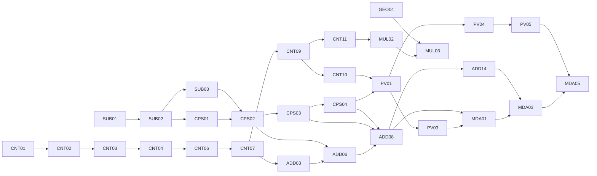

# 01 — Math Progression and Prerequisite Graph (K–8, extensible to HS)

Research date: 2026-11-17. Audience: the builders of an adaptive math game whose first users are an
advanced kindergartner and an advanced 2nd grader in the US.

**Bottom line**

1. Use **CCSS-M** as the "spine" for grade labels and coverage. Use **Clements & Sarama learning
   trajectories** for the fine-grained developmental order in K–2, because CCSS is coarse there.
2. Bootstrap standard-to-standard prerequisite edges from the **Coherence Map** (Student Achievement
   Partners, **CC0**). Learning Commons redistributes it as JSON/CSV with an API. Then decompose each
   standard into your own **atomic skills**, roughly 3–6 per standard, with your own skill-level edges.
3. Model the curriculum the way Math Academy does. Use **atomic skills** with **hard prerequisite
   edges**, plus a separate, sparse set of **weighted "encompasses" edges**. The encompasses edges
   give implicit review credit and drive spaced repetition. Add KST/ALEKS-style **outer-fringe**
   selection (only offer skills whose prerequisites are mastered) and a graph-driven diagnostic.
4. Granularity target: **~80–150 atomic skills per grade**, so roughly **800–1,200 for K–8**. For the
   MVP, **~250–350 skills for K–3** is enough to cover both kids for a long time.
5. Spend the most design effort on the gateway concepts: **unitizing and place value**,
   **relational equality**, **multiplicative reasoning**, **fractions as numbers**, **proportional
   reasoning**, **negative numbers**, and **variables**.

---

## 1. Common Core State Standards for Mathematics (CCSS-M)

Source: the standards themselves (https://www.thecorestandards.org/Math/). Standards are coded
`Grade.Domain.Cluster.Standard`, e.g. `2.NBT.B.5`.

### 1.1 Domains by grade (K–8)

| Domain | Code | K | 1 | 2 | 3 | 4 | 5 | 6 | 7 | 8 |
|---|---|---|---|---|---|---|---|---|---|---|
| Counting & Cardinality | CC | ● | | | | | | | | |
| Operations & Algebraic Thinking | OA | ● | ● | ● | ● | ● | ● | | | |
| Number & Operations in Base Ten | NBT | ● | ● | ● | ● | ● | ● | | | |
| Number & Operations—Fractions | NF | | | | ● | ● | ● | | | |
| Measurement & Data | MD | ● | ● | ● | ● | ● | ● | | | |
| Geometry | G | ● | ● | ● | ● | ● | ● | ● | ● | ● |
| Ratios & Proportional Relationships | RP | | | | | | | ● | ● | |
| The Number System | NS | | | | | | | ● | ● | ● |
| Expressions & Equations | EE | | | | | | | ● | ● | ● |
| Functions | F | | | | | | | | | ● |
| Statistics & Probability | SP | | | | | | | ● | ● | ● |

The grades have roughly 21–29 top-level content standards each, about 230 for K–8. Several standards
have sub-parts (a, b, c). Counts by grade: K ≈ 22, 1 ≈ 21, 2 ≈ 26, 3 ≈ 25, 4 ≈ 28, 5 ≈ 26, 6 ≈ 29,
7 ≈ 24, 8 ≈ 28. Standards are **too coarse to serve as adaptive skills**. For example, 2.NBT.B.7 "add
and subtract within 1000 using concrete models or drawings and strategies…" contains at least 5–8
teachable, separately assessable skills.

**Critical areas / major work.** Each grade has 2–4 "critical areas." Student Achievement Partners
labels every cluster as Major, Supporting, or Additional work. K–2 major work is almost entirely
**CC / OA / NBT** plus linear measurement. Weight the adaptive engine toward these.

**Required fluencies.** These make good targets for timed "fluency" mastery levels
(https://achievethecore.org/file/1453, https://archives.state.ak.us/akstandards/math/resources/Required_Fluencies_K-6.docx):

| Grade | Fluency |
|---|---|
| K | K.OA.A.5 add/subtract within 5 |
| 1 | 1.OA.C.6 add/subtract within 10 |
| 2 | 2.OA.B.2 add/subtract within 20 (all single-digit sums from memory by end of grade); 2.NBT.B.5 add/subtract within 100 |
| 3 | 3.OA.C.7 multiply/divide within 100 (single-digit products from memory); 3.NBT.A.2 add/subtract within 1000 |
| 4 | 4.NBT.B.4 add/subtract within 1,000,000 (standard algorithm) |
| 5 | 5.NBT.B.5 multi-digit multiplication (standard algorithm) |
| 6 | 6.NS.B.2 multi-digit division; 6.NS.B.3 multi-digit decimal operations |

### 1.2 High-school conceptual categories

The six HS conceptual categories are Number & Quantity (N), Algebra (A), Functions (F), Modeling (★,
woven into the other categories), Geometry (G), and Statistics & Probability (S). Each has domains,
e.g. A-SSE, A-REI, F-IF, F-BF, F-LE, G-CO, G-SRT, S-ID, S-CP. The model in §5 handles HS without
changes: add strands and skills, and link them to grade 6–8 EE/F/RP/NS skills. Achieve the Core's
**"Widely Applicable Prerequisites for College and Career Readiness"** (Zimba) lists the grade 6–8
standards that HS depends on most, and the Coherence Map flags them.

### 1.3 Progressions documents

The **Progressions for the Common Core State Standards** were written by the Common Core Standards
Writing Team (Bill McCallum, Jason Zimba, Phil Daro, and others; Institute for Mathematics and
Education, University of Arizona). They are narrative documents that explain how each domain develops
across grades. They are the best single source for *why* the order is what it is, and for the
problem-type and strategy taxonomies.

- Archive and drafts: https://archive.math.arizona.edu/ime/progressions/
- Achieve the Core copies: https://achievethecore.org/page/254/ (K–5 CC/OA progression: https://achievethecore.org/file/1172 ; front matter https://achievethecore.org/file/22)
- **Consolidated 2023 edition (CC BY)**: https://webnew.ped.state.nm.us/wp-content/uploads/2025/04/Progressions-for-the-Common-Core-State-Standards-Math_05.23-version.pdf
- K CC + K–5 OA (2011 draft): https://www.isbe.net/Documents/counting-cardinality-k-5.pdf

Content from the progressions that maps directly to software:

- **Add/subtract situation types.** There are 15 types: Add-to, Take-from, Put-together/Take-apart,
  and Compare, each crossed with Result-, Change-, or Start-unknown (Compare uses Difference-, Bigger-,
  or Smaller-unknown). Use these as an item-template dimension. The progression says K covers the
  easier types, G1 adds most of the rest, and G2 covers all types plus two-step problems.
- **Levels of add/subtract strategies.** Level 1 is direct modeling / count all. Level 2 is counting on.
  Level 3 is converting to an easier problem (make-ten, doubles, decomposing). These line up with the
  ADD skills in §5.
- **Multiplication/division situation types.** These are equal groups, arrays/area, and compare, each
  with product-, group-size-, or number-of-groups-unknown.
- **Fractions.** The NF progression treats a fraction as a *number* built from unit fractions
  (1/b iterated a times) and places it on the number line. This is the model to follow (see §6).

### 1.4 Coherence Map (Achieve the Core / Student Achievement Partners)

- Tool: https://tools.achievethecore.org/coherence-map/ ; about: https://achievethecore.org/page/2801/learn-more-about-the-coherence-map
- It derives from Jason Zimba's **CCSSM Wiring Diagram** (https://achievethecore.org/page/844/ccssm-wiring-diagram).
- For each standard it shows the connected standards in earlier and later grades, Major / Supporting /
  Additional status, progression excerpts, and sample tasks. For HS it shows widely applicable
  prerequisites.
- Its stated purpose includes "tracing a standard back through its prerequisites to identify gaps in
  understanding." That is exactly the adaptive-remediation use case.
- Source code: https://github.com/achievethecore/atc-coherence-map (README dedicates it to the public
  domain under **CC0 1.0**). The standards data is loaded from an Achieve the Core endpoint and is not
  in the repo. Use the Learning Commons copy instead (§4).

---

## 2. Research-based learning trajectories

### 2.1 Clements & Sarama — Learning Trajectories ([LT]²)

- Site: https://www.learningtrajectories.org/ (Birth to Grade 3; 20 trajectories). Book: *Learning
  and Teaching Early Math: The Learning Trajectories Approach* (Routledge; 4th ed. listed 2026:
  https://www.routledge.com/Learning-and-Teaching-Early-Math-The-Learning-Trajectories-Approach/Clements-Sarama/p/book/9781032949758).
- **License caution.** The site is "© all rights reserved," and its text and videos may not be copied
  or distributed separately without permission. Use the *ideas and level ordering*, which are research
  findings. Write your own descriptions, and cite Clements & Sarama (2017/2019), *[LT]²*, University
  of Denver.
- Each trajectory has three parts: a goal, a developmental progression of levels, and instructional
  activities matched to each level.

The level lists below are the **verified level names** from https://www.learningtrajectories.org/math/learning-trajectories
for the trajectories most relevant to K–2. They are in order, and each level builds on the previous ones:

| Trajectory | Levels (in order) |
|---|---|
| **Subitizing** | Number Senser: Foundations → Very Small Number Recognizer → Maker of Small Collections → Small Collection Namer → Perceptual Subitizer to 4 → Perceptual Subitizer to 5 → Conceptual Subitizer to 5 → Conceptual Subitizer to 7 → Conceptual Subitizer to 10 → Conceptual Subitizer to 20 → Conceptual Subitizer with Place Value → Conceptual Subitizer with Multiplicative Thinking |
| **Counting** | Number Word Sayer → Reciter → Reciter (10) → Corresponder → Counter (Small Numbers) → Counter (10) → Producer (Small Numbers) → Counter and Producer (10+) → Counter Backward from 10 → Counter from N (N+1, N−1) → Skip Counter by 10s to 100 → Counter to 100 → Counter On Using Patterns → Skip Counter → Counter On Keeping Track → Counter of Quantitative Units/Place Value → Counter Beyond 100 → Number Conserver → Counter Forward and Back (10s and 1s) |
| **Comparing & Ordering** | … Matching Comparer → Counting Comparer (Same Size) → Counting Comparer (5) → Mental Number Line to 5 → Serial Orderer to 5 → Ordinal Counter → Counting Comparer (10) → Mental Number Line to 10 → Serial Orderer to 6+ → Place Value Comparer → Mental Number Line to 100 → … Mental Number Line to 1000 → Benchmarks Estimator → Composition Estimator |
| **Adding/Subtracting** | Arithmetic Senser → Preverbal +/− → Small Number +/− → Find Result +/− → Make It N → Find Change +/− → Counting Strategies +/− → Part-Whole +/− → Numbers-in-Numbers +/− → Deriver +/− → Problem Solver +/− → Multidigit +/− |
| **Composing Numbers** | Actor on Parts → Parts Combiner → Parts-Whole Recognizer → Composer to 4, then 5 → Composer to 7 → Composer to 10 → Composer to 20 → Composer with Tens and Ones → Deriver +/− → Problem Solver +/− → Multidigit +/− |
| **Multiplying/Dividing** | Nonquantitative Sharer → Beginning Grouper and Distributive Sharer → Grouper and Distributive Sharer → Concrete Modeler ×/÷ → Parts and Wholes ×/÷ → Skip Counter ×/÷ → Deriver ×/÷ → Problem Solver ×/÷ → Partitive Divisor |
| **Fractions** | Early Proportional Thinker → Shape Equipartitioner → Half Recognizer → Unit Fraction Recognizer → Fraction Recognizer → Fraction Maker from Units → Fraction Maker → Fraction Repeater → Fraction Arithmetic +/− → Fraction Arithmetic ×/÷ → Fraction and Integer Sequencer |
| **Patterns/Algebraic Thinking** | Intuitive Patterner → Pattern Recognizer → Patterner AB → Patterner → Pattern Translator and Unit Recognizer → Numeric Patterner → Beginning Arithmetic Patterner → Relational Thinker +/− → Relational Thinker–Symbolic +/− → Relational Thinker with Multiplication → Functional Algebraic Thinker |
| **Length measurement** | … Length Direct Comparer → Length Indirect Comparer → Serial Orderer (Length) → End-to-End Length Measurer → Length Unit Relater and Repeater → Length Measurer → Conceptual Ruler Measurer → Integrated Conceptual Path Measurer → Abstract Length Measurer |
| **Area measurement** | … Physical Coverer and Counter → Complete Coverer and Counter → Area Unit Relater and Repeater → Initial Composite Structurer → Area Row and Column Structurer → **Array Structurer** (the bridge to multiplication) |
| **2D shapes / composing shapes / 3D / spatial / angle / data** | e.g. Shape Recognizer → Side Recognizer → Shape Identifier → Parts of Shapes Identifier → Shape Class Identifier → Shape Property Identifier → Property Class Identifier; Piece Assembler → Picture Maker → Shape Composer → … Shape Composer—Units of Units; Simple Sorter → … Data Representer |

Other trajectories on the site: Disembedding Shapes, Composing 3D Shapes, Spatial Visualization,
Spatial Orientation, Volume, and Angle & Turn.

Implications for the K–2 skill graph:

- **Subitizing is a separate strand from counting** and feeds composing/decomposing. Conceptual
  subitizing (seeing 7 as 5 and 2 on a ten-frame) is the visual basis of make-ten and of place value.
  Dot-flash and ten-frame items should get dedicated skills.
- **Counting on** ("Counter from N", "Counter On Keeping Track") is a prerequisite for the
  "Counting Strategies +/−" level. **Part-Whole +/−** and **Numbers-in-Numbers** depend on
  composing/decomposing. **Deriver +/−** (derived facts: make-ten, doubles±1) needs both.
- **Area "Array Structurer"** and **Composer with Tens and Ones** both require *unitizing*, treating a
  group (a row, a ten) as a countable unit. They make a good joint gateway to multiplication and place
  value.

### 2.2 Other notable trajectories and frameworks

- **Stages of Early Arithmetical Learning (SEAL)**, part of Math Recovery's *Learning Framework in
  Number* (Wright, Martland, Stafford; based on Steffe & Cobb). The stages are Emergent → Perceptual
  counting → Figurative counting → Counting-on/back → Facile (non-count-by-one strategies). This is a
  very usable diagnostic of *strategy level*, separate from accuracy, and response time is a good proxy
  for it. See https://sites.google.com/view/learning-framework-in-number/stages-of-early-arithmetic-learning
  and https://www.ru.ac.za/media/rhodesuniversity/content/sanc/documents/LFIN_aspects_&_levels.pdf
- **Steffe's units coordination** (1 → 2 → 3 levels of units). This research underlies multiplicative
  reasoning and fractions. A child who can only coordinate one level of units struggles with
  "groups of groups" and with fractions of fractions.
- **Confrey's equipartitioning / rational number reasoning LT** and **Math-Mapper 6–8**. This is a
  learning map of 9 big ideas for middle school, unpacked into research-based trajectories with
  diagnostic assessments. Equipartitioning (fair sharing) is treated as the root of division, fractions,
  ratio, and rate. See https://efa.unisa.edu.au/wp-content/uploads/2025/09/Equipartitioning-A-foundaiton-for-Rational-Number-Reasoning.pdf ,
  https://cadrek12.org/projects/building-next-generation-diagnostic-assessment-and-reporting-system-within-learning-traject ,
  and the CPRE report on learning trajectories (Daro, Mosher, Corcoran 2011):
  https://www.mathedleadership.org/docs/ccss/learning%20trajectories%20in%20math_cpre%20report.pdf
- **Fosnot & Dolk, "Landscapes of Learning"** (Young Mathematicians at Work) covers addition and
  subtraction, multiplication and division, and fractions/decimals/percents as networks of strategies,
  big ideas, and models. It is useful for strategy-skill design.
- **Proportional reasoning** (Lamon; Lesh, Post & Behr). This line of work develops from additive to
  multiplicative comparison, then to ratio tables and unit rate, then to proportional relationships
  (CCSS 6.RP → 7.RP → 8.EE.B → F).

---

## 3. How existing products model the knowledge graph

| Product | Unit of knowledge | Graph structure | Mastery / scheduling | Granularity (rough) |
|---|---|---|---|---|
| **Math Academy** | *Topic* (3–4 "knowledge points" each) | Hand-built DAG of prerequisites (per knowledge point) **plus a separate weighted "encompassing" graph** | Diagnostic finds the "knowledge frontier"; lessons need 2 correct in a row per knowledge point; **FIRe** spaced repetition with implicit credit flowing down encompassings | ~2,500 topics total; ~300 per course; starts at 4th grade |
| **ALEKS** | *Item / topic* (problem type) | **Knowledge Space Theory**: the set of feasible knowledge states (subsets closed under the learning order) | Adaptive assessment determines the state; students learn from the **outer fringe** ("ready to learn"); periodic re-assessment (knowledge checks) | Courses hold a few hundred topics (e.g., a grade-3-level "Priority Standards" course: 46 core + 194 additional topics) |
| **Khan Academy** | *Skill* (one exercise) | Courses → units → lessons → skills; legacy "knowledge map" had prerequisite links; now mostly course order | 4 levels: Attempted → Familiar → Proficient → Mastered. Mastered needs Proficient plus correct on a unit test or course challenge; skills can be demoted | ~140 skills per grade course (grade 3 example: 142 skills) |
| **IXL** | *Skill* (narrow, letter-number coded e.g. "L.7") | Flat categories per grade; "skill plans" map skills to standards and textbooks; Real-Time Diagnostic places students | **SmartScore** 0–100 (not percent correct): 80 = proficient, 100 = mastery; harder items near the top; misses cost more at high scores | Very fine: **K ≈ 369**, **Gr 2 ≈ 354** skills listed |
| **Beast Academy** (AoPS) | Chapter / lesson, puzzle-heavy | Linear book sequence by level (1A–5D) with placement tests per unit | Problem-solving depth over coverage; "stars" for challenge problems | Level 1 (ages 6–8): counting, shapes, comparing, +/−, patterns, big numbers, measurement. Level 2 (ages 7–9): place value, +/−, expressions, measurement, odds/evens, big numbers, algorithms. Level 3 (ages 8–10): shape classification, skip-counting, perimeter/area, multiplication, perfect squares, distributive property … |

### 3.1 Math Academy details (most relevant model)

- They **hand-craft the graph**. It has about 2,500 topics, each split into 3–4 knowledge points, and
  each knowledge point links to several prerequisites. "Chunk size" comes from expert judgment and is
  refined by splitting topics. Source: https://justinmath.com/how-math-academy-creates-its-knowledge-graph/
- **Encompassing weights** are distinct from prerequisites. An encompassing weight (0–1) is the
  fraction of a simpler topic that is practiced, implicitly, by an average problem in an advanced
  topic. Example: multi-digit addition encompasses single-digit addition facts at roughly weight 1. An
  encompassing implies a prerequisite, but a prerequisite does not always imply an encompassing.
  Experts set weights only for nearby pairs with non-trivial values that cannot be inferred
  transitively, so the number of weights grows about linearly with the topic count. The first pass
  (about 1,500 topics × about 5 prerequisites, at about 2 minutes each) took about 250 hours.
- **FIRe (Fractional Implicit Repetition)** works in three ways:
  - A successful review of an advanced topic sends credit **down** the encompassing graph, damped by
    partial weights.
  - A failure on a simple topic sends **penalties up** to the topics that depend on it.
  - **Repetition compression** picks tasks whose implicit credit covers as many due reviews as
    possible.

  Per student and topic, the state includes `repNum`, `memory` (which decays as
  `0.5^(days/interval)`), and `speed` (student ability relative to topic difficulty). Slow learners
  (speed < 1) do not get implicit credit and need explicit reviews.
  Source: https://justinmath.com/individualized-spaced-repetition-in-hierarchical-knowledge-structures/
- Product flow: an adaptive diagnostic of 30–45 minutes finds the knowledge frontier. Lessons run
  tutorial → worked example → up to 5 practice problems (2 correct in a row advances). Timed quizzes
  come every 150 XP, and 1 XP is about 1 minute of focused work. Source: https://mathacademy.com/how-it-works

### 3.2 ALEKS / Knowledge Space Theory

- A *knowledge state* is the subset of items a student has mastered. The feasible states form a
  *learning space*, where a student can always add one item at a time.
- The **outer fringe** is the set of items one step beyond the current state ("ready to learn"). The
  **inner fringe** is the set of most recently mastered items. A state is fully determined by its inner
  and outer fringes. This gives a compact way to report progress and pick the next items.
- If skills are partially ordered by prerequisites, the feasible states are the "downward closed"
  sets. The diagnostic can then **infer**: a correct answer on X raises the probability of all of X's
  ancestors, and an incorrect answer lowers the probability of all of X's descendants. That inference
  is what makes a 30–45 minute placement test feasible over hundreds of skills.
- Refs: https://en.wikipedia.org/wiki/Knowledge_space ; Falmagne et al., *Knowledge Spaces and Learning Spaces* https://arxiv.org/pdf/1511.06757 ; McGraw-Hill white paper https://www.mheducation.com/content/dam/mhe/research/prek-12/essa-tier-4/aleks-assessing-learning-space.pdf

### 3.3 Khan Academy and IXL

- Khan levels, as used in "skills to proficient": Familiar comes from 70–85% on an exercise or all
  correct on a quiz/test. Proficient comes from 100% on an exercise or all correct on a quiz, test, or
  challenge. Mastered requires Proficient plus correct answers on a unit test or course challenge, so
  it requires **delayed, mixed retrieval**. Low later scores demote the skill. Course mastery % is the
  share of skills at Proficient or above. Sources: https://support.khanacademy.org/hc/en-us/articles/115002552631 ,
  https://support.khanacademy.org/hc/en-us/articles/48431088309645-Update-How-mastery-percentage-is-calculated-on-Khan-Academy ,
  https://blog.khanacademy.org/?p=13201
- IXL SmartScore: https://www.ixl.com/research/smartscore , https://www.ixl.com/materials/SmartScore_Guide.pdf .
  Skill lists: https://www.ixl.com/math/kindergarten , https://www.ixl.com/math/grade-2 .
  IXL's granularity is a good reference for **item-template variety** (e.g., "count on ten-frames,"
  "count dots," and "count shapes in rows" are separate skills there). For your graph these should be
  *representations within one skill*, not separate skills.

### 3.4 Mastery-criterion evidence

- **N-consecutive-correct.** ASSISTments uses 3 correct in a row. Kelly et al. (EDM 2015) found that
  N = 3 gives adequate practice. RCTs found no learning difference between N = 2…5, so more practice
  mostly costs time. Sources: https://www.educationaldatamining.org/EDM2015/proceedings/short404-407.pdf ,
  https://sites.google.com/view/drkimkelly/matrix/defining-mastery
- **Bayesian Knowledge Tracing** (Corbett & Anderson 1995) conventionally declares mastery at
  P(known) ≥ 0.95. N-CCR is provably optimal for some BKT variants.
- For young children, response time matters as much as accuracy. A correct "7 + 8" reached by counting
  all is not the same skill state as an instant retrieval or a make-ten derivation (SEAL stages).

---

## 4. Machine-readable standards sources and licensing

| Source | What it gives | Prerequisite edges? | License |
|---|---|---|---|
| **Learning Commons Knowledge Graph — Math Coherence Map** (https://docs.learningcommons.org/knowledge-graph/datasets/math-coherence-map.md) | CCSS-M standards K–HS as `StandardsFrameworkItem` nodes; JSON/CSV (`nodes.jsonl`, `relationships.jsonl`); REST API (prerequisites / builds-towards / related per standard); MCP server | **Yes.** `buildsTowards` (directional; proficiency in A raises the probability of success in B, e.g. 3.OA.A.1 → 4.NBT.B.5) and `relatesTo` (undirected, e.g. 3.NF.A.1 ↔ 3.NF.A.2) | **CC0** (from Student Achievement Partners). Courtesy credit suggested |
| **Learning Commons — Math learning components** (https://docs.learningcommons.org/knowledge-graph/datasets/math-learning-components.md) | Granular skills under each standard (e.g., "Use place value to add two two-digit numbers" `supports` 2.NBT.B.5), aligned to CCSS and 40+ state frameworks | No (component → standard only) | **CC BY 4.0** (Achievement Network); attribution required |
| **Learning Commons — Eedi Misconceptions Graph** | K–12 math misconceptions linked to components | n/a | Open (check dataset page). Very useful for **distractor generation** |
| **Learning Commons — U.S. academic standards** | All 50 states + DC, sourced from 1EdTech CASE Network 2 | Hierarchy only | Varies by state (row-level) |
| Repo & license overview | https://github.com/learning-commons-org/knowledge-graph ; https://docs.learningcommons.org/knowledge-graph/resources/license | | Code MIT; data "by publisher" |
| **Achieve the Core Coherence Map source** | https://github.com/achievethecore/atc-coherence-map | Data not in the repo (loaded from an ATC endpoint) | CC0 |
| **CASE (1EdTech Competencies & Academic Standards Exchange)** / **CASE Network** / **OpenSALT** | Standard JSON-LD/REST format for frameworks: `CFDocument`, `CFItem`, `CFAssociation` | Association types: `isChildOf`, **`precedes`**, `isRelatedTo`, `isPartOf`, `exactMatchOf`, `isPeerOf`, `replacedBy`, `exemplar`, `hasSkillLevel`, `isTranslationOf`; extensible with `ext:` | Spec open; framework licenses vary. Spec: https://www.imsglobal.org/sites/default/files/spec/case/v1p1/information_model/caseservicev1p1_infomodelv1p0.html |
| **Common Standards Project** (https://github.com/commonstandardsproject/api) | JSON standard sets for all states (from ASN), GUIDs, API at api.commonstandardsproject.com (API key) | No cross-standard alignment | Code Apache-2.0; data derived from CC-licensed ASN |
| **CCSS text itself** | https://www.thecorestandards.org/Math/ | — | NGA/CCSSO **public license**: royalty-free copy/display "for purposes that support the CCSS Initiative," with required notice "© Copyright 2010 National Governors Association Center for Best Practices and Council of Chief State School Officers. All rights reserved." Derivative-work rights are unclear. **Store codes and your own paraphrases; quote sparingly with the notice.** Archived copy: https://webarchive.library.unt.edu/dentonfracking/20141113220026/http://www.corestandards.org/public-license/ |
| **Progressions documents** (2023 edition) | Narrative progressions | — | CC BY |
| **learningtrajectories.org** | LT levels and activities | Implicit (level order) | All rights reserved. Use ideas, not text |

**Practical recommendation.** Download the Coherence Map (CC0) and the Math learning components
(CC BY 4.0) from Learning Commons:

- https://platform.learningcommons.org/dataset-catalog/coherence-map
- https://platform.learningcommons.org/dataset-catalog/math-learning-components

Use them as **seed data and a cross-check**: every atomic skill gets a `standards: [ccss codes]`
field, and the standard-level `buildsTowards` edges should be *implied* by your skill-level edges.
A CI check can flag any Coherence Map edge that has no corresponding skill path. Keep the authored
graph as YAML in the repo, under your own license, with attribution for any CC BY material.
Optionally export to CASE JSON later for interoperability, mapping `prerequisite` to `precedes` and
`encompasses` to an `ext:encompasses` association.

---

## 5. Recommended data model

### 5.1 Entities

```
Strand            e.g. "Counting & Cardinality", "Place Value", "Add/Sub Facts", "Fractions"
  └─ Skill        atomic, teachable in ~5–15 minutes, assessable by auto-generated items
       ├─ prerequisites[]   hard edges (DAG). Gate: skill unlocks when all are mastered
       ├─ encompasses[]     weighted edges (0–1) for implicit review credit (FIRe-style)
       ├─ related[]         soft, non-gating (for interleaving and "you might also like")
       ├─ mastery           criteria (accuracy + optional fluency + retention)
       ├─ representations[] ten-frame, dots, number line, base-ten blocks, bar model, clock, coins…
       ├─ itemTemplates[]   parametric generators
       └─ misconceptions[]  with diagnostic distractors and remediation skill links
```

### 5.2 Skill schema (YAML, one file per strand)

```yaml
- id: ADD.08                      # stable, never reused
  name: Make-ten strategy for sums 11–18
  strand: ADD
  kind: strategy                  # concept | procedure | strategy | fact-fluency | problem-solving
  grade: 1                        # nominal CCSS grade (for reporting, NOT gating)
  standards: [1.OA.C.6]           # CCSS codes (+ state codes later)
  trajectories: ["C&S Add/Sub: Deriver +/-", "C&S Composing: Composer to 20", "SEAL: Facile"]
  prerequisites: [CPS.03, CPS.04, ADD.06]
  encompasses: {CPS.03: 1.0, ADD.06: 0.5}
  representations: [ten-frame-pair, number-line-jumps, symbolic]
  mastery:
    accuracy: {consecutive_correct: 3, min_items: 5}   # or BKT p>=0.95
    fluency: null                 # strategies are not timed; ADD.14 (facts) is
    retention: {delayed_reviews: [1d, 7d]}             # must pass spaced checks to be "Mastered"
  item_templates: [ADD.08.t1, ADD.08.t2, ADD.08.t3]
  misconceptions:
    - id: MC.count-all-instead
      detect: "correct but RT > 8s or tap-counting trace"
      remediate: [ADD.03]
```

### 5.3 Item template schema

```yaml
- id: ADD.08.t1
  skill: ADD.08
  format: tenframe-fill          # tap/drag | multiple-choice | numeric-entry | number-line-place | clock-set | coin-drag
  params:
    a: {range: [6, 9]}
    b: {range: [3, 9]}
  constraints: ["a + b > 10", "a + b <= 18"]
  prompt: "Fill the ten-frame to make 10, then finish: {a} + {b} = ?"
  answer: "a + b"
  scaffold_steps: ["{a} + ? = 10", "{b} - (10-{a}) = ?", "10 + ? = ?"]
  distractors:
    - {value: "a + b - 1", reason: MC.off-by-one-counting}
    - {value: "a + b - 10", reason: MC.forgot-ten}
  difficulty: {irt_b: null}      # calibrate from data later
  audio: true                    # pre-readers: every prompt must be read aloud
```

### 5.4 Learner state (per learner × skill)

```
status: locked | ready (outer fringe) | learning | practiced | fluent | mastered | needs_review
p_known (BKT) or mastery evidence; consecutive_correct; median_rt; strategy_level (SEAL-like)
memory, interval, repNum (FIRe), last_seen, next_due
```

### 5.5 Engine rules

1. **Next-skill selection.** Choose from the outer fringe (all prerequisites ≥ practiced). Weight by
   strand balance, by Major-work priority, and by how many downstream skills the skill unlocks.
2. **Diagnostic placement.** Use KST-style adaptive probing along the graph. Probe a mid-graph skill.
   On success, mark its ancestors as probable. On failure, probe its prerequisites. Expect about 20–40
   items to place a child across K–3.
3. **Mastery ladder.**
   - *Practiced*: 3 consecutive correct with no hints, across at least 2 representations.
   - *Fluent*: only for `fact-fluency` skills, with median RT under a threshold (e.g. ≤ 3 s for
     facts within 10 and ≤ 4 s for facts within 20; tune for motor and reading speed).
   - *Mastered*: passed delayed mixed reviews at about 1 day and about 1 week.
4. **Reviews.** Spaced repetition with FIRe-style implicit credit through `encompasses`. A failure
   pushes "needs_review" upward and triggers a prerequisite probe for remediation.
5. **Interleaving.** After a skill is practiced, mix it into review sets with related skills, e.g.
   add vs. subtract word problems and compare vs. change situations.
6. **Grade is metadata, not a gate.** Advanced kids should flow through the DAG at their own pace.

### 5.6 Sample: first ~60 K–2 skills with prerequisite links

Strand codes: **CNT** counting, **SUB** subitizing, **CMP** comparing, **CPS** composing/decomposing,
**ADD** add/sub facts & strategies, **PV** place value, **MDA** multi-digit add/sub, **MUL**
multiplicative, **FRA** fractions, **GEO** geometry, **MEA** length, **TIM** time, **MON** money,
**DAT** data, **ALG** patterns/equality. The "Gr" column is the nominal CCSS grade.

| ID | Skill | Gr | CCSS | Prerequisites |
|---|---|---|---|---|
| CNT.01 | Rote count 1–10 (and 1–20) | K | K.CC.A.1 | — |
| CNT.02 | One-to-one counting of up to 10 objects (line, then scattered) | K | K.CC.B.4a | CNT.01 |
| CNT.03 | Cardinality: last count word tells how many; recount invariance | K | K.CC.B.4b | CNT.02 |
| CNT.04 | Produce a set: "give me N" (N ≤ 10) | K | K.CC.B.5 | CNT.03 |
| CNT.05 | Read and write numerals 0–20; match numeral ↔ quantity | K | K.CC.A.3 | CNT.01, CNT.03 |
| CNT.06 | Count and produce sets to 20 | K | K.CC.B.5 | CNT.04, CNT.05 |
| CNT.07 | Count forward from any N (no restart at 1); next number after N | K | K.CC.A.2 | CNT.06 |
| CNT.08 | Count backward from 10, then from any N ≤ 20 | K | (K.CC; C&S Counter Backward) | CNT.07 |
| CNT.09 | Count to 100 by ones and by tens; decade transitions (39→40) | K | K.CC.A.1 | CNT.07 |
| CNT.10 | Count, read, write to 120 starting anywhere | 1 | 1.NBT.A.1 | CNT.09, CNT.05 |
| CNT.11 | Skip-count by 2s and 5s to 100 | 2 | 2.NBT.A.2 | CNT.09 |
| CNT.12 | Skip-count by 10s and 100s within 1000 from any number | 2 | 2.NBT.A.2 | PV.05, CNT.09 |
| SUB.01 | Perceptual subitizing 1–4 (dot flash) | K | (K.CC.B.5; C&S) | — |
| SUB.02 | Perceptual subitizing to 5; dice and finger patterns | K | (K.CC.B.5) | SUB.01 |
| SUB.03 | Conceptual subitizing to 10 on five/ten-frames (7 = 5 + 2) | K | (K.OA.A.3) | SUB.02, CNT.03 |
| SUB.04 | Conceptual subitizing to 20 on double ten-frames (14 = 10 + 4) | 1 | (1.NBT.B.2) | SUB.03, CPS.04 |
| CMP.01 | Compare two groups ≤ 10: more/fewer/same (match or count) | K | K.CC.C.6 | CNT.03 |
| CMP.02 | Compare two numerals 1–10 | K | K.CC.C.7 | CMP.01, CNT.05 |
| CMP.03 | One more / one less than N (N ≤ 20) without counting from 1 | K | (K.CC.A.2) | CNT.07, CNT.08 |
| CMP.04 | Place numbers on a 0–20 then 0–100 number line | 1 | (2.MD.B.6) | CMP.02, CNT.09 |
| CPS.01 | Decompose N ≤ 5 into two parts (all pairs) | K | K.OA.A.3 | SUB.02, CNT.03 |
| CPS.02 | Decompose N ≤ 10 into two parts; record as drawing or equation | K | K.OA.A.3 | CPS.01, SUB.03 |
| CPS.03 | Partners of 10: find the number that makes 10 with N | K | K.OA.A.4 | CPS.02 |
| CPS.04 | Teen numbers as ten ones and some more ones (11–19) | K | K.NBT.A.1 | CPS.03, CNT.06 |
| ADD.01 | Act out add-to / take-from / put-together within 10 (objects, drawings) | K | K.OA.A.1–2 | CNT.04, CPS.01 |
| ADD.02 | Fluency: add/subtract within 5 | K | K.OA.A.5 | ADD.01, CPS.01 |
| ADD.03 | Count on from the larger addend to add | 1 | 1.OA.C.5 | CNT.07, ADD.01 |
| ADD.04 | Count back / count up to subtract | 1 | 1.OA.C.5 | CNT.08, ADD.03 |
| ADD.05 | Commutativity and adding 0 (turn-around facts) | 1 | 1.OA.B.3 | ADD.01 |
| ADD.06 | Fluency: add/subtract within 10 | 1 | 1.OA.C.6 | CPS.02, ADD.02, ADD.03 |
| ADD.07 | Doubles and near-doubles to 20 (6+6, 6+7) | 1 | 1.OA.C.6 | ADD.06 |
| ADD.08 | Make-ten strategy for sums 11–18 (8+5 = 8+2+3) | 1 | 1.OA.C.6 | CPS.03, CPS.04, ADD.06 |
| ADD.09 | Subtraction as unknown addend ("think addition"); fact families | 1 | 1.OA.B.4 | ADD.04, ADD.06 |
| ADD.10 | Meaning of `=`: true/false equations (7 = 3 + 4; 5 + 2 = 4 + 3) | 1 | 1.OA.D.7 | ADD.05 |
| ADD.11 | Unknown in any position (8 + ? = 11; ? − 3 = 5) | 1 | 1.OA.D.8 | ADD.09, ADD.10 |
| ADD.12 | Word problems within 20: all situation types incl. start-unknown and compare | 1 | 1.OA.A.1 | ADD.11 |
| ADD.13 | Add three whole numbers (sum ≤ 20); associativity (make ten first) | 1 | 1.OA.A.2 | ADD.05, ADD.08 |
| ADD.14 | Fluency: all sums/differences within 20 from memory | 2 | 2.OA.B.2 | ADD.07, ADD.08, ADD.09 |
| PV.01 | Two-digit numbers as tens and ones (bundling; 10 as a unit) | 1 | 1.NBT.B.2 | CPS.04, CNT.10 |
| PV.02 | Compare two-digit numbers with <, =, > | 1 | 1.NBT.B.3 | PV.01, CMP.02 |
| PV.03 | Mentally find 10 more / 10 less | 1 | 1.NBT.C.5 | PV.01 |
| PV.04 | Hundreds: 100 as ten tens; three-digit numbers as H/T/O | 2 | 2.NBT.A.1 | PV.01, CNT.09 |
| PV.05 | Read/write to 1000: numerals, number names, expanded form | 2 | 2.NBT.A.3 | PV.04 |
| PV.06 | Compare three-digit numbers | 2 | 2.NBT.A.4 | PV.05, PV.02 |
| PV.07 | Mentally add/subtract 10 or 100 (within 100–900) | 2 | 2.NBT.B.8 | PV.03, PV.05 |
| MDA.01 | Add within 100: 2-digit + 1-digit, 2-digit + multiple of 10 (models) | 1 | 1.NBT.C.4 | PV.01, PV.03, ADD.08 |
| MDA.02 | Subtract multiples of 10 (10–90) | 1 | 1.NBT.C.6 | PV.03 |
| MDA.03 | Add/subtract within 100 with place-value strategies (regrouping) | 2 | 2.NBT.B.5 | MDA.01, MDA.02, ADD.14 |
| MDA.04 | Add up to four two-digit numbers | 2 | 2.NBT.B.6 | MDA.03, ADD.13 |
| MDA.05 | Add/subtract within 1000 with models/strategies (composing/decomposing tens and hundreds) | 2 | 2.NBT.B.7 | MDA.03, PV.05, PV.07 |
| MDA.06 | One- and two-step word problems within 100 (tape diagrams) | 2 | 2.OA.A.1 | ADD.12, MDA.03 |
| MUL.01 | Even and odd (pairing; doubles) | 2 | 2.OA.C.3 | ADD.07, CNT.11 |
| MUL.02 | Equal groups: total by skip-counting or repeated addition | 2 | (2.OA.C.4) | CNT.11, ADD.13 |
| MUL.03 | Arrays up to 5×5: total as a sum of equal addends (rows/columns) | 2 | 2.OA.C.4 | MUL.02, GEO.04 |
| GEO.01 | Name 2D/3D shapes regardless of size/orientation; position words | K | K.G.A.1–3 | — |
| GEO.02 | Defining vs. non-defining attributes; compose shapes from shapes | 1 | 1.G.A.1–2 | GEO.01 |
| GEO.03 | Identify polygons by sides/angles (triangle…hexagon); cube faces | 2 | 2.G.A.1 | GEO.02, CNT.06 |
| GEO.04 | Partition a rectangle into rows and columns of equal squares; count | 2 | 2.G.A.2 | GEO.03, MUL.02 |
| FRA.01 | Halves and fourths ("quarters") of circles and rectangles | 1 | 1.G.A.3 | GEO.02 |
| FRA.02 | Halves, thirds, fourths; equal shares of the same whole need not look alike; 4 fourths = 1 whole | 2 | 2.G.A.3 | FRA.01 |
| MEA.01 | Compare lengths directly and indirectly; order three objects | 1 | K.MD.A.1–2, 1.MD.A.1 | CMP.01 |
| MEA.02 | Measure with non-standard units (iterate a unit, no gaps or overlaps) | 1 | 1.MD.A.2 | MEA.01, CNT.06 |
| MEA.03 | Measure with a ruler in inches/cm; estimate; compare lengths by difference | 2 | 2.MD.A.1–4 | MEA.02, CMP.04 |
| MEA.04 | Length word problems; whole numbers as lengths on a number line | 2 | 2.MD.B.5–6 | MEA.03, MDA.03 |
| TIM.01 | Tell/write time to the hour and half-hour (analog and digital) | 1 | 1.MD.B.3 | CNT.10, FRA.01 |
| TIM.02 | Time to the nearest 5 minutes; a.m./p.m. | 2 | 2.MD.C.7 | TIM.01, CNT.11 |
| MON.01 | Identify coins and their values (1¢, 5¢, 10¢, 25¢) | 2 | (2.MD.C.8) | CNT.11 |
| MON.02 | Count mixed coin collections (largest first; skip-count switching) | 2 | 2.MD.C.8 | MON.01, MDA.01 |
| MON.03 | Money word problems with dollars and cents | 2 | 2.MD.C.8 | MON.02, MDA.03 |
| DAT.01 | Sort into categories; count and order categories by count | K | K.MD.B.3 | CNT.04 |
| DAT.02 | Picture and bar graphs (≤ 4 categories); compare/total questions | 1–2 | 1.MD.C.4, 2.MD.D.10 | DAT.01, ADD.12 |
| DAT.03 | Line plot of measured lengths | 2 | 2.MD.D.9 | MEA.03, DAT.02 |
| ALG.01 | Repeating patterns (AB, ABB, ABC): extend, translate, identify core unit | K | (C&S Patterns) | — |
| ALG.02 | Growing numeric patterns (+1, +2, +10); explain the rule | 1 | (C&S Numeric Patterner) | ALG.01, CNT.11 |

There are 74 rows. The extra ones cover the non-number strands the kids are currently doing. Most
non-number skills are leaves with few dependents, so the engine should interleave them rather than
gate on them. Codes in parentheses are the nearest supporting standard; the skill itself comes from a
learning trajectory.

**K–2 spine** (critical-path DAG, simplified):



### 5.7 Grade-3 "next" skills (where the 2nd grader is headed)

| ID | Skill | CCSS | Prerequisites |
|---|---|---|---|
| MUL.04 | Interpret a × b as a groups of b (equal groups, arrays, area) | 3.OA.A.1 | MUL.03 |
| MUL.05 | Interpret division: fair share (partitive) and how-many-groups (quotative) | 3.OA.A.2 | MUL.02 |
| MUL.06 | Commutative property; ×0, ×1; ×2/×5/×10 facts via skip-counting | 3.OA.B.5 | MUL.04, CNT.11 |
| MUL.07 | Distributive "break-apart" strategy (7×6 = 5×6 + 2×6); area model | 3.OA.B.5 | MUL.06, GEO.04 |
| MUL.08 | Division as unknown factor; ×/÷ fact families | 3.OA.B.6 | MUL.05, MUL.06 |
| MUL.09 | Fluency: products/quotients within 100 | 3.OA.C.7 | MUL.07, MUL.08 |
| MUL.10 | ×/÷ word problems (equal groups, arrays, measurement); unknown in any position | 3.OA.A.3–4 | MUL.08, ADD.11 |
| MUL.11 | Multiply one-digit × multiples of 10 (4 × 30 = 4 × 3 tens) | 3.NBT.A.3 | MUL.06, PV.04 |
| MEA.05 | Area by counting unit squares, then by multiplying side lengths | 3.MD.C.5–7 | GEO.04, MUL.04 |
| MEA.06 | Perimeter | 3.MD.D.8 | MEA.03, MDA.03 |
| FRA.03 | Unit fraction 1/b as one of b equal parts; a/b as a copies of 1/b | 3.NF.A.1 | FRA.02, MUL.05 |
| FRA.04 | Fractions on the number line (partition 0–1 into b parts) | 3.NF.A.2 | FRA.03, MEA.04 |
| FRA.05 | Equivalent fractions (with models/number line); whole numbers as fractions | 3.NF.A.3a–c | FRA.04 |
| FRA.06 | Compare fractions with the same numerator or same denominator | 3.NF.A.3d | FRA.05, PV.02 |
| PV.08 | Round to nearest 10 or 100 | 3.NBT.A.1 | PV.06, CMP.04 |
| MDA.07 | Add/subtract within 1000 fluently (standard algorithm) | 3.NBT.A.2 | MDA.05 |
| TIM.03 | Time to the minute; elapsed time on a number line | 3.MD.A.1 | TIM.02, MEA.04 |
| ALG.03 | Arithmetic patterns in addition/multiplication tables | 3.OA.D.9 | MUL.06, ALG.02 |

### 5.8 Scaling past K–3

Seed grades 3–8 by taking each CCSS standard, pulling its Learning Commons learning components (CC BY
4.0), and turning those into 3–6 atomic skills. Then derive skill-level prerequisite edges, using the
Coherence Map `buildsTowards` edges as the coarse check. HS maps the same way onto N/A/F/G/S domains,
using "Widely Applicable Prerequisites" to prioritize remediation.

---

## 6. Advanced learners and gateway concepts

### 6.1 Where to push these two kids

Run the graph diagnostic first (§5.5). Advanced kids are usually **uneven**: strong at counting and
calculation, sometimes weak at representation, explanation, or measurement. The DAG handles that
automatically.

**Advanced kindergartner.** Typical profile: counts to 100+, subitizes, does facts within 10.

- Consolidate **conceptual subitizing and decomposition to 10/20** (SUB.03–04, CPS.03–04). These are
  the foundation of make-ten and place value, and they are often skipped by kids who count well.
- Move from counting on into **derived-fact strategies** (ADD.07, ADD.08, ADD.09) and **relational
  `=`** (ADD.10–11).
- Then **tens and ones** (PV.01–03), **adding within 100** (MDA.01–02), **time to the half-hour**,
  **halves/fourths**, and **non-standard to ruler measurement**.
- A realistic advanced-K target is end-of-grade-1 content (CCSS 1.OA, 1.NBT), plus some 2.NBT place
  value to 1000.
- Avoid pushing **written algorithms** early. Counting-based "Level 1" strategies should give way to
  decomposition ("Level 3") before any algorithm appears.

**Advanced 2nd grader.** Typical profile: place value to 1000, adds/subtracts within 1000.

- Make sure ADD.14 (facts within 20 from memory) and MDA.05 work *with understanding of regrouping*.
- Then **multiplication and division meaning** through equal groups, arrays, and area (MUL.02–05).
- Then **fact strategies via the distributive property** (MUL.07), followed by fact fluency (MUL.09).
  Beast Academy 3 covers the same ground.
- **Fractions as numbers on the number line** (FRA.03–06). This is the single most valuable advanced
  push. See §6.2.
- **Area/perimeter**, **time to the minute**, and **rounding**.
- After that, grade-4 multi-digit × 1-digit (area model), place value to 1,000,000, and decimals as
  tenths/hundredths.
- **Early algebra and enrichment** (Beast Academy style): unknowns as boxes and then letters,
  balance-scale equations, even/odd reasoning, and patterns.
- **Informal negative numbers**: extend the number line left, use temperature and "below zero,"
  and count back past 0.

### 6.2 Gateway concepts that block later progress

These deserve the deepest skill decomposition, the most representations, and the strictest mastery
plus retention checks.

1. **Cardinality and hierarchical inclusion (K).** The child must understand that the last count word
   is the quantity and that 5 is "inside" 6. Without this, counting is a recitation with no number
   sense behind it.
2. **Unitizing and place value (K–2, the biggest early gateway).** "Ten" must be a single countable
   unit, and the meaning of a digit must depend on its position. Weak place value later shows up as
   errors in regrouping, rounding, decimals, and algorithms. Teach it with bundling, ten-frames, and
   base-ten blocks. Use place-value strategies before algorithms (C&S "Composer with Tens and Ones";
   CCSS NBT progression).
3. **Relational equality and part-whole thinking (1–2).** The `=` sign means "same amount as," not
   "write the answer." Relational understanding predicts algebra success even after controlling for
   standardized math scores (Knuth et al. 2006). Arithmetic-only practice in the "a + b = __" format
   *entrenches* the operational misconception (McNeil & Alibali). Kindergarten relational thinking
   predicts grade-2 equivalence understanding (Devlin, Byrd Hornburg & McNeil 2023).
   **Design rule:** from G1 on, vary the equation format (`__ = 3 + 4`, `5 + __ = 4 + 3`).
   Sources: https://stanford.edu/~jlmcc/papers/MickeyMcClelland14Equivalence.pdf ,
   https://mathed.net/wiki/Alibali,_Knuth,_Hattikudur,_McNeil,_%26_Stephens_(2007) ,
   https://alibali.psych.wisc.edu/wp-content/uploads/sites/371/2018/02/McNeilAlibali2005a.pdf
4. **Multiplicative reasoning (2–4).** The child must shift from additive ("3 more") to
   multiplicative ("3 times as many") thinking and coordinate groups of groups (Steffe's units
   coordination). Arrays and area are the bridge (C&S "Array Structurer"). This underlies fractions,
   ratio, area/volume, and algebra.
5. **Fractions as numbers (3–5).** Fifth-grade fraction and division knowledge uniquely predicts high
   school algebra and overall math achievement, after controlling for IQ, working memory, family
   income, and whole-number skills (Siegler et al. 2012, *Psychological Science*). Fraction
   *magnitude* knowledge (number-line placement), not whole-number knowledge, predicts equation-solving
   in Algebra 1 (Booth & Newton 2012).
   **Design rule:** number-line representations for fractions from the start; avoid
   "pizza-slices-only" models; target the whole-number bias (thinking 1/8 > 1/6).
   Sources: https://www.psychologicalscience.org/news/releases/knowledge-of-fractions-and-long-division-predicts-long-term-math-success.html ,
   https://news.umich.edu/fractions-are-the-key-to-math-success-new-study-shows/ ,
   https://reasoning.psych.ucla.edu/KH%20pdfs/DeWolf_et_al_jecp_2015.pdf
6. **Proportional reasoning (6–7).** This is the shift from additive comparison to ratio, rate, unit
   rate, percent, and proportional relationships (y = kx). It is one of the most persistent difficulties
   in middle school and it feeds linear functions and slope (8.EE.B, 8.F). Confrey's equipartitioning
   trajectory roots it in fair sharing.
7. **Negative numbers and the extended number line (6–7).** Students must see numbers as positions
   and directions, understand absolute value, and accept that subtraction can "go past zero." Sign-rule
   memorization without the number-line and vector models breaks down in algebra.
8. **Variables and expressions (6–8).** Letters stand for quantities, generalized arithmetic,
   equivalence of expressions, and then solving equations as maintaining balance. This depends directly
   on gateway 3. Early "unknown in any position" and balance-scale work in grades 1–3 de-risks it.
9. **Functions (8 → HS).** This is covariation: input → output rules, tables, graphs, and equations as
   linked representations. It builds on patterns (ALG strand) and proportional reasoning.

**Engine implications.** Tag gateway skills `gateway: true`. For these skills, require mastery across
at least 2 representations, always run delayed retention checks, and give upstream failures a larger
penalty weight. When a child stalls on a downstream skill, the remediation probe should test the
nearest gateway ancestor first.

---

## Sources (consolidated)

- CCSS-M: https://www.thecorestandards.org/Math/ ; public license (archived): https://webarchive.library.unt.edu/dentonfracking/20141113220026/http://www.corestandards.org/public-license/
- Progressions: https://archive.math.arizona.edu/ime/progressions/ ; https://achievethecore.org/page/254/ ; https://achievethecore.org/file/1172 ; 2023 CC BY edition: https://webnew.ped.state.nm.us/wp-content/uploads/2025/04/Progressions-for-the-Common-Core-State-Standards-Math_05.23-version.pdf
- Coherence Map: https://tools.achievethecore.org/coherence-map/ ; https://achievethecore.org/page/2801/learn-more-about-the-coherence-map ; https://achievethecore.org/page/844/ccssm-wiring-diagram ; https://github.com/achievethecore/atc-coherence-map
- Required fluencies: https://achievethecore.org/file/1453 ; https://archives.state.ak.us/akstandards/math/resources/Required_Fluencies_K-6.docx
- Learning Commons: https://github.com/learning-commons-org/knowledge-graph ; https://docs.learningcommons.org/knowledge-graph/datasets/introduction.md ; https://docs.learningcommons.org/knowledge-graph/datasets/math-coherence-map.md ; https://docs.learningcommons.org/knowledge-graph/datasets/math-learning-components.md ; https://docs.learningcommons.org/knowledge-graph/entity-and-relationship-reference/learning-progressions ; https://docs.learningcommons.org/knowledge-graph/resources/license
- CASE: https://www.imsglobal.org/sites/default/files/spec/case/v1p1/information_model/caseservicev1p1_infomodelv1p0.html ; https://standards.1edtech.org/case/specifications/standards/v1p1 ; https://www.imsglobal.org/sites/default/files/CASE/CASE%20Network%20Documentation%20-%20Creating%20Associations.docx.pdf
- Common Standards Project: https://github.com/commonstandardsproject/api
- Clements & Sarama: https://www.learningtrajectories.org/ ; https://www.learningtrajectories.org/math/learning-trajectories ; https://www.routledge.com/Learning-and-Teaching-Early-Math-The-Learning-Trajectories-Approach/Clements-Sarama/p/book/9781032949758 ; https://ies.ed.gov/ncee/rel/math-young-children/pdf/TMYC_Mod1_Subitizing_Developmental_Progression.pdf
- SEAL / LFIN: https://sites.google.com/view/learning-framework-in-number/stages-of-early-arithmetic-learning ; https://www.ru.ac.za/media/rhodesuniversity/content/sanc/documents/LFIN_aspects_&_levels.pdf
- Confrey / CPRE: https://cadrek12.org/projects/building-next-generation-diagnostic-assessment-and-reporting-system-within-learning-traject ; https://efa.unisa.edu.au/wp-content/uploads/2025/09/Equipartitioning-A-foundaiton-for-Rational-Number-Reasoning.pdf ; https://www.mathedleadership.org/docs/ccss/learning%20trajectories%20in%20math_cpre%20report.pdf
- Math Academy: https://mathacademy.com/how-it-works ; https://mathacademy.com/how-our-ai-works ; https://justinmath.com/how-math-academy-creates-its-knowledge-graph/ ; https://justinmath.com/individualized-spaced-repetition-in-hierarchical-knowledge-structures/
- ALEKS / KST: https://en.wikipedia.org/wiki/Knowledge_space ; https://arxiv.org/pdf/1511.06757 ; https://www.mheducation.com/content/dam/mhe/research/prek-12/essa-tier-4/aleks-assessing-learning-space.pdf ; https://www.mheducation.com/unitas/school/explore/sites/aleks/aleks-course-catalog.pdf
- Khan Academy: https://support.khanacademy.org/hc/en-us/articles/115002552631 ; https://support.khanacademy.org/hc/en-us/articles/48431088309645-Update-How-mastery-percentage-is-calculated-on-Khan-Academy ; https://blog.khanacademy.org/?p=13201
- IXL: https://www.ixl.com/research/smartscore ; https://www.ixl.com/materials/SmartScore_Guide.pdf ; https://www.ixl.com/math/kindergarten ; https://www.ixl.com/math/grade-2
- Beast Academy: https://beastacademy.com/books/level-1 ; https://beastacademy.com/books/level-2 ; https://artofproblemsolving.com/store/list/beast-academy
- Mastery criteria: https://www.educationaldatamining.org/EDM2015/proceedings/short404-407.pdf ; https://sites.google.com/view/drkimkelly/matrix/defining-mastery ; Corbett & Anderson (1995), *User Modeling and User-Adapted Interaction* 4:253–278
- Fractions / equality research: https://www.psychologicalscience.org/news/releases/knowledge-of-fractions-and-long-division-predicts-long-term-math-success.html ; https://news.umich.edu/fractions-are-the-key-to-math-success-new-study-shows/ ; https://reasoning.psych.ucla.edu/KH%20pdfs/DeWolf_et_al_jecp_2015.pdf ; https://stanford.edu/~jlmcc/papers/MickeyMcClelland14Equivalence.pdf ; https://mathed.net/wiki/Alibali,_Knuth,_Hattikudur,_McNeil,_%26_Stephens_(2007)

### Confidence notes

- The per-grade CCSS standard counts are approximate, counted from memory of the standards
  structure. The CCSS codes in the skill tables are from knowledge of the standards and should be
  spot-checked against thecorestandards.org when the YAML is authored.
- IXL and Khan skill counts were read from live pages or help articles in Nov 2026 and change over
  time.
- The exact license for each Learning Commons dataset should be re-checked on its catalog page at
  download time. The license page currently lists the Coherence Map as CC0 and the learning
  components as CC BY 4.0.
- C&S level *names* were verified on learningtrajectories.org. Their exact age bands were not
  retrieved (the PDFs were image-only).
