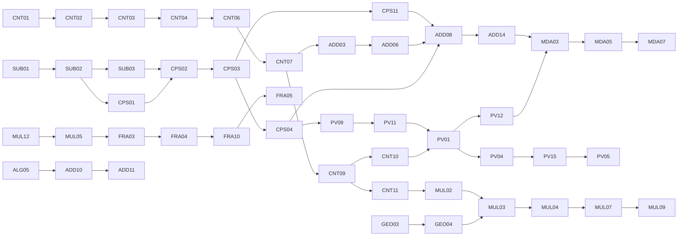

# 03: Curriculum and content

This document defines **what is taught and how content is authored**: strands, the K–3 skill catalog, the YAML authoring schema, item generators and formats, lessons, misconceptions, narration, and the content build. It sits on the shared contracts in [02 §5](02-architecture.md#5-shared-contracts). Where this doc names a type that 02 references but does not define (`ParamSpec`, `WidgetConfig`, `AnswerSpec`, `HintStep`, `LessonSpec`, `NarrationKey`, `Representation` …), the definition here is binding. [04](04-learning-engine.md) owns how the learner model *uses* this content (ratings, mastery, scheduling). [05](05-game-design.md) owns the workshops that host the formats.

**Reading guide for build agents**

| You are building | Read |
|---|---|
| Content pipeline (C01) | §4, §8, §9, §11 |
| Engine core, generators (E01) | §5, §7, §9.3 |
| Widgets (U03–U05) | §5.1, §5.5 (your formats), §6.3 (demo ops) |
| Curriculum (K01, K02) | §1–§3 (your strands), §4, §5.6, §6, §7, §8, §10 |
| Audio / narration (A01, A02) | §8 |

Conventions: "must" is binding. "Judgment call" marks a decision made here with a short reason; change it only by editing this doc with a reason (README rule).

---

## 1. Strands

A strand is a group of related skills and the prefix of every `SkillId` (`^[A-Z]{2,4}\.\d{2}$`, 02 §4.1). Each strand can hold at most 99 skills. Ids are allocated in order (`.01`, `.02`, …) and **never reused**: a retired id goes into `packages/content/retired.yaml` and the validator rejects it forever after.

```ts
// packages/content/src/schema/strands.ts
export type StrandId =
  | 'CNT' | 'SUB' | 'CMP' | 'CPS' | 'ADD' | 'PV' | 'MDA' | 'MUL' | 'FRA' | 'DEC'
  | 'GEO' | 'MEA' | 'TIM' | 'MON' | 'DAT' | 'ALG' | 'PUZ'
  // reserved: no v1 skills (validator rejects skills in these strands until activated here)
  | 'DIV' | 'FAC' | 'CRD' | 'NSY' | 'RAT' | 'EXP' | 'FUN' | 'STA' | 'PRB'
  | 'HSN' | 'HSA' | 'HSF' | 'HSG' | 'HSS';
```

### 1.1 Active strands (v1)

| Code | Strand | Grades (v1) | Skills | What it covers |
|---|---|---|---|---|
| `CNT` | Counting | K–2 | 20 | Count sequence, one-to-one counting, cardinality, producing sets, numerals, counting on and back, skip counting, counting to 1000 |
| `SUB` | **Subitizing** | K–2 | 9 | Seeing quantities at a glance: perceptual (≤ 5), conceptual (five/ten-frames, rekenrek), place-value and equal-group subitizing. **`SUB` is subitizing, not subtraction.** Subtraction lives in `ADD` and `MDA`. |
| `CMP` | Comparing, ordering, number line | K–2 (+ one stretch) | 14 | More/fewer/same, comparing numerals, one more/one less, ordering, number-line placement and estimation, benchmarks |
| `CPS` | Composing and decomposing | K–2 | 11 | Part–part–whole, number bonds, partners of 10, teen numbers as ten and ones, partners of 100 |
| `ADD` | Addition and subtraction facts and strategies (within 20) | K–2 | 27 | Joining and separating, counting on, doubles, near doubles, make ten, think-addition, fact fluency, the equal sign, unknowns, story problems within 20 |
| `PV` | Place value | 1–3 (+ stretch) | 24 | Tens as units, two- and three-digit place value, expanded form, comparing, ±10/±100, rounding, place value to 1,000,000 (stretch) |
| `MDA` | Multi-digit addition and subtraction | 1–3 (+ stretch) | 25 | Place-value strategies within 100 and 1000, regrouping, open number line, compensation, algorithms, one- and two-step story problems |
| `MUL` | Multiplication and division | 1–3 (+ stretch) | 23 | Even/odd, equal groups, arrays, the meanings of × and ÷, fair sharing, fact strategies (break apart), fluency, × multiples of 10, area-model × (stretch) |
| `FRA` | Fractions | 1–3 | 17 | Equal shares, halves/thirds/fourths, unit fractions, fractions on the number line, equivalence, comparison |
| `DEC` | Decimals | 4 (stretch only) | 3 | Tenths and hundredths, decimal notation, comparing decimals. Activated in v1 only for stretch skills; grades 4–5 content grows here. |
| `GEO` | Geometry | K–3 | 16 | Naming 2D/3D shapes, position words, attributes, composing shapes, polygons, partitioning into rows and columns, quadrilateral categories |
| `MEA` | Measurement | K–3 | 22 | Measurable attributes, comparing and measuring length, rulers and units, estimation, area, perimeter, mass and liquid volume |
| `TIM` | Time | K–3 | 11 | Daily sequence, clocks to the hour, half hour, 5 minutes, minute; a.m./p.m.; elapsed time |
| `MON` | Money | 2–3 | 8 | Coin values, counting coins, paying amounts, dollars and cents, making change |
| `DAT` | Data | K–3 | 10 | Sorting and counting categories, tallies, picture and bar graphs (scaled from grade 3), line plots |
| `ALG` | Patterns, equality and early algebra | K–3 | 10 | Repeating and growing patterns, the balance model of equality, relational thinking, unknowns as boxes and letters, input–output rules |
| `PUZ` | Enrichment puzzles | 1–3 | 10 | Optional puzzles (number paths, sum triangles, mini KenKen, balance riddles, digit cards, missing digits). Never on the critical path: nothing lists a `PUZ` skill as a prerequisite. |

Total: **260 skills** (§3.20 has the per-grade counts).

**Decision: division folds into `MUL` for K–3.** Judgment call. CCSS teaches × and ÷ together in one 3.OA cluster through fact families and "division as an unknown factor", the research sample already places division skills in `MUL` (`MUL.05`, `MUL.08`), and keeping them together keeps fact-family prerequisites inside one strand. `DIV` is reserved for grade 4+ multi-digit division (4.NBT.B.6 and up), where it becomes a procedure strand of its own. Workshops that host division (05 §4, W7 Bakery) list `MUL` as their strand.

### 1.2 Reserved strands (no v1 skills)

These codes are reserved now so ids never collide when content grows. The validator rejects skills in a reserved strand until this table activates it.

| Code | Planned strand | Grades | First CCSS domains |
|---|---|---|---|
| `DIV` | Multi-digit division, remainders | 4–6 | 4.NBT.B.6, 5.NBT.B.6, 6.NS.B.2 |
| `FAC` | Factors, multiples, primes | 4 | 4.OA.B.4 |
| `CRD` | Coordinate plane | 5–6 | 5.G.A, 6.NS.C.8 |
| `NSY` | The number system: integers, rational number operations | 6–7 | 6.NS, 7.NS |
| `RAT` | Ratios, rates, percent, proportional relationships | 6–7 | 6.RP, 7.RP |
| `EXP` | Expressions and equations | 6–8 | 6.EE, 7.EE, 8.EE |
| `FUN` | Functions | 8 | 8.F |
| `STA` | Statistics | 6–8 | 6.SP, 7.SP.A–B, 8.SP |
| `PRB` | Probability | 7 | 7.SP.C |
| `HSN` | HS Number and Quantity | HS | N-RN, N-Q, N-CN, N-VM |
| `HSA` | HS Algebra | HS | A-SSE, A-APR, A-CED, A-REI |
| `HSF` | HS Functions | HS | F-IF, F-BF, F-LE, F-TF |
| `HSG` | HS Geometry | HS | G-CO, G-SRT, G-C, G-GPE, G-GMD, G-MG |
| `HSS` | HS Statistics and Probability | HS | S-ID, S-IC, S-CP, S-MD |

Active strands continue upward as well: `GEO`, `MEA`, `FRA`, `DEC`, `ALG`, `DAT` and `PV` gain grade 4–8 skills with new sequential ids. HS modeling is not a strand. Modeling skills live in the strand of their mathematics.

---

## 2. Standards tagging

### 2.1 CCSS-M codes (primary)

Every skill carries `standards.ccss: string[]`, using the full **Grade.Domain.Cluster.Standard** form with an optional lowercase sub-part letter:

| Level | Regex | Examples |
|---|---|---|
| K–8 | `^(K\|[1-8])\.(CC\|OA\|NBT\|NF\|MD\|G\|RP\|NS\|EE\|F\|SP)\.[A-D]\.\d{1,2}[a-e]?$` | `K.CC.B.4a`, `2.NBT.A.1`, `3.NF.A.3d` |
| HS | `^HS(N\|A\|F\|G\|S)-[A-Z]{2,3}\.[A-D]\.\d{1,2}[a-e]?$` | `HSA-REI.B.4`, `HSF-IF.A.1` |

- Short forms such as `K.CC.4` are never stored. The validator checks every code against a code list (`packages/content/standards/ccss-codes.txt`, codes only, one per line).
- **Addresses vs supports.** A skill lists in `ccss` the standards it *directly teaches and assesses*. Skills that come from a learning trajectory rather than a standard (subitizing, ordinal numbers, benchmark estimation) list their nearest standard in `standards.supports` instead (02 §5.1). In the catalog tables a supporting code is written with a leading `~` (for example `~K.CC.B.5`). Supporting codes never count toward coverage.
- A skill may have both, and may have neither only if it is listed in §2.5.

### 2.2 Wisconsin Standards for Mathematics (2021) aliases

**Research summary (verified 2026-11-17 against DPI sources).** Wisconsin's 2021 standards (DPI, May 2021; [standards page](https://dpi.wi.gov/math/standards), [standards PDF](https://dpi.wi.gov/media/44405), [2010→2021 K–8 comparison](https://dpi.wi.gov/media/44373)) keep the CCSS domain/cluster/standard structure and prefix every code with `M.`: `M.K.CC.A.1`, `M.2.NBT.B.7`, `M.3.NF.A.3`. Most K–3 codes are the CCSS code with `M.` in front. The exceptions come from one added standard (`M.K.CC.B.5`), one split standard (`1.OA.C.5`), and two removed standards (`1.OA.D.8` and `3.OA.A.4`; the second removal shifts the later grade-3 OA numbers). Where numbers changed, the WI document prints the previous code in brackets (e.g. `[WI.2010.K.CC.C.6]`).

**Alias rule (compiler):** `standards.wi` is derived, never hand-copied:

1. For each code `c` in `standards.ccss`: if `c` (or its parent without the sub-part letter) is in the exception table below, use the mapped value; otherwise use `'M.' + c`.
2. Append any codes listed explicitly in the YAML `standards.wi` (for WI-only standards and WI sub-parts). Explicit codes are validated against `packages/content/standards/wi-2021-codes.txt`.
3. De-duplicate, then sort. A derived code that is not in the WI code list is a validation **error** (it means the exception table is incomplete).

| CCSS code | WI 2021 code | Why |
|---|---|---|
| `K.CC.B.5` | `M.K.CC.B.6` | WI inserted a new `M.K.CC.B.5` (perceptual subitizing), shifting later numbers |
| `K.CC.C.6` | `M.K.CC.C.7` | shifted |
| `K.CC.C.7` | `M.K.CC.C.8` | shifted |
| `1.OA.C.5` | `M.1.OA.C.5a` | WI split 1.OA.C.5 into (a) counting and (b) conceptual subitizing |
| `1.OA.D.8` | *(none)* | WI 2021 has no separate standard for the unknown in an equation relating three numbers. The skills keep the CCSS tag and get no WI alias. |
| `3.OA.A.4` | *(none)* | same as above, for × and ÷ |
| `3.OA.B.5` | `M.3.OA.B.4` | renumbered after the removal |
| `3.OA.B.6` | `M.3.OA.B.5` | renumbered |
| `3.OA.C.7` | `M.3.OA.C.6` | renumbered; WI adds parts a (strategies) and b (fluency with 0, 1, 2, 5, 10) |
| `3.OA.D.8` | `M.3.OA.D.7` | renumbered |
| `3.OA.D.9` | `M.3.OA.D.8` | renumbered |

Notes:
- The comparison PDF prints the cardinality standard as `M.K.CC.A.4` under cluster B. The standards PDF prints `M.K.CC.B.4`. **Use `M.K.CC.B.4`** (the adopted document wins). `K.CC.B.4a–c` therefore map to `M.K.CC.B.4a–c` by the default rule.
- Grade 4 stretch codes used here (`4.NBT.A.1–3`, `4.NBT.B.4–5`, `4.NF.C.5–7`) map by the default rule. (WI adds a new `M.4.OA.D.6`, which no v1 skill uses.)
- When CCSS has no sub-parts but WI does (`1.OA.C.6` → WI `a` within 10, `b` within 20), the default alias is the parent `M.1.OA.C.6`. Skills may add the precise sub-part explicitly (`wi: [M.1.OA.C.6a]`).

**WI-only explicit tags** (no CCSS counterpart; written in YAML `standards.wi`):

| Skills | Explicit WI code | Meaning (our words) |
|---|---|---|
| `SUB.01`, `SUB.02` | `M.K.CC.B.5` | name small quantities shown briefly, without counting |
| `SUB.06`, `SUB.07` | `M.1.OA.C.5b` | use conceptual subitizing to relate parts to addition and subtraction |
| `ADD.06` | `M.1.OA.C.6a` | flexible add/subtract within 10 |
| `ADD.07`, `ADD.08`, `ADD.16`–`ADD.19` | `M.1.OA.C.6b` | strategies within 20 |
| `MUL.13`, `MUL.14`, `MUL.15`, `MUL.21` | `M.3.OA.C.6a` | strategies for × and ÷ within 100 |
| `MUL.09`, `MUL.17` | `M.3.OA.C.6b` | flexible, efficient × and ÷ facts |

### 2.3 Licensing

- **Store codes and our own wording only.** Never copy standards text (CCSS or WI) into YAML, narration, the app, or the parent dashboard. Every skill `name` in this doc is original wording. Codes are facts. The code lists in `packages/content/standards/*.txt` contain codes only, with no descriptions.
- CCSS text is under the NGA/CCSSO public license, which requires a copyright notice when quoted. We do not quote it, so no notice is needed. If a future feature shows standard text to parents, it must fetch it at runtime from the publisher or ship it with the required notice, under a separate licence review.
- The WI document carries no reuse grant. Treat it the same way: codes only.
- If skill edges are cross-checked against the Learning Commons Coherence Map (CC0) or its learning components (CC BY 4.0), record attribution in `packages/content/ATTRIBUTION.md`. Never import component text into skill names.

### 2.4 Coverage rule

Every K–3 standard in the code list, and every grade 4 code a stretch skill names, must be **addressed** (listed in `ccss`, not `supports`) by at least one skill. A parent code with sub-parts (`K.CC.B.4`) counts as covered when the parent is tagged, or when every sub-part is tagged. A tagged parent covers its sub-parts too (`3.MD.C.5` covers `3.MD.C.5a` and `3.MD.C.5b`). `pnpm content:validate` prints any uncovered code and fails (§9, V20). The v1 catalog in §3 covers all of K.CC, K.OA, K.NBT, K.MD, K.G, 1.OA, 1.NBT, 1.MD, 1.G, 2.OA, 2.NBT, 2.MD, 2.G, 3.OA, 3.NBT, 3.NF, 3.MD and 3.G.

### 2.5 Skills with no standards tag

Only `ALG.01` and `ALG.04` may have neither a `ccss` nor a `supports` code: repeating patterns are not in CCSS K–3, but they are a well-evidenced early-algebra trajectory. Every other skill has at least one of the two. (`PUZ` skills use `supports` only.)

---

## 3. The K–3 skill catalog

### 3.1 How to read the tables

| Column | Meaning |
|---|---|
| **ID** | `SkillId`. Ids from the research sample (research 01 §5.6–§5.7) are kept. Where a research skill bundled several teachable units, the id keeps the core unit and the rest got new ids (§3.21). |
| **Skill** | Our wording. Becomes `Skill.name` (it may be shortened, but must not change meaning). |
| **Kind** | `Skill.kind`: `concept`, `procedure`, `strategy`, `fact-fluency`, `problem-solving`. |
| **Gr** | `Skill.grade`: a label for reports and placement priors only, never a gate. |
| **CCSS** | `standards.ccss`. A `~` prefix means `standards.supports` (§2.1). WI tags are derived (§2.2). |
| **Prerequisites** | `Skill.prerequisites` (hard edges). `—` = root. |
| **GW** | `Skill.gateway`. Gateway skills use the stricter mastery rule (04 §3), must have ≥ 3 representations and ≥ 1 abstract-tier template (§9, V09), and are probed first when a descendant stalls. |
| **Representations** | `Skill.representations`, ordered concrete → abstract (§3.2 ids). Every listed representation must be used by at least one template, and every template's representation must be listed. |
| **Formats** | The `ItemFormat`s the skill's templates must cover (02 §5.2). Minimum template set = one template per listed format, so each skill has ≥ 2 templates across ≥ 2 formats. Authors may add more. |
| **Fluency** | `Skill.fluency.medianLatencyMs` for `fact-fluency` skills (latency from item ready to submit, including number-pad entry). 04 §3 scales it ×1.5 for K. |

Derived fields are not in the tables: `templates` (from template files), `misconceptions` (from the misconception library, §7), `lesson` (§6), `narration.intro` (`sk.<id>.intro`), `related` (authored, default `[]`), `encompasses` (§3.19).

### 3.2 Representation ids

`Representation` is a string id from this closed list (`packages/content/src/schema/representations.ts`). The tier column is the usual CPA tier. The tier of an actual item comes from its template.

| Id | What it is | Usual tiers |
|---|---|---|
| `objects` | Island objects (fish, shells, planks…) as countable sprites | C, P |
| `fingers` | Hand and finger patterns | C, P |
| `dots` | Dot patterns, dice, scattered dots | P |
| `five-frame` | A 1×5 frame | C, P |
| `ten-frame` | A 2×5 frame. In-world it is a Pebbling's shell | C, P |
| `double-ten-frame` | Two ten-frames (11–20). In-world, a Ten Turtle plus a friend | C, P |
| `rekenrek` | Bead rack, 2 rows of 10 (5 red, 5 white) | C, P |
| `number-path` | Numbered stepping stones (counts squares, not points) | C, P |
| `number-line` | Number line with ticks and labels | P |
| `open-number-line` | Number line without ticks: jumps only | P |
| `hundred-chart` | 1–100 (or 0–99, 101–200, 1–120) grid | P |
| `bundles` | Bundled sticks or planks (ten = one bundle) | C |
| `base-ten` | Units, rods, flats, thousands cubes | C, P |
| `pv-chart` | Place-value chart with columns | P, A |
| `expanded` | Expanded-form cards (300 + 40 + 5) | P, A |
| `words` | Number names, fraction names, position words | A |
| `number-bond` | Part–part–whole diagram | P |
| `bar-model` | Tape diagram | P |
| `balance` | Pan balance | C, P |
| `groups` | Equal groups (rafts, plates, baskets) | C, P |
| `array` | Rows × columns of objects | C, P |
| `area-model` | Rectangle split by place value or factors | P |
| `area-grid` | Grid of unit squares | P |
| `tiles` | Draggable unit tiles | C |
| `fraction-shape` | Circle, rectangle or loaf cut into parts | C, P |
| `fraction-strip` | Fraction bars | C, P |
| `fraction-line` | Number line partitioned into fractions | P |
| `shapes` | 2D shape cards | C, P |
| `solids` | 3D solids | P |
| `pattern-blocks` | Triangle, square, rhombus, trapezoid, hexagon pieces | C |
| `dot-grid` | Geoboard-style dot grid for drawing | C, P |
| `units` | Non-standard length units (shells, cubes, paper-clip-like sticks) | C |
| `ruler` | Inch or centimeter ruler | C, P |
| `scale` | Kitchen or hanging scale with a dial | P |
| `beaker` | Measuring jug | P |
| `thermometer` | Vertical number line | P |
| `clock` | Analog clock | C, P |
| `digital-clock` | Digital time display | A |
| `timeline` | Time line and daily-schedule strip | P |
| `coins` | US coins (original vector art) | C, P |
| `bills` | Dollar bills | C, P |
| `picture-graph` | Picture graph | P |
| `bar-graph` | Bar graph | P |
| `line-plot` | Line plot | P |
| `tally` | Tally marks | P |
| `table` | Data or input–output table | A |
| `story` | Narrated island story scene | P |
| `symbols` | Numerals and symbols only | A |

### 3.3 CNT: Counting (20)

| ID | Skill | Kind | Gr | CCSS | Prerequisites | GW | Representations | Formats | Fluency |
|---|---|---|---|---|---|---|---|---|---|
| CNT.01 | Say the counting sequence to 20 and find what comes next | concept | K | K.CC.A.1 | — | N | number-path, hundred-chart, symbols | numeral-pick, order, hundred-chart | — |
| CNT.02 | Count up to 10 objects one by one (in a line, then scattered) | procedure | K | K.CC.B.4a | CNT.01 | N | objects, ten-frame, dots | tap-count, make-set | — |
| CNT.03 | The last number counted tells how many; a recount gives the same | concept | K | K.CC.B.4b | CNT.02 | Y | objects, ten-frame, dots, symbols | tap-count, numeral-pick, number-pad | — |
| CNT.04 | Make a set of N objects (N ≤ 10) | procedure | K | K.CC.B.5 | CNT.03 | N | objects, fingers, ten-frame | make-set, tenframe-fill | — |
| CNT.05 | Read and write numerals 0–20; match a numeral to a quantity | concept | K | K.CC.A.3 | CNT.01, CNT.03 | N | objects, dots, symbols | numeral-pick, number-pad, tap-count | — |
| CNT.06 | Count and make sets to 20 (lines, arrays, circles) | procedure | K | K.CC.B.5 | CNT.04, CNT.05 | N | objects, double-ten-frame, symbols | tap-count, make-set, number-pad | — |
| CNT.07 | Count forward from any number; say the next number | procedure | K | K.CC.A.2 | CNT.06 | N | number-path, number-line, hundred-chart, symbols | number-line-jump, numeral-pick, hundred-chart | — |
| CNT.08 | Count backward from 10, then from any number to 20 | procedure | K | K.CC.A.2 | CNT.07 | N | number-path, number-line, symbols | number-line-jump, numeral-pick | — |
| CNT.09 | Count to 100 by ones and by tens; cross decades (39 → 40) | procedure | K | K.CC.A.1 | CNT.07 | N | hundred-chart, number-line, symbols | hundred-chart, numeral-pick, order | — |
| CNT.10 | Count, read and write to 120 from any start | procedure | 1 | 1.NBT.A.1 | CNT.09, CNT.05 | N | hundred-chart, number-line, symbols | hundred-chart, number-pad, number-line-jump | — |
| CNT.11 | Skip-count by 2s and 5s to 100 | procedure | 2 | 2.NBT.A.2, ~2.OA.C.3 | CNT.09 | N | groups, hundred-chart, number-line | hundred-chart, number-line-jump, number-pad | — |
| CNT.12 | Skip-count by 10s and 100s within 1000 from any number | procedure | 2 | 2.NBT.A.2 | PV.05, CNT.09 | N | base-ten, number-line, symbols | number-line-jump, number-pad, order | — |
| CNT.13 | Zero means none: count an empty set and write 0 | concept | K | K.CC.A.3 | CNT.03 | N | objects, ten-frame, symbols | tap-count, numeral-pick | — |
| CNT.14 | Each number is one more than the one before (6 has 5 inside it) | concept | K | K.CC.B.4c | CNT.04, CNT.07 | Y | objects, ten-frame, number-path, symbols | make-set, tenframe-fill, numeral-pick | — |
| CNT.15 | Ordinal positions, first to tenth | concept | K | ~K.CC.B.4 | CNT.06 | N | objects, number-path, words | tap-count, numeral-pick | — |
| CNT.16 | Count backward from any number within 120 | procedure | 1 | 1.NBT.A.1 | CNT.08, CNT.10 | N | hundred-chart, number-line, symbols | number-line-jump, hundred-chart, number-pad | — |
| CNT.17 | Count by ones within 1000, across hundreds (199 → 200) | procedure | 2 | 2.NBT.A.2 | CNT.10, PV.15 | N | base-ten, number-line, symbols | number-pad, order, number-line-jump | — |
| CNT.18 | Find missing numbers on a number path or chart within 120 | procedure | 1 | 1.NBT.A.1 | CNT.10 | N | number-path, hundred-chart | hundred-chart, number-pad | — |
| CNT.19 | Count a big collection by making groups of ten | strategy | 1 | 1.NBT.B.2a | CNT.09, PV.09 | N | objects, bundles, ten-frame | make-set, tap-count, base-ten-build | — |
| CNT.20 | Count on and back by tens and ones from any number (34, 44, 45) | procedure | 1 | ~1.NBT.C.5 | CNT.10, PV.03 | N | base-ten, hundred-chart, open-number-line | hundred-chart, number-line-jump, number-pad | — |

### 3.4 SUB: Subitizing (9)

| ID | Skill | Kind | Gr | CCSS | Prerequisites | GW | Representations | Formats | Fluency |
|---|---|---|---|---|---|---|---|---|---|
| SUB.01 | See 1 to 4 at a glance | concept | K | ~K.CC.B.5 | — | N | objects, fingers, dots | dot-flash, numeral-pick | — |
| SUB.02 | See up to 5 at a glance; dice and finger patterns | concept | K | ~K.CC.B.5 | SUB.01 | N | fingers, five-frame, dots | dot-flash, numeral-pick, make-set | — |
| SUB.03 | See 6–10 on a ten-frame as five and some more | concept | K | ~K.OA.A.3 | SUB.02, CNT.03 | Y | fingers, five-frame, ten-frame, dots, symbols | dot-flash, tenframe-fill, number-pad | — |
| SUB.04 | See 11–20 on double ten-frames as ten and some more | concept | 1 | ~1.NBT.B.2 | SUB.03, CPS.04 | N | rekenrek, double-ten-frame, dots | dot-flash, number-pad, rekenrek | — |
| SUB.05 | Show and read finger patterns to 10 | concept | K | ~K.CC.B.5 | SUB.02 | N | fingers, five-frame | dot-flash, make-set | — |
| SUB.06 | See small groups inside a scattered set (3 and 4 make 7) | concept | 1 | ~1.OA.C.5 | SUB.03 | N | objects, dots, number-bond | dot-flash, number-bond | — |
| SUB.07 | Quick-read beads on a rekenrek to 20 | concept | 1 | ~1.OA.C.5 | SUB.04 | N | rekenrek, double-ten-frame | rekenrek, dot-flash | — |
| SUB.08 | Quick-read tens and ones from a base-ten picture | concept | 1 | ~1.NBT.B.2 | SUB.04, PV.01 | N | bundles, base-ten | dot-flash, number-pad | — |
| SUB.09 | Quick-read equal groups and small arrays (3 groups of 4) | concept | 2 | ~2.OA.C.4 | SUB.06, MUL.02 | N | groups, array, dots | dot-flash, number-pad | — |

### 3.5 CMP: Comparing, ordering and the number line (14)

| ID | Skill | Kind | Gr | CCSS | Prerequisites | GW | Representations | Formats | Fluency |
|---|---|---|---|---|---|---|---|---|---|
| CMP.01 | Compare two groups up to 10: more, fewer, the same | concept | K | K.CC.C.6 | CNT.03 | N | objects, ten-frame, dots | compare, make-set | — |
| CMP.02 | Compare two numerals 1–10 | concept | K | K.CC.C.7 | CMP.01, CNT.05 | N | number-path, symbols | compare, numeral-pick | — |
| CMP.03 | One more and one less than a number to 20 | concept | K | ~K.CC.A.2 | CNT.07, CNT.08 | N | ten-frame, number-path, symbols | tenframe-fill, number-pad, number-line-jump | — |
| CMP.04 | Place numbers on 0–20 and 0–100 number lines | concept | 1 | ~2.MD.B.6 | CMP.02, CNT.09 | N | number-path, number-line | number-line-place, order | — |
| CMP.05 | Compare groups by matching when looks mislead (spread out vs. bunched) | concept | K | K.CC.C.6 | CMP.01 | N | objects, dots | compare, make-set | — |
| CMP.06 | Order three or more numbers to 20 | concept | K | ~K.CC.C.7 | CMP.02 | N | number-path, symbols | order, number-line-place | — |
| CMP.07 | Compare numbers 11–20 | concept | K | ~K.CC.C.7 | CMP.02, CPS.04 | N | double-ten-frame, number-line, symbols | compare, order | — |
| CMP.08 | Use <, > and = to compare numbers to 20 | procedure | 1 | 1.NBT.B.3 | CMP.07 | N | balance, number-line, symbols | compare, balance | — |
| CMP.09 | Estimate where a number goes on a 0–100 line with only the ends marked | concept | 1 | ~2.MD.B.6 | CMP.04 | N | number-line, symbols | number-line-place, numeral-pick | — |
| CMP.10 | Place and estimate numbers on a 0–1000 number line | concept | 2 | ~2.NBT.A.4 | CMP.09, PV.05 | N | number-line, symbols | number-line-place, numeral-pick | — |
| CMP.11 | Read a number line marked in 2s, 5s or 10s | procedure | 2 | 2.MD.B.6 | CMP.04, CNT.11 | N | ruler, number-line | number-line-place, number-pad | — |
| CMP.12 | Closer to which? Compare a number with two benchmarks | concept | 2 | ~3.NBT.A.1 | CMP.09 | N | number-line, symbols | number-line-place, compare | — |
| CMP.13 | Estimate how many are in a big group | concept | 1 | ~1.NBT.B.2 | CMP.01, CNT.09, SUB.06 | N | objects, dots, number-line | dot-flash, numeral-pick | — |
| CMP.14 | Numbers below zero on a number line (stretch, enrichment) | concept | 6 | 6.NS.C.5 | CMP.09, CNT.16 | N | thermometer, number-line | number-line-place, number-line-jump | — |

`CMP.14` is labelled grade 6 because its standard is 6.NS.C.5. It is offered only as enrichment to a child who has reached `CMP.09` and `CNT.16` (research 01 §6.1, informal negatives). Judgment call: the honest label matters more than the 4-only stretch rule.

### 3.6 CPS: Composing and decomposing (11)

| ID | Skill | Kind | Gr | CCSS | Prerequisites | GW | Representations | Formats | Fluency |
|---|---|---|---|---|---|---|---|---|---|
| CPS.01 | Break numbers to 5 into two parts, every way | concept | K | K.OA.A.3 | SUB.02, CNT.03 | N | objects, fingers, ten-frame, number-bond | number-bond, make-set, tenframe-fill | — |
| CPS.02 | Break numbers to 10 into two parts; record with a drawing or equation | concept | K | K.OA.A.3 | CPS.01, SUB.03 | Y | ten-frame, rekenrek, number-bond, symbols | number-bond, tenframe-fill, rekenrek, number-pad | — |
| CPS.03 | Partners of 10: find the number that makes 10 | concept | K | K.OA.A.4 | CPS.02 | N | ten-frame, rekenrek, number-bond, symbols | tenframe-fill, number-bond, number-pad | — |
| CPS.04 | Teen numbers are ten ones and some more ones | concept | K | K.NBT.A.1 | CPS.03, CNT.06 | Y | double-ten-frame, rekenrek, bundles, symbols | tenframe-fill, base-ten-build, rekenrek, number-pad | — |
| CPS.05 | Find the missing part when the whole is up to 10 | concept | K | K.OA.A.3 | CPS.02 | N | ten-frame, number-bond, symbols | number-bond, number-pad, tenframe-fill | — |
| CPS.06 | Find all the ways to make a number up to 10 | problem-solving | 1 | K.OA.A.3 | CPS.05 | N | objects, number-bond | number-bond, puzzle-grid | — |
| CPS.07 | Write a teen number as 10 plus ones (10 + 4 = 14) | procedure | K | K.NBT.A.1 | CPS.04 | N | double-ten-frame, number-bond, expanded, symbols | number-bond, number-pad, expanded-form | — |
| CPS.08 | Break numbers to 20 into parts several ways (13 = 9 + 4 = 10 + 3) | concept | 1 | ~1.OA.C.6 | CPS.07, CPS.05 | N | double-ten-frame, rekenrek, number-bond | number-bond, rekenrek, tenframe-fill | — |
| CPS.09 | Tens partners of 100 (30 + 70) | concept | 1 | ~2.NBT.B.5 | CPS.03, PV.10 | N | base-ten, hundred-chart, number-bond | number-bond, base-ten-build, hundred-chart | — |
| CPS.10 | Partners of 100 (64 + 36) | concept | 2 | ~2.NBT.B.5 | CPS.09, MDA.08 | N | base-ten, open-number-line, number-bond | number-bond, number-line-jump, number-pad | — |
| CPS.11 | Split a number to finish a ten (8 + 5: give 2, keep 3) | strategy | 1 | ~1.OA.C.6 | CPS.05, CPS.03 | N | ten-frame, rekenrek, number-bond | tenframe-fill, number-bond, rekenrek | — |

### 3.7 ADD: Addition and subtraction within 20 (27)

| ID | Skill | Kind | Gr | CCSS | Prerequisites | GW | Representations | Formats | Fluency |
|---|---|---|---|---|---|---|---|---|---|
| ADD.01 | Join: add-to and put-together within 10 with objects | concept | K | K.OA.A.1 | CNT.04, CPS.01 | N | objects, fingers, ten-frame, symbols | make-set, tenframe-fill, number-pad | — |
| ADD.02 | Fluency: add and subtract within 5 | fact-fluency | K | K.OA.A.5 | ADD.01, ADD.24, CPS.01 | N | ten-frame, symbols | number-pad, numeral-pick | 3500 |
| ADD.03 | Count on from the larger number to add | strategy | 1 | 1.OA.C.5 | CNT.07, ADD.01 | N | number-path, ten-frame, number-line, symbols | number-line-jump, tenframe-fill, number-pad | — |
| ADD.04 | Count back or count up to subtract | strategy | 1 | 1.OA.C.5 | CNT.08, ADD.03, ADD.24 | N | number-path, number-line, symbols | number-line-jump, number-pad | — |
| ADD.05 | Turn-around facts and adding zero | concept | 1 | 1.OA.B.3 | ADD.01 | N | ten-frame, balance, number-bond, symbols | tenframe-fill, balance, number-pad | — |
| ADD.06 | Fluency: add and subtract within 10 | fact-fluency | 1 | 1.OA.C.6 | CPS.02, ADD.02, ADD.03, ADD.04 | N | ten-frame, symbols | number-pad, numeral-pick | 3000 |
| ADD.07 | Doubles to 10 + 10 | strategy | 1 | 1.OA.C.6 | ADD.06 | N | dots, ten-frame, double-ten-frame, symbols | tenframe-fill, dot-flash, number-pad | — |
| ADD.08 | Make ten to add (8 + 5 = 8 + 2 + 3) | strategy | 1 | 1.OA.C.6 | CPS.11, CPS.04, ADD.06 | Y | double-ten-frame, rekenrek, number-bond, open-number-line, symbols | tenframe-fill, rekenrek, number-line-jump, number-pad | — |
| ADD.09 | Think addition to subtract; fact families | strategy | 1 | 1.OA.B.4 | ADD.04, ADD.06, CPS.05 | N | number-bond, bar-model, symbols | number-bond, number-pad | — |
| ADD.10 | The equal sign means "the same as": true or false equations | concept | 1 | 1.OA.D.7 | ADD.05, ALG.05 | Y | objects, balance, symbols | balance, compare, number-pad | — |
| ADD.11 | Find the unknown anywhere in an equation (8 + ? = 11; ? − 3 = 5) | concept | 1 | 1.OA.D.8 | ADD.09, ADD.10 | Y | balance, number-bond, bar-model, symbols | balance, number-pad, number-bond | — |
| ADD.12 | Story problems within 20 of every type (start unknown, compare) | problem-solving | 1 | 1.OA.A.1 | ADD.11, ADD.21 | N | story, bar-model, number-line | story-problem, number-pad | — |
| ADD.13 | Add three numbers, making ten first when you can | strategy | 1 | 1.OA.B.3 | ADD.05, ADD.08 | N | ten-frame, number-bond, symbols | tenframe-fill, number-pad | — |
| ADD.14 | Fluency: sums within 20 | fact-fluency | 2 | 2.OA.B.2 | ADD.07, ADD.16, ADD.08, ADD.17 | N | symbols | number-pad, numeral-pick | 3500 |
| ADD.15 | Plus one, plus two, minus one, minus two | strategy | K | ~1.OA.C.5 | CMP.03, ADD.01 | N | number-path, ten-frame, symbols | number-line-jump, number-pad | — |
| ADD.16 | Near doubles (6 + 7 = 6 + 6 + 1) | strategy | 1 | 1.OA.C.6 | ADD.07 | N | dots, double-ten-frame, symbols | tenframe-fill, number-pad | — |
| ADD.17 | Add 9 by adding 10 and taking 1 away | strategy | 1 | 1.OA.C.6 | ADD.08, ADD.26 | N | double-ten-frame, rekenrek, symbols | rekenrek, number-pad | — |
| ADD.18 | Subtract back to ten first (13 − 4 = 13 − 3 − 1) | strategy | 1 | 1.OA.C.6 | ADD.08, ADD.04 | N | double-ten-frame, open-number-line, symbols | tenframe-fill, number-line-jump, number-pad | — |
| ADD.19 | Subtract by counting up through ten (13 − 8: 8 → 10 → 13) | strategy | 1 | 1.OA.C.6 | ADD.09, CPS.11 | N | double-ten-frame, open-number-line, symbols | number-line-jump, number-pad | — |
| ADD.20 | Story problems within 10: join, separate, put together | problem-solving | K | K.OA.A.2 | ADD.01, ADD.24 | N | objects, story, symbols | story-problem, make-set, number-pad | — |
| ADD.21 | Compare stories: how many more, how many fewer (to 20) | problem-solving | 1 | 1.OA.A.1 | ADD.20, ADD.09, CMP.07 | N | objects, story, bar-model | story-problem, number-pad | — |
| ADD.22 | Fluency: differences within 20 | fact-fluency | 2 | 2.OA.B.2 | ADD.14, ADD.18, ADD.19 | N | symbols | number-pad, numeral-pick | 4000 |
| ADD.23 | Match an equation to a picture or story (3 + 2 = 5) | concept | K | K.OA.A.1 | ADD.20, CNT.05 | N | objects, story, symbols | numeral-pick, number-pad | — |
| ADD.24 | Separate: take-from and take-apart within 10 with objects | concept | K | K.OA.A.1 | CNT.04, CPS.01 | N | objects, fingers, ten-frame, symbols | make-set, tenframe-fill, number-pad | — |
| ADD.25 | Story problems with three addends (sum to 20) | problem-solving | 1 | 1.OA.A.2 | ADD.13, ADD.20 | N | ten-frame, story, symbols | story-problem, number-pad | — |
| ADD.26 | Ten plus ones, and teen minus ten (10 + 7; 17 − 10) | procedure | 1 | ~1.OA.C.6 | CPS.07 | N | double-ten-frame, base-ten, symbols | tenframe-fill, number-pad | — |
| ADD.27 | Add and subtract within 20 with jumps on a number line | strategy | 1 | 1.OA.C.5 | ADD.03, CMP.04 | N | number-line, symbols | number-line-jump, number-pad | — |

### 3.8 PV: Place value (24)

| ID | Skill | Kind | Gr | CCSS | Prerequisites | GW | Representations | Formats | Fluency |
|---|---|---|---|---|---|---|---|---|---|
| PV.01 | Two-digit numbers are tens and ones | concept | 1 | 1.NBT.B.2 | PV.10, PV.11, CNT.10 | Y | bundles, ten-frame, base-ten, pv-chart, expanded, symbols | base-ten-build, expanded-form, number-pad | — |
| PV.02 | Compare two-digit numbers with <, = and > | procedure | 1 | 1.NBT.B.3 | PV.01, CMP.08 | N | base-ten, number-line, symbols | compare, order | — |
| PV.03 | Find 10 more and 10 less in your head | procedure | 1 | 1.NBT.C.5 | PV.01 | N | base-ten, hundred-chart, symbols | hundred-chart, base-ten-build, number-pad | — |
| PV.04 | A hundred is ten tens; count hundreds | concept | 2 | 2.NBT.A.1a, 2.NBT.A.1b | PV.01, CNT.09 | Y | bundles, base-ten, hundred-chart, symbols | base-ten-build, base-ten-trade, number-pad | — |
| PV.05 | Read and write numbers to 1000 as numerals, names and expanded form | procedure | 2 | 2.NBT.A.3 | PV.15 | N | base-ten, expanded, words, symbols | expanded-form, numeral-pick, number-pad | — |
| PV.06 | Compare three-digit numbers | procedure | 2 | 2.NBT.A.4 | PV.05, PV.02 | N | base-ten, number-line, symbols | compare, order | — |
| PV.07 | Add or subtract 10 or 100 in your head (100–900) | procedure | 2 | 2.NBT.B.8 | PV.03, PV.05 | N | base-ten, open-number-line, symbols | base-ten-build, number-line-jump, number-pad | — |
| PV.08 | Round to the nearest ten | procedure | 3 | 3.NBT.A.1 | PV.06, CMP.12 | N | number-line, symbols | number-line-place, numeral-pick, number-pad | — |
| PV.09 | Ten ones make one ten: bundle and unbundle | concept | 1 | 1.NBT.B.2a | CPS.04, CNT.06 | Y | objects, bundles, ten-frame, base-ten, symbols | base-ten-trade, make-set, base-ten-build, number-pad | — |
| PV.10 | Decade numbers are some tens and no ones (60 = 6 tens) | concept | 1 | 1.NBT.B.2c | PV.09, CNT.09 | N | bundles, base-ten, symbols | base-ten-build, number-pad | — |
| PV.11 | Teen numbers are one ten and some ones | concept | 1 | 1.NBT.B.2b | PV.09 | N | bundles, double-ten-frame, base-ten | base-ten-build, number-pad | — |
| PV.12 | One number, many ways: 34 is 3 tens 4 ones or 2 tens 14 ones | concept | 2 | ~2.NBT.B.5 | PV.01 | Y | bundles, base-ten, pv-chart, expanded, symbols | base-ten-trade, base-ten-build, expanded-form, number-pad | — |
| PV.13 | Two-digit numbers in expanded form and words (40 + 7) | procedure | 1 | 1.NBT.B.2 | PV.01 | N | expanded, words, symbols | expanded-form, numeral-pick | — |
| PV.14 | Three-digit numbers with zeros (305, 450) | concept | 2 | 2.NBT.A.1 | PV.15 | N | base-ten, pv-chart, symbols | base-ten-build, numeral-pick, number-pad | — |
| PV.15 | Three-digit numbers are hundreds, tens and ones | concept | 2 | 2.NBT.A.1 | PV.04 | Y | base-ten, pv-chart, expanded, symbols | base-ten-build, expanded-form, number-pad | — |
| PV.16 | Regroup three-digit numbers (253 = 25 tens 3 ones) | concept | 2 | ~2.NBT.B.7 | PV.12, PV.15 | N | base-ten, pv-chart | base-ten-trade, base-ten-build | — |
| PV.17 | Order three-digit numbers | procedure | 2 | ~2.NBT.A.4 | PV.06 | N | number-line, symbols | order, number-line-place | — |
| PV.18 | Round to the nearest hundred | procedure | 3 | 3.NBT.A.1 | PV.08, CMP.10 | N | number-line, symbols | number-line-place, numeral-pick, number-pad | — |
| PV.19 | Estimate sums and differences by rounding | problem-solving | 3 | ~3.OA.D.8 | PV.18, MDA.05 | N | number-line, symbols | numeral-pick, number-pad | — |
| PV.20 | Place value to 1,000,000 (stretch) | concept | 4 | 4.NBT.A.2 | PV.23 | N | pv-chart, expanded, words, symbols | expanded-form, numeral-pick, number-pad | — |
| PV.21 | Each place is worth ten times the place to its right (stretch) | concept | 4 | 4.NBT.A.1 | PV.20 | N | base-ten, pv-chart, symbols | base-ten-trade, number-pad | — |
| PV.22 | Compare and round big numbers (stretch) | procedure | 4 | 4.NBT.A.2, 4.NBT.A.3 | PV.21, PV.18 | N | number-line, pv-chart, symbols | compare, number-line-place, number-pad | — |
| PV.23 | Four-digit numbers: thousands, hundreds, tens, ones (stretch) | concept | 4 | 4.NBT.A.2 | PV.16, PV.05 | N | base-ten, pv-chart, expanded, symbols | base-ten-build, expanded-form, number-pad | — |
| PV.24 | What a digit is worth (the 4 in 345 means 40) | concept | 2 | 2.NBT.A.1 | PV.15 | N | base-ten, pv-chart, expanded, symbols | numeral-pick, expanded-form, base-ten-build | — |

### 3.9 MDA: Multi-digit addition and subtraction (25)

| ID | Skill | Kind | Gr | CCSS | Prerequisites | GW | Representations | Formats | Fluency |
|---|---|---|---|---|---|---|---|---|---|
| MDA.01 | Add tens to a two-digit number; add ones without crossing a ten | procedure | 1 | 1.NBT.C.4 | PV.01, PV.03, ADD.06 | N | base-ten, hundred-chart, open-number-line, symbols | base-ten-build, number-line-jump, number-pad | — |
| MDA.02 | Subtract multiples of 10 (10–90) | procedure | 1 | 1.NBT.C.6 | PV.03 | N | base-ten, hundred-chart, open-number-line, symbols | base-ten-build, number-line-jump, number-pad | — |
| MDA.03 | Add two-digit numbers with regrouping (place-value strategies) | procedure | 2 | 2.NBT.B.5 | MDA.08, MDA.09, PV.12, ADD.14 | Y | base-ten, open-number-line, expanded, symbols | base-ten-trade, number-line-jump, number-pad | — |
| MDA.04 | Add up to four two-digit numbers | procedure | 2 | 2.NBT.B.6 | MDA.03, ADD.13 | N | base-ten, symbols | base-ten-trade, number-pad | — |
| MDA.05 | Add within 1000 with regrouping (models and strategies) | procedure | 2 | 2.NBT.B.7 | MDA.24, MDA.03, PV.16 | N | base-ten, open-number-line, expanded, symbols | base-ten-trade, expanded-form, number-pad | — |
| MDA.06 | One-step story problems within 100 | problem-solving | 2 | 2.OA.A.1 | ADD.12, MDA.03, MDA.12 | N | story, bar-model, open-number-line | story-problem, number-pad | — |
| MDA.07 | Add within 1000 with the standard algorithm | procedure | 3 | 3.NBT.A.2 | MDA.05 | N | pv-chart, symbols | base-ten-trade, number-pad | — |
| MDA.08 | Add a one-digit number across a ten (37 + 5 → 40 + 2) | strategy | 1 | 1.NBT.C.4 | MDA.01, ADD.08 | N | base-ten, open-number-line, symbols | number-line-jump, base-ten-trade, number-pad | — |
| MDA.09 | Add two-digit numbers without regrouping | procedure | 1 | 1.NBT.C.4 | MDA.01 | N | base-ten, expanded, symbols | base-ten-build, expanded-form, number-pad | — |
| MDA.10 | Subtract a one-digit number from a two-digit number across a ten | strategy | 2 | 2.NBT.B.5 | MDA.02, ADD.18 | N | base-ten, open-number-line, symbols | number-line-jump, base-ten-trade, number-pad | — |
| MDA.11 | Subtract two-digit numbers without regrouping | procedure | 2 | 2.NBT.B.5 | MDA.02, PV.01, ADD.06 | N | base-ten, symbols | base-ten-build, number-pad | — |
| MDA.12 | Subtract two-digit numbers with regrouping (trade a ten) | procedure | 2 | 2.NBT.B.5 | MDA.10, MDA.11, PV.12, ADD.22 | Y | base-ten, open-number-line, expanded, symbols | base-ten-trade, number-line-jump, number-pad | — |
| MDA.13 | Jump by tens and ones on an open number line | strategy | 2 | 2.NBT.B.5 | MDA.09, CMP.04, PV.03 | N | open-number-line, symbols | number-line-jump, number-pad | — |
| MDA.14 | Subtract by counting up (62 − 48: 48 → 50 → 62) | strategy | 2 | 2.NBT.B.9 | MDA.13, ADD.19 | N | open-number-line, bar-model | number-line-jump, number-pad | — |
| MDA.15 | Make a friendly number (49 + 26 = 50 + 25) | strategy | 2 | 2.NBT.B.9 | MDA.03 | N | base-ten, balance, open-number-line, symbols | number-line-jump, balance, number-pad | — |
| MDA.16 | Check subtraction with addition (within 100) | concept | 2 | 2.NBT.B.9 | MDA.12, ADD.09 | N | number-bond, bar-model, symbols | number-bond, number-pad | — |
| MDA.17 | Subtract within 1000 with regrouping (models and strategies) | procedure | 2 | 2.NBT.B.7 | MDA.25, MDA.12, PV.16, PV.07 | N | base-ten, open-number-line, symbols | base-ten-trade, number-line-jump, number-pad | — |
| MDA.18 | Subtract across zeros (400 − 168) | procedure | 3 | 3.NBT.A.2 | MDA.17 | N | base-ten, pv-chart, symbols | base-ten-trade, number-pad | — |
| MDA.19 | Two-step story problems within 100 | problem-solving | 2 | 2.OA.A.1 | MDA.06 | N | story, bar-model | story-problem, number-pad | — |
| MDA.20 | Two-step story problems with all four operations; is the answer reasonable? | problem-solving | 3 | 3.OA.D.8 | MDA.19, MUL.10, PV.19 | N | story, bar-model, symbols | story-problem, number-pad | — |
| MDA.21 | Subtract within 1000 with the standard algorithm | procedure | 3 | 3.NBT.A.2 | MDA.18 | N | pv-chart, symbols | base-ten-trade, number-pad | — |
| MDA.22 | Find a missing number in addition or subtraction within 100 (36 + ? = 80) | concept | 2 | ~2.OA.A.1 | MDA.14, ADD.11 | N | balance, bar-model, open-number-line, symbols | number-line-jump, number-pad, balance | — |
| MDA.23 | Add and subtract multi-digit numbers with the standard algorithm (stretch) | procedure | 4 | 4.NBT.B.4 | MDA.07, MDA.21, PV.20 | N | pv-chart, symbols | base-ten-trade, number-pad | — |
| MDA.24 | Add three-digit numbers without regrouping | procedure | 2 | 2.NBT.B.7 | MDA.09, PV.15 | N | base-ten, expanded, symbols | base-ten-build, expanded-form, number-pad | — |
| MDA.25 | Subtract three-digit numbers without regrouping | procedure | 2 | 2.NBT.B.7 | MDA.11, PV.15 | N | base-ten, symbols | base-ten-build, number-pad | — |

### 3.10 MUL: Multiplication and division (23)

| ID | Skill | Kind | Gr | CCSS | Prerequisites | GW | Representations | Formats | Fluency |
|---|---|---|---|---|---|---|---|---|---|
| MUL.01 | Even and odd: can everyone have a partner? | concept | 2 | 2.OA.C.3 | ADD.07, CNT.11 | N | objects, groups, ten-frame, symbols | equal-share, shape-sort, number-pad | — |
| MUL.02 | Equal groups: find the total by skip-counting or adding | concept | 2 | ~2.OA.C.4 | CNT.11, ADD.13 | N | objects, groups, number-line | equal-groups, number-line-jump, number-pad | — |
| MUL.03 | Arrays to 5 × 5: the total as a sum of equal rows | concept | 2 | 2.OA.C.4 | MUL.02, GEO.04 | N | tiles, array, symbols | array-build, number-pad | — |
| MUL.04 | Multiplication means equal groups: a × b | concept | 3 | 3.OA.A.1 | MUL.03 | Y | groups, array, number-line, symbols | equal-groups, array-build, number-pad | — |
| MUL.05 | Division as fair sharing: how many in each group? | concept | 3 | 3.OA.A.2 | MUL.12, MUL.02 | Y | objects, groups, array, symbols | equal-share, equal-groups, number-pad | — |
| MUL.06 | Turn-around facts, × 0 and × 1 | concept | 3 | 3.OA.B.5 | MUL.04 | N | groups, array, balance, symbols | array-build, number-pad, balance | — |
| MUL.07 | Break apart to multiply (7 × 6 = 5 × 6 + 2 × 6) | strategy | 3 | 3.OA.B.5, 3.MD.C.7c | MUL.15, MUL.06, GEO.04 | Y | tiles, array, area-model, symbols | array-build, area-tiles, number-pad | — |
| MUL.08 | Division as a missing factor; × and ÷ fact families | concept | 3 | 3.OA.B.6 | MUL.05, MUL.22, MUL.06 | N | array, symbols | array-build, number-pad | — |
| MUL.09 | Fluency: products within 100 | fact-fluency | 3 | 3.OA.C.7 | MUL.07, MUL.14, MUL.13 | N | symbols | number-pad, numeral-pick | 4000 |
| MUL.10 | Equal-group and array story problems with the unknown anywhere | problem-solving | 3 | 3.OA.A.3 | MUL.08, ADD.11 | N | groups, array, story, bar-model | story-problem, number-pad | — |
| MUL.11 | Multiply a one-digit number by a multiple of 10 (4 × 30) | procedure | 3 | 3.NBT.A.3 | MUL.06, MUL.13, PV.04 | N | groups, base-ten, symbols | equal-groups, base-ten-build, number-pad | — |
| MUL.12 | Share a set fairly by dealing one at a time | concept | 1 | ~2.G.A.3 | CNT.06 | N | objects, groups | equal-share, make-set | — |
| MUL.13 | Facts for × 2, × 5 and × 10 by skip-counting | strategy | 3 | 3.OA.C.7 | MUL.04, CNT.11 | N | groups, number-line, hundred-chart, symbols | number-line-jump, equal-groups, number-pad | — |
| MUL.14 | Double to multiply: × 4 and × 8 | strategy | 3 | 3.OA.C.7 | MUL.13, ADD.07 | N | groups, array, symbols | array-build, number-pad | — |
| MUL.15 | Add or take away a group: × 3, × 6 and × 9 | strategy | 3 | 3.OA.B.5 | MUL.13 | N | groups, array, symbols | equal-groups, array-build, number-pad | — |
| MUL.16 | Multiply three numbers in any order (3 × 5 × 2) | procedure | 3 | 3.OA.B.5 | MUL.06, MUL.13 | N | groups, array, symbols | equal-groups, number-pad | — |
| MUL.17 | Fluency: quotients within 100 | fact-fluency | 3 | 3.OA.C.7 | MUL.09, MUL.08 | N | symbols | number-pad, numeral-pick | 4500 |
| MUL.18 | Find the unknown in × and ÷ equations (8 × ? = 48) | concept | 3 | 3.OA.A.4 | MUL.08, ADD.11 | N | balance, array, symbols | balance, number-pad | — |
| MUL.19 | Multiply a two-digit number by a one-digit number with an area model (stretch) | strategy | 4 | 4.NBT.B.5 | MUL.11, MUL.07, MEA.12 | N | base-ten, area-model, symbols | area-tiles, array-build, number-pad | — |
| MUL.20 | Multiply up to four digits by one digit with partial products (stretch) | procedure | 4 | 4.NBT.B.5 | MUL.19, PV.23 | N | area-model, expanded, symbols | expanded-form, number-pad | — |
| MUL.21 | Divide by 2, 5 and 10 using a related multiplication | strategy | 3 | 3.OA.C.7 | MUL.08, MUL.13 | N | groups, array, symbols | equal-groups, number-pad | — |
| MUL.22 | Division as making groups: how many groups of 4 are in 12? | concept | 3 | 3.OA.A.2 | MUL.02 | N | objects, groups, number-line | equal-groups, number-line-jump, number-pad | — |
| MUL.23 | Measurement and area story problems with × and ÷ | problem-solving | 3 | 3.OA.A.3 | MUL.10, MEA.12 | N | area-model, story, bar-model | story-problem, number-pad | — |

### 3.11 FRA: Fractions (17)

| ID | Skill | Kind | Gr | CCSS | Prerequisites | GW | Representations | Formats | Fluency |
|---|---|---|---|---|---|---|---|---|---|
| FRA.01 | Halves and fourths of circles and rectangles | concept | 1 | 1.G.A.3 | FRA.07, GEO.02 | N | fraction-shape, fraction-strip, words | fraction-cut, fraction-pick | — |
| FRA.02 | Halves, thirds and fourths; four fourths make a whole | concept | 2 | 2.G.A.3 | FRA.01 | N | fraction-shape, fraction-strip, words | fraction-cut, fraction-pick | — |
| FRA.03 | Unit fractions: 1/b is one of b equal parts | concept | 3 | 3.NF.A.1 | FRA.02, FRA.16, MUL.05 | Y | fraction-shape, fraction-strip, fraction-line, symbols | fraction-cut, fraction-pick, fraction-line | — |
| FRA.04 | Unit fractions on the number line | concept | 3 | 3.NF.A.2a | FRA.03, MEA.04 | Y | fraction-strip, ruler, fraction-line, symbols | fraction-line, fraction-pick, number-pad | — |
| FRA.05 | Equivalent fractions with models (1/2 = 2/4) | concept | 3 | 3.NF.A.3a, 3.NF.A.3b | FRA.10, FRA.09 | Y | fraction-shape, fraction-strip, fraction-line, symbols | fraction-pick, fraction-cut, fraction-line, number-pad | — |
| FRA.06 | Compare fractions with the same denominator | concept | 3 | 3.NF.A.3d | FRA.09, PV.02 | N | fraction-strip, fraction-line, symbols | compare, fraction-pick | — |
| FRA.07 | Equal parts or not? Spot fair shares | concept | 1 | ~1.G.A.3 | GEO.01, MUL.12 | N | objects, fraction-shape | fraction-pick, fraction-cut, equal-share | — |
| FRA.08 | More equal parts means smaller parts | concept | 1 | 1.G.A.3 | FRA.01 | N | fraction-shape, fraction-strip | compare, fraction-cut | — |
| FRA.09 | Non-unit fractions: a/b is a copies of 1/b | concept | 3 | 3.NF.A.1 | FRA.03 | N | fraction-shape, fraction-strip, symbols | fraction-cut, fraction-pick | — |
| FRA.10 | Place any fraction a/b on a number line | concept | 3 | 3.NF.A.2b | FRA.04, FRA.09 | N | fraction-strip, fraction-line | fraction-line, fraction-pick | — |
| FRA.11 | Fractions greater than 1 on the number line | concept | 3 | 3.NF.A.2b | FRA.10 | N | fraction-strip, fraction-line, symbols | fraction-line, number-pad | — |
| FRA.12 | Whole numbers as fractions (3 = 3/1; 4/4 = 1) | concept | 3 | 3.NF.A.3c | FRA.10 | N | fraction-strip, fraction-line, symbols | fraction-line, number-pad | — |
| FRA.13 | Compare fractions with the same numerator | concept | 3 | 3.NF.A.3d | FRA.06, FRA.08 | N | fraction-strip, fraction-line, symbols | compare, fraction-pick | — |
| FRA.14 | Split shapes into equal areas; each part is 1/b of the area | concept | 3 | 3.G.A.2 | FRA.03, GEO.04 | N | fraction-shape, area-grid | fraction-cut, area-tiles | — |
| FRA.15 | Compare a fraction with 1/2 and with 1 | concept | 3 | ~3.NF.A.3d | FRA.12, FRA.06 | N | fraction-strip, fraction-line | fraction-line, compare | — |
| FRA.16 | Equal shares of the same whole need not look the same | concept | 2 | 2.G.A.3 | FRA.02 | N | fraction-shape, area-grid | fraction-cut, fraction-pick | — |
| FRA.17 | Equivalent fractions on the number line | concept | 3 | 3.NF.A.3a | FRA.05 | N | fraction-line, symbols | fraction-line, number-pad | — |

### 3.12 DEC: Decimals (3, stretch)

| ID | Skill | Kind | Gr | CCSS | Prerequisites | GW | Representations | Formats | Fluency |
|---|---|---|---|---|---|---|---|---|---|
| DEC.01 | Tenths: 3/10 = 0.3 (stretch) | concept | 4 | 4.NF.C.6 | FRA.10, PV.05 | N | base-ten, fraction-strip, fraction-line, symbols | fraction-line, base-ten-build, number-pad | — |
| DEC.02 | Hundredths and tenths together (0.47 = 47/100) (stretch) | concept | 4 | 4.NF.C.5, 4.NF.C.6 | DEC.01 | N | base-ten, area-grid, symbols | area-tiles, number-pad | — |
| DEC.03 | Compare decimals to hundredths (stretch) | concept | 4 | 4.NF.C.7 | DEC.02 | N | area-grid, number-line, symbols | compare, number-line-place | — |

### 3.13 GEO: Geometry (16)

| ID | Skill | Kind | Gr | CCSS | Prerequisites | GW | Representations | Formats | Fluency |
|---|---|---|---|---|---|---|---|---|---|
| GEO.01 | Name flat shapes whatever their size or turn | concept | K | K.G.A.2 | — | N | pattern-blocks, shapes | shape-sort, numeral-pick | — |
| GEO.02 | Shape rules: sides and corners matter; color and size do not | concept | 1 | 1.G.A.1 | GEO.08 | N | shapes, dot-grid | shape-sort, shape-compose | — |
| GEO.03 | Name polygons by counting sides and corners (triangle to hexagon) | concept | 2 | 2.G.A.1 | GEO.02, CNT.06 | N | shapes, dot-grid | shape-sort, numeral-pick, shape-compose | — |
| GEO.04 | Split a rectangle into rows and columns of equal squares; count them | concept | 2 | 2.G.A.2 | GEO.03, MUL.02 | Y | tiles, array, area-grid, symbols | area-tiles, array-build, number-pad | — |
| GEO.05 | Position words: above, below, beside, in front of, behind, next to | concept | K | K.G.A.1 | — | N | objects, words | shape-compose, numeral-pick | — |
| GEO.06 | Flat or solid? 2D and 3D shapes | concept | K | K.G.A.3 | GEO.01 | N | shapes, solids | shape-sort, numeral-pick | — |
| GEO.07 | Name solid shapes: cube, cone, cylinder, sphere | concept | K | K.G.A.2 | GEO.06 | N | objects, solids | shape-sort, numeral-pick | — |
| GEO.08 | Compare shapes by sides, corners and equal sides | concept | K | K.G.B.4 | GEO.01, CNT.02 | N | shapes, solids | shape-sort, compare | — |
| GEO.09 | Build shapes from sticks and corners | procedure | K | K.G.B.5 | GEO.08 | N | shapes, dot-grid | shape-compose, shape-sort | — |
| GEO.10 | Put two shapes together to make a new shape | procedure | K | K.G.B.6 | GEO.01 | N | pattern-blocks, shapes | shape-compose, numeral-pick | — |
| GEO.11 | Compose shapes into bigger designs, and make new shapes from those | problem-solving | 1 | 1.G.A.2 | GEO.10 | N | pattern-blocks, shapes | shape-compose, numeral-pick | — |
| GEO.12 | Faces of solid shapes (a cube has 6 square faces) | concept | 2 | 2.G.A.1 | GEO.07, GEO.03 | N | solids, shapes, symbols | shape-sort, number-pad | — |
| GEO.13 | Quadrilaterals: rhombus, rectangle and square | concept | 3 | 3.G.A.1 | GEO.15, GEO.02 | N | shapes, dot-grid | shape-sort, shape-compose | — |
| GEO.14 | Shape families: a square is also a rectangle and a rhombus | concept | 3 | 3.G.A.1 | GEO.13 | N | shapes, words | shape-sort, numeral-pick | — |
| GEO.15 | Find square corners (right angles) | concept | 2 | ~2.G.A.1 | GEO.03 | N | shapes, dot-grid | shape-sort, shape-compose | — |
| GEO.16 | Draw shapes with a given number of sides and corners on a dot grid | procedure | 2 | 2.G.A.1 | GEO.03 | N | dot-grid, shapes | shape-compose, shape-sort | — |

### 3.14 MEA: Measurement (22)

| ID | Skill | Kind | Gr | CCSS | Prerequisites | GW | Representations | Formats | Fluency |
|---|---|---|---|---|---|---|---|---|---|
| MEA.01 | Compare two lengths side by side: longer, shorter | concept | K | K.MD.A.2 | MEA.15 | N | objects, ruler | compare-length, compare | — |
| MEA.02 | Measure with copies of one unit, no gaps or overlaps | procedure | 1 | 1.MD.A.2 | MEA.07, CNT.06 | N | units, symbols | measure-length, number-pad | — |
| MEA.03 | Measure with a ruler in inches and centimeters | procedure | 2 | 2.MD.A.1 | MEA.02, MEA.22, CMP.04 | N | units, ruler | measure-length, number-pad | — |
| MEA.04 | Length story problems within 100 | problem-solving | 2 | 2.MD.B.5, 2.MD.B.6 | MEA.03, MDA.03, MDA.12 | N | ruler, story, number-line | story-problem, number-line-jump | — |
| MEA.05 | Area by counting unit squares | concept | 3 | 3.MD.C.5, 3.MD.C.6 | GEO.04, MUL.04 | Y | tiles, array, area-grid, symbols | area-tiles, array-build, number-pad | — |
| MEA.06 | Perimeter: add up the side lengths | procedure | 3 | 3.MD.D.8 | MEA.03, MDA.03 | N | shapes, dot-grid, symbols | perimeter-walk, number-pad | — |
| MEA.07 | Order three objects by length; compare two using a third | concept | 1 | 1.MD.A.1 | MEA.01 | N | objects, symbols | compare-length, order | — |
| MEA.08 | Estimate lengths in inches, feet, centimeters and meters | concept | 2 | 2.MD.A.3 | MEA.03 | N | objects, ruler | numeral-pick, measure-length | — |
| MEA.09 | Measure one thing in two units; smaller unit, bigger number | concept | 2 | 2.MD.A.2 | MEA.03, MEA.22 | N | units, ruler | measure-length, compare | — |
| MEA.10 | How much longer? Find the difference in length | procedure | 2 | 2.MD.A.4 | MEA.03, MDA.11 | N | ruler, bar-model, symbols | compare-length, measure-length, number-pad | — |
| MEA.11 | Find a missing side from the perimeter | problem-solving | 3 | 3.MD.D.8 | MEA.06, MDA.22 | N | shapes, symbols | perimeter-walk, number-pad | — |
| MEA.12 | Area = rows × columns (multiply the side lengths) | concept | 3 | 3.MD.C.7a, 3.MD.C.7b | MEA.05, MUL.04 | N | area-model, array, symbols | area-tiles, number-pad | — |
| MEA.13 | Area of L-shapes by splitting them into rectangles | problem-solving | 3 | 3.MD.C.7d | MEA.12 | N | area-grid, area-model | area-tiles, number-pad | — |
| MEA.14 | Same area, different perimeter (and the other way round) | problem-solving | 3 | 3.MD.D.8 | MEA.06, MEA.12 | N | tiles, area-grid | perimeter-walk, area-tiles | — |
| MEA.15 | What can we measure? Long, heavy, holds more | concept | K | K.MD.A.1 | — | N | objects, words | shape-sort, compare | — |
| MEA.16 | Compare weights with a balance | concept | K | K.MD.A.2 | MEA.15 | N | objects, balance | balance, compare | — |
| MEA.17 | Mass in grams and kilograms; read a scale | procedure | 3 | 3.MD.A.2 | CMP.11, MEA.16 | N | scale, number-line | number-pad, numeral-pick | — |
| MEA.18 | Liquid volume in liters; read a jug | procedure | 3 | 3.MD.A.2 | CMP.11, MEA.15 | N | beaker, number-line | number-pad, numeral-pick | — |
| MEA.19 | Mass and liquid volume story problems | problem-solving | 3 | 3.MD.A.2 | MEA.17, MEA.18, MUL.10 | N | scale, beaker, story | story-problem, number-pad | — |
| MEA.20 | Area story problems (garden plots and floors) | problem-solving | 3 | 3.MD.C.7b | MEA.12 | N | area-model, story | story-problem, area-tiles | — |
| MEA.21 | Measure to the nearest half and quarter inch | procedure | 3 | 3.MD.B.4 | MEA.03, FRA.10 | N | ruler, fraction-line | measure-length, numeral-pick | — |
| MEA.22 | Bigger units, fewer units | concept | 1 | 1.MD.A.2 | MEA.02 | N | units, objects | measure-length, compare | — |

### 3.15 TIM: Time (11)

| ID | Skill | Kind | Gr | CCSS | Prerequisites | GW | Representations | Formats | Fluency |
|---|---|---|---|---|---|---|---|---|---|
| TIM.01 | Tell time to the hour | procedure | 1 | 1.MD.B.3 | CNT.05, TIM.08 | N | clock, digital-clock | clock-read, clock-set | — |
| TIM.02 | Tell time to the nearest 5 minutes | procedure | 2 | 2.MD.C.7 | TIM.09, CNT.11 | N | clock, digital-clock | clock-read, clock-set | — |
| TIM.03 | Tell time to the minute | procedure | 3 | 3.MD.A.1 | TIM.02 | N | clock, digital-clock | clock-read, clock-set | — |
| TIM.04 | Tell time to the half hour | procedure | 1 | 1.MD.B.3 | TIM.01, FRA.01 | N | clock, digital-clock | clock-read, clock-set | — |
| TIM.05 | Morning or evening: a.m. and p.m. | concept | 2 | 2.MD.C.7 | TIM.02, TIM.08 | N | clock, timeline | numeral-pick, shape-sort | — |
| TIM.06 | Elapsed time within the hour on a time line | procedure | 3 | 3.MD.A.1 | TIM.03, MDA.13 | N | clock, timeline | number-line-jump, clock-set | — |
| TIM.07 | Elapsed time across the hour; find a start or end time | problem-solving | 3 | 3.MD.A.1 | TIM.06 | N | clock, timeline, story | number-line-jump, story-problem, clock-set | — |
| TIM.08 | Put daily events in order (before, after, morning, night) | concept | K | ~1.MD.B.3 | — | N | objects, timeline | order, shape-sort | — |
| TIM.09 | Read the hour hand between numbers ("it's after 3") | concept | 1 | 1.MD.B.3 | TIM.04 | N | clock | clock-read, clock-set | — |
| TIM.10 | Quarter past and quarter to | concept | 2 | ~2.MD.C.7 | TIM.02, FRA.02 | N | clock, digital-clock | clock-read, clock-set | — |
| TIM.11 | Match analog and digital times | procedure | 2 | 2.MD.C.7 | TIM.02 | N | clock, digital-clock | numeral-pick, clock-set | — |

### 3.16 MON: Money (8)

| ID | Skill | Kind | Gr | CCSS | Prerequisites | GW | Representations | Formats | Fluency |
|---|---|---|---|---|---|---|---|---|---|
| MON.01 | Name coins and their values (1¢, 5¢, 10¢, 25¢) | concept | 2 | ~2.MD.C.8 | CNT.09 | N | coins | shape-sort, numeral-pick | — |
| MON.02 | Count a mix of coins (biggest value first) | procedure | 2 | 2.MD.C.8 | MON.04, MDA.01 | N | coins | coin-count, coin-pay | — |
| MON.03 | Money story problems with dollars and cents | problem-solving | 2 | 2.MD.C.8 | MON.06, MDA.06 | N | coins, bills, story | story-problem, coin-pay | — |
| MON.04 | Count same coins: pennies by 1s, nickels by 5s, dimes by 10s | procedure | 2 | 2.MD.C.8 | MON.01, CNT.11 | N | coins, number-line | coin-count, coin-pay, number-line-jump | — |
| MON.05 | Pay an exact amount with coins | procedure | 2 | 2.MD.C.8 | MON.02 | N | coins | coin-pay, coin-count | — |
| MON.06 | Dollars and cents: write $1.25 | procedure | 2 | 2.MD.C.8 | MON.02, PV.05 | N | coins, bills, symbols | coin-count, numeral-pick | — |
| MON.07 | Make change by counting up | problem-solving | 3 | ~2.MD.C.8 | MON.05, MDA.14 | N | coins, open-number-line | make-change, number-line-jump | — |
| MON.08 | Which purse has more? Compare amounts of money | concept | 2 | 2.MD.C.8 | MON.02, PV.02 | N | coins | compare, coin-count | — |

### 3.17 DAT: Data (10)

| ID | Skill | Kind | Gr | CCSS | Prerequisites | GW | Representations | Formats | Fluency |
|---|---|---|---|---|---|---|---|---|---|
| DAT.01 | Sort things into groups by one attribute | concept | K | K.MD.B.3 | CNT.04 | N | objects, shapes | shape-sort, make-set | — |
| DAT.02 | Read picture and bar graphs with up to 3 categories | concept | 1 | 1.MD.C.4 | DAT.10, ADD.20 | N | picture-graph, bar-graph | bar-graph-read, compare | — |
| DAT.03 | Make a line plot of measured lengths | procedure | 2 | 2.MD.D.9 | MEA.03, DAT.04 | N | ruler, line-plot | measure-length, bar-graph-build, bar-graph-read | — |
| DAT.04 | Build picture and bar graphs (up to 4 categories) | procedure | 2 | 2.MD.D.10 | DAT.02, DAT.09 | N | tally, picture-graph, bar-graph | bar-graph-build, bar-graph-read | — |
| DAT.05 | Put-together, take-apart and compare questions about a bar graph | problem-solving | 2 | 2.MD.D.10 | DAT.04, ADD.12 | N | bar-graph, symbols | bar-graph-read, number-pad | — |
| DAT.06 | Scaled picture and bar graphs (each picture = 2 or 5) | concept | 3 | 3.MD.B.3 | DAT.05, MUL.13 | N | picture-graph, bar-graph | bar-graph-read, bar-graph-build | — |
| DAT.07 | How many more or fewer? Two-step questions about scaled graphs | problem-solving | 3 | 3.MD.B.3 | DAT.06, MDA.19 | N | picture-graph, bar-graph, symbols | bar-graph-read, number-pad | — |
| DAT.08 | Line plots with halves and quarters of an inch | procedure | 3 | 3.MD.B.4 | DAT.03, MEA.21 | N | ruler, line-plot | measure-length, bar-graph-build, bar-graph-read | — |
| DAT.09 | Tally marks and simple tables | procedure | 1 | ~1.MD.C.4 | DAT.10, CNT.06 | N | tally, table | bar-graph-build, bar-graph-read | — |
| DAT.10 | Count each group and order the groups by how many | procedure | K | K.MD.B.3 | DAT.01, CMP.02 | N | objects, picture-graph | shape-sort, bar-graph-read | — |

### 3.18 ALG: Patterns, equality and early algebra (10) and PUZ: Enrichment puzzles (10)

| ID | Skill | Kind | Gr | CCSS | Prerequisites | GW | Representations | Formats | Fluency |
|---|---|---|---|---|---|---|---|---|---|
| ALG.01 | Repeating patterns (AB, ABB, ABC): copy and extend | concept | K | — | — | N | objects, shapes | pattern-extend, order | — |
| ALG.02 | Growing number patterns (+1, +2, +10): find the rule | concept | 1 | ~1.OA.C.5 | ALG.01, CNT.10 | N | hundred-chart, number-line, symbols | pattern-extend, hundred-chart, number-line-jump | — |
| ALG.03 | Patterns in addition and multiplication tables | concept | 3 | 3.OA.D.9 | MUL.06, MUL.13, ALG.02 | N | hundred-chart, array, symbols | hundred-chart, pattern-extend, shape-sort | — |
| ALG.04 | Find the part that repeats (the core) | concept | K | — | ALG.01 | N | objects, shapes | pattern-extend, order | — |
| ALG.05 | Balanced means the same amount on both sides | concept | K | ~1.OA.D.7 | CMP.01 | N | objects, balance | balance, compare | — |
| ALG.06 | Same value without adding up (7 + 5 = 8 + 4) | concept | 2 | ~2.OA.B.2 | ADD.11, ADD.14 | N | balance, number-line, symbols | balance, number-pad | — |
| ALG.07 | Balance puzzles with a box for the unknown (? + 4 = 6 + 3) | problem-solving | 2 | ~1.OA.D.8 | ALG.06 | N | balance, symbols | balance, number-pad | — |
| ALG.08 | A letter can stand for the unknown (n + 6 = 15) | concept | 3 | 3.OA.D.8 | ALG.07, MUL.18 | N | balance, bar-model, symbols | balance, number-pad | — |
| ALG.09 | Input–output machines: find the rule | problem-solving | 2 | ~3.OA.D.9 | ALG.02, ADD.11 | N | table, symbols | pattern-extend, number-pad | — |
| ALG.10 | Growing shape patterns: build the next step | problem-solving | 2 | ~3.OA.D.9 | ALG.02, ALG.04 | N | objects, tiles, table | pattern-extend, number-pad | — |
| PUZ.01 | Number path puzzles | problem-solving | 1 | ~1.NBT.A.1 | CNT.18 | N | number-path, hundred-chart | puzzle-grid, hundred-chart | — |
| PUZ.02 | Sum triangles: make every side add to the same number | problem-solving | 1 | ~1.OA.C.6 | CPS.05, ADD.06 | N | number-bond, symbols | puzzle-grid, number-bond | — |
| PUZ.03 | Shape puzzles: fill the outline | problem-solving | 1 | ~1.G.A.2 | GEO.11 | N | pattern-blocks, shapes | shape-compose, puzzle-grid | — |
| PUZ.04 | Mini sum-grid puzzles (3 × 3 cages) | problem-solving | 2 | ~2.OA.B.2 | ADD.14, ADD.11 | N | balance, symbols | puzzle-grid, balance | — |
| PUZ.05 | Balance riddles with two kinds of objects | problem-solving | 3 | ~3.OA.D.8 | ALG.07, MUL.04 | N | objects, balance, symbols | balance, puzzle-grid | — |
| PUZ.06 | Digit-card puzzles: the biggest and smallest numbers | problem-solving | 2 | ~2.NBT.A.4 | PV.06 | N | pv-chart, symbols | puzzle-grid, order | — |
| PUZ.07 | Mystery number clues | problem-solving | 2 | ~2.NBT.A.4 | CMP.10, MUL.01 | N | number-line, hundred-chart | puzzle-grid, hundred-chart | — |
| PUZ.08 | Garden plot puzzles: every rectangle with one area | problem-solving | 3 | ~3.MD.C.7 | MEA.12 | N | array, area-grid | array-build, puzzle-grid | — |
| PUZ.09 | Coin puzzles: how many ways to pay 25¢? | problem-solving | 2 | ~2.MD.C.8 | MON.05 | N | coins, symbols | coin-pay, puzzle-grid | — |
| PUZ.10 | Missing-digit sums and differences | problem-solving | 3 | ~3.NBT.A.2 | MDA.03, MDA.12 | N | pv-chart, symbols | puzzle-grid, number-pad | — |

### 3.19 Encompassing weights (authored)

`Skill.encompasses` gives implicit review credit (04 §4). It is **sparse by design**: authors set a weight only when an average item of the skill really exercises the simpler skill, and only for pairs that cannot be inferred one hop away. A key must be an ancestor of the skill (V07). Weights are in (0, 1]. Skills not listed have `encompasses: {}`. Curriculum authors may add rows, following the same rule.

| Skill | `encompasses` |
|---|---|
| CNT.06 | `{CNT.04: 1.0, CNT.05: 0.5}` |
| CNT.10 | `{CNT.09: 1.0}` |
| ADD.06 | `{ADD.02: 1.0}` |
| ADD.08 | `{CPS.03: 1.0, CPS.11: 1.0}` |
| ADD.13 | `{ADD.08: 0.5, ADD.05: 0.3}` |
| ADD.14 | `{ADD.06: 0.8, ADD.07: 0.3, ADD.08: 0.4, ADD.16: 0.3}` |
| ADD.22 | `{ADD.06: 0.6, ADD.18: 0.4, ADD.19: 0.4}` |
| PV.06 | `{PV.02: 0.6, PV.05: 0.5}` |
| PV.07 | `{PV.03: 1.0}` |
| PV.18 | `{PV.08: 0.6}` |
| MDA.01 | `{ADD.06: 0.5, PV.03: 0.5}` |
| MDA.03 | `{ADD.14: 0.8, MDA.09: 1.0, MDA.08: 0.5, PV.12: 0.5}` |
| MDA.04 | `{MDA.03: 1.0, ADD.13: 0.5}` |
| MDA.05 | `{MDA.03: 1.0, MDA.24: 1.0}` |
| MDA.06 | `{MDA.03: 0.5, MDA.12: 0.5}` |
| MDA.07 | `{MDA.05: 1.0}` |
| MDA.12 | `{ADD.22: 0.8, MDA.11: 1.0, MDA.10: 0.5, PV.12: 0.5}` |
| MDA.17 | `{MDA.12: 1.0, MDA.25: 1.0}` |
| MDA.21 | `{MDA.17: 1.0, MDA.18: 0.5}` |
| MUL.09 | `{MUL.13: 0.6, MUL.14: 0.5, MUL.15: 0.5, MUL.07: 0.3}` |
| MUL.17 | `{MUL.09: 0.5, MUL.08: 0.5}` |
| MEA.06 | `{MDA.03: 0.4}` |
| FRA.10 | `{FRA.04: 1.0, FRA.09: 0.5}` |
| FRA.13 | `{FRA.08: 0.5}` |
| TIM.02 | `{TIM.04: 0.6, TIM.09: 0.5}` |
| TIM.03 | `{TIM.02: 1.0}` |
| MON.02 | `{MON.04: 1.0}` |
| MON.07 | `{MON.05: 0.6}` |
| DAT.05 | `{DAT.02: 0.6}` |
| DAT.07 | `{DAT.06: 1.0}` |

### 3.20 Summary: counts, gateways, roots

Skills per strand and grade label (all counts machine-checked against the tables above):

| Strand | K | 1 | 2 | 3 | 4 (stretch) | 6 (enrichment) | Total |
|---|---|---|---|---|---|---|---|
| CNT | 12 | 5 | 3 | 0 | 0 | 0 | 20 |
| SUB | 4 | 4 | 1 | 0 | 0 | 0 | 9 |
| CMP | 6 | 4 | 3 | 0 | 0 | 1 | 14 |
| CPS | 6 | 4 | 1 | 0 | 0 | 0 | 11 |
| ADD | 6 | 19 | 2 | 0 | 0 | 0 | 27 |
| PV | 0 | 7 | 10 | 3 | 4 | 0 | 24 |
| MDA | 0 | 4 | 16 | 4 | 1 | 0 | 25 |
| MUL | 0 | 1 | 3 | 17 | 2 | 0 | 23 |
| FRA | 0 | 3 | 2 | 12 | 0 | 0 | 17 |
| DEC | 0 | 0 | 0 | 0 | 3 | 0 | 3 |
| GEO | 7 | 2 | 5 | 2 | 0 | 0 | 16 |
| MEA | 3 | 3 | 5 | 11 | 0 | 0 | 22 |
| TIM | 1 | 3 | 4 | 3 | 0 | 0 | 11 |
| MON | 0 | 0 | 7 | 1 | 0 | 0 | 8 |
| DAT | 2 | 2 | 3 | 3 | 0 | 0 | 10 |
| ALG | 3 | 1 | 4 | 2 | 0 | 0 | 10 |
| PUZ | 0 | 3 | 4 | 3 | 0 | 0 | 10 |
| **Total** | **50** | **65** | **73** | **61** | **10** | **1** | **260** |

K01 delivers every K and grade-1 row (115 skills). That set is closed under prerequisites (no K–1 skill depends on a grade 2+ skill), so it validates on its own. It includes the grade-1 rows of `FRA`, `MUL` and `PUZ`, which the K01 issue text does not list, because `TIM.04` needs `FRA.01`. K02 delivers the other 145 rows.

**Gateway skills (23):** `CNT.03`, `CNT.14` (cardinality, hierarchical inclusion); `SUB.03`, `CPS.02`, `CPS.04` (part–whole and the first unitizing); `ADD.08` (make ten); `ADD.10`, `ADD.11` (relational equality); `PV.09`, `PV.01`, `PV.12`, `PV.04`, `PV.15` (unitizing and place value); `MDA.03`, `MDA.12` (regrouping); `MUL.04`, `MUL.05`, `MUL.07`, `GEO.04`, `MEA.05` (multiplicative and array structure); `FRA.03`, `FRA.04`, `FRA.05` (fractions as numbers). These follow research 01 §6.2.

**Roots (allowlist, V05):** `CNT.01`, `SUB.01`, `GEO.01`, `GEO.05`, `MEA.15`, `TIM.08`, `ALG.01`. A new skill with no prerequisites fails validation unless it is added to `packages/content/graph.yaml: roots`.

**K–3 spine** (critical path, simplified; the full graph is `dist/graph.json`):



### 3.21 Changes from the research sample

The research sample (research 01 §5.6–§5.7) was a first cut. Every research id keeps its core meaning. These skills were narrowed (the split-off parts got new ids) or had edges adjusted:

| Research id | Change here | Reason |
|---|---|---|
| ADD.07 | Doubles only; near doubles → `ADD.16` | Separate strategy nodes (research 02 §1.3) |
| ADD.14 | Sums only; differences → `ADD.22`. Prerequisites `ADD.07, ADD.16, ADD.08, ADD.17` | Subtraction fluency lags addition and has its own strategies |
| ADD.02, ADD.04 | Add `ADD.24` (separating) as a prerequisite | ADD.01 now covers joining only |
| ADD.06 | Adds `ADD.04` | Its items include subtraction |
| ADD.08 | `CPS.11` replaces `CPS.03` (CPS.11 depends on CPS.03) | Splitting the second addend is the missing sub-step |
| ADD.10 | Adds `ALG.05` | A concrete balance precursor in K |
| ADD.12 | Adds `ADD.21` | Compare problems taught on their own first |
| PV.01 | Prerequisites `PV.10, PV.11, CNT.10` (through `PV.09` → `CPS.04`) | Bundling ten is its own gateway step |
| PV.02 | Adds `CMP.08` | The symbols are taught at ≤ 20 first |
| PV.04 | Hundreds as units only; three-digit place value → `PV.15`. `PV.05` now depends on `PV.15` | Finer steps |
| PV.08 | Nearest ten only; nearest hundred → `PV.18`. `CMP.12` (benchmarks) replaces `CMP.04` | Rounding is "closer to which ten" |
| MDA.01 | No crossing a ten; crossing → `MDA.08`. `ADD.06` replaces `ADD.08` | Separate the bridging step |
| MDA.03 | Addition with regrouping only; subtraction → `MDA.12` | Different strategies and bugs |
| MDA.05, MDA.07 | Addition only; subtraction → `MDA.17`, `MDA.21` | Same |
| MDA.06 | One-step only (adds `MDA.12`); two-step → `MDA.19` | |
| MUL.05 | Partitive only; quotative → `MUL.22`. Prerequisites `MUL.12, MUL.02` | The two meanings of division are taught and probed separately |
| MUL.06 | Properties, ×0, ×1 only; ×2/×5/×10 → `MUL.13` | |
| MUL.07 | Adds `MUL.15` | "Add a group" precedes general break-apart |
| MUL.09 | Products only; quotients → `MUL.17`. Prerequisites `MUL.07, MUL.14, MUL.13` | Strategy before retrieval (research 02 §1.9) |
| MUL.11 | Prerequisites `MUL.06, MUL.13, PV.04` | ×10 facts come from `MUL.13` |
| FRA.01, FRA.03 | Add `FRA.07`, `FRA.16` | Equal-parts concepts first |
| FRA.05 | 3.NF.A.3a–b only; wholes as fractions → `FRA.12`. Prerequisites `FRA.10, FRA.09` | |
| FRA.06 | Same denominator only; same numerator → `FRA.13`. Prerequisites `FRA.09, PV.02` | Same-numerator comparison targets the whole-number bias separately |
| GEO.01 | 2D naming only; positions → `GEO.05`; 3D → `GEO.06`, `GEO.07` | |
| GEO.02 | Attributes only (prerequisite `GEO.08`); composing → `GEO.11` | |
| GEO.03 | Cube faces → `GEO.12` | |
| MEA.01 | Direct comparison only (prerequisite `MEA.15`); indirect and ordering → `MEA.07` | |
| MEA.03 | Ruler only (adds `MEA.22`); estimate, two units, difference → `MEA.08`–`MEA.10` | |
| MEA.04 | Adds `MDA.12` | Its problems include subtraction |
| MEA.05 | Counting squares only; multiplying → `MEA.12` | |
| TIM.01 | Hour only (prerequisites `CNT.05, TIM.08`); half hour → `TIM.04`, which takes `FRA.01` | Reading the hour does not need counting to 120 |
| TIM.02, TIM.03 | a.m./p.m. → `TIM.05`; elapsed time → `TIM.06`, `TIM.07` | |
| MON.01 | Prerequisite `CNT.09` replaces `CNT.11` | Naming a coin's value does not need skip-counting. Counting coins (`MON.04`) does. |
| MON.02, MON.03 | `MON.02` ← `MON.04, MDA.01`; `MON.03` ← `MON.06, MDA.06` | |
| DAT.01, DAT.02 | Counting categories → `DAT.10`; `DAT.02` ← `DAT.10, ADD.20` | Grade-1 graph questions need only K story-problem skills |
| ALG.02 | `CNT.10` replaces `CNT.11` | +2 patterns do not need skip-counting fluency |
| ALG.03 | Adds `MUL.13` | |

---

## 4. YAML authoring schema

### 4.1 Files

```
packages/content/
  skills/<STRAND>.yaml          one file per strand: skill definitions (§4.2)
  templates/<STRAND>.yaml       one file per strand: item templates (§4.3)
  lessons/<STRAND>.yaml         optional authored lessons (§4.5); skills without an entry get an auto lesson
  misconceptions/<area>.yaml    misconception library by area: counting, place-value, addsub, multdiv,
                                fractions, measurement, time-money, equality, patterns-data (§4.4)
  narration/<STRAND>.yaml       narration lines owned by a strand (sk.*, tp.*, ls.*)
  narration/common.yaml         shared prompts, hints, feedback, generator steps (p.*, h.*, fb.*, gen.*)
  narration/numbers.yaml        number-word and unit clip inventory (§8.3)
  narration/phrases.yaml        AI feedback phrase bank (ph.*; content owned by 07 §2)
  narration/voices.yaml         voice choices (07 §3)
  narration/ui.yaml             child-facing app chrome lines (ui.*): profile picker, buttons, parent-gate prompt…
  narration/game.yaml           island and story lines (game.*, req.*, res.*): Pip, onboarding, request lines,
                                resident lines, Glim intro, wind-down recaps. Each UI issue authors its own keys here.
  game/*.yaml                   GameData (02 §5.8): buildings, recipes, residents, decor, materials (authored by U02)
  contexts.yaml                 story contexts and nouns (§4.6)
  graph.yaml                    root allowlist, coverageGrades and plannedIds (§9.2) and graph-level settings
  outlines.yaml                 shape outlines for geo.compose
  narration/wordlist-k1.txt, wordlist-2.txt, denylist.txt   reading-level and tone lists (§8.5)
  retired.yaml                  retired SkillIds and TemplateIds (never reusable)
  standards/ccss-codes.txt      code lists, codes only (§2.3)
  standards/wi-2021-codes.txt
  standards/wi-exceptions.yaml  the §2.2 exception table
  src/schema/*.ts               Zod schemas and exported types
  src/compile/*.ts              YAML → dist compiler
  dist/                         build output (§9.1), git-ignored
```

Rules for every YAML file: UTF-8, two-space indent, no anchors or aliases (`&`, `*`), no merge keys, and keys in camelCase exactly as the TypeScript field names. Unknown keys are a validation **error** (Zod `.strict()`), except keys starting with `_` (authoring metadata such as `_meta`, §10.3), which the compiler strips. `grade` accepts `K` or a number and is coerced to the string union. Each strand file starts with `strand: <CODE>`, and every id in it must start with that code.

### 4.2 Skills (`skills/ADD.yaml`)

```yaml
strand: ADD
skills:
  - id: ADD.08
    name: Make ten to add (8 + 5 = 8 + 2 + 3)
    kind: strategy
    grade: 1
    standards:
      ccss: [1.OA.C.6]
      wi: [M.1.OA.C.6b]            # explicit extra WI tag (§2.2); M.1.OA.C.6 is derived automatically
    prerequisites: [CPS.11, CPS.04, ADD.06]
    encompasses: { CPS.03: 1.0, CPS.11: 1.0 }
    related: [ADD.16, ADD.17, ADD.13]
    gateway: true
    representations: [double-ten-frame, rekenrek, number-bond, open-number-line, symbols]
    # templates, misconceptions, lesson and narration are derived (table below); writing them here is an error

  - id: ADD.14
    name: "Fluency: sums within 20"
    kind: fact-fluency
    grade: 2
    standards: { ccss: [2.OA.B.2] }
    prerequisites: [ADD.07, ADD.16, ADD.08, ADD.17]
    encompasses: { ADD.06: 0.8, ADD.07: 0.3, ADD.08: 0.4, ADD.16: 0.3 }
    gateway: false
    representations: [symbols]
    fluency: { medianLatencyMs: 3500 }
```

A trajectory skill with supporting tags only (in `skills/SUB.yaml`):

```yaml
strand: SUB
skills:
  - id: SUB.01
    name: See 1 to 4 at a glance
    kind: concept
    grade: K
    standards: { ccss: [], supports: [K.CC.B.5], wi: [M.K.CC.B.5] }   # supports: 02 §5.1
    prerequisites: []              # must be in graph.yaml roots
    gateway: false
    representations: [objects, fingers, dots]
```

| Skill field | Source | Rule |
|---|---|---|
| `id`, `name`, `kind`, `grade`, `prerequisites`, `gateway`, `representations` | authored | required |
| `strand` | derived | from the file's `strand:` |
| `standards.ccss` | authored | required; may be `[]` only per §2.5 or when `supports` is non-empty |
| `standards.wi` | derived + authored | §2.2 alias rule, plus explicit codes |
| `standards.supports` | authored | optional (§11 C2) |
| `encompasses`, `related` | authored | default `{}` and `[]` |
| `fluency` | authored | required if and only if `kind: fact-fluency` |
| `templates` | derived | all templates whose `skillId` is this skill, sorted by id |
| `misconceptions` | derived | all library entries whose `skills` include this skill (§7) |
| `lesson` | derived | the `lessons/<STRAND>.yaml` entry if present, otherwise the auto lesson (§6.4) |
| `narration.intro` | derived | `sk.<id>.intro`; the line must exist (V16) |

### 4.3 Templates (`templates/ADD.yaml`)

```yaml
strand: ADD
templates:
  - id: ADD.08.t1
    skillId: ADD.08
    format: tenframe-fill
    tier: concrete
    representation: double-ten-frame          # 02 §5.1 (defaults from the format, §5.5)
    generator: addsub.facts
    params:
      a: { int: [6, 9] }
      b: { int: [3, 9] }
      op: { const: "+" }
      unknown: { const: result }
      family: { const: make-ten }
    constraints:
      - "a + b >= 11"
      - "a + b <= 18"
      - "a >= b"                              # the bigger addend fills the first frame
    difficulty:
      base: -0.4
      features: { size: 0.5 }                 # overrides the default weight of 'size'; others keep defaults
    expectedLatencyMs: 12000                  # 02 §5.1 (04 §2.3 reads it)
    narration:
      prompt: tp.ADD.08.t1.prompt
      hints: [h.addsub.make-ten.nudge, h.addsub.make-ten.show-frame, h.addsub.make-ten.worked]

  - id: ADD.08.t3
    skillId: ADD.08
    format: number-line-jump
    tier: pictorial
    representation: open-number-line
    generator: addsub.facts
    params:
      a: { int: [6, 9] }
      b: { int: [3, 9] }
      op: { const: "+" }
      unknown: { const: result }
      family: { const: make-ten }
    constraints: ["a + b >= 11", "a + b <= 18"]
    difficulty: { base: 0.0, features: {} }
    narration:
      prompt: tp.ADD.08.t3.prompt
      hints: [h.addsub.make-ten.nudge, h.numberline.jump-to-ten, h.addsub.make-ten.worked]

  - id: ADD.08.t4
    skillId: ADD.08
    format: number-pad
    tier: abstract
    representation: symbols
    generator: addsub.facts
    params:
      a: { int: [2, 9] }
      b: { int: [2, 9] }
      op: { const: "+" }
      unknown: { choice: [result, change], weights: [3, 1] }
      family: { const: make-ten }
    constraints: ["a + b >= 11", "a + b <= 18"]
    difficulty: { base: 0.2, features: {} }
    narration:
      prompt: tp.ADD.08.t4.prompt
      hints: [h.addsub.make-ten.nudge, h.addsub.make-ten.show-frame, h.addsub.make-ten.worked]

  - id: ADD.08.t5
    skillId: ADD.08
    format: numeral-pick                      # a diagnostic multiple-choice template (D5)
    tier: abstract
    representation: symbols
    generator: addsub.facts
    params:
      a: { int: [6, 9] }
      b: { int: [3, 9] }
      op: { const: "+" }
      unknown: { const: result }
      family: { const: make-ten }
    constraints: ["a + b >= 11", "a + b <= 18"]
    difficulty: { base: 0.0, features: {} }
    narration:
      prompt: tp.ADD.08.t5.prompt
      hints: [h.addsub.make-ten.nudge]
    distractors:
      - { rule: MC.count-start-number }
      - { rule: MC.forgot-the-ten }
```

Field rules:
- `id` is `${skillId}.t${n}`, numbered from 1 with no gaps except retired ids. Order templates concrete → pictorial → abstract (V10 warns otherwise).
- **Template ids are stable.** An id that has shipped keeps its format, tier and representation forever, because attempts store `templateId` and the learner rebuilds each attempt's difficulty from the template (04 §2.2). A template added to a skill later takes the next free number, even when that breaks the tier order. The V10 order warning is then expected (K01: `SUB.03.t5`). To offer a skill in another format, add a new template with the next free id and leave the old one in place, so logged attempts keep resolving. Never retire or rewrite a shipped template: the compiler rejects a retired id, and its attempts would lose the template the learner needs.
- `params` uses the ParamSpec shorthand (§5.2). Names must be params the generator declares (V13). Params the template omits take the generator's defaults.
- `constraints` are strings in the constraint grammar (§5.2). The generator enforces them by rejection sampling, and the property test re-checks them on every generated item.
- `difficulty.features` overrides individual default weights from the generator registry (§5.6). An empty object means "all defaults".
- `narration.hints` has 1–3 keys, used for hint-ladder levels 2–4 (§5.8). Level 1 (replay) and level 5 (show me) are automatic.
- `distractors` is allowed only when the template's format and mode produce a `choice` answer (`numeral-pick`, `compare`, `fraction-pick` in pick mode, `clock-read` in pick mode). The generator calls each rule's `predict` (§7.1) to build options.

### 4.4 Misconceptions (`misconceptions/addsub.yaml`)

```yaml
area: addsub
misconceptions:
  - id: MC.count-start-number
    name: Counts the starting number when counting on
    detect: { kind: answer, rule: countStartNumber }
    appliesTo: { generators: [addsub.facts, story.addsub, mda.addsub] }
    skills: [ADD.03, ADD.04, ADD.15, ADD.27, MDA.13]
    remediation: [CNT.07, ADD.03]
    feedback: fb.mc.count-start-number
    priority: 60
    parentTip: >-
      When counting on from 5 to add 3, say "5" quietly and count "6, 7, 8" on three fingers.
    examples:
      - params: { a: 5, b: 3, op: "+", unknown: result }
        response: { kind: number, value: 7 }
        match: true
      - params: { a: 5, b: 3, op: "+", unknown: result }
        response: { kind: number, value: 9 }
        match: false
```

`MisconceptionSpec` (TS in §7.1) fields: `id` (`MC.kebab-case`); `name` (our words, parent-facing); `detect` (`kind` = `answer` | `state` | `process`, and `rule` = the id of a registered TS rule); `appliesTo.generators` (the rule runs only on items from these generators); `skills` (where it is tracked; this drives the derived `Skill.misconceptions`); `remediation` (skills whose lesson is queued, 04 §6.4); `feedback` (the deterministic `FeedbackKey`); `priority` (higher wins when several match; default 50); `parentTip` (one sentence of parent-area English, shown with dashboard alerts, 04 §7); `examples` (≥ 1 `match: true` and ≥ 1 `match: false`; the validator runs them, V18). The trigger threshold (2 matches in the last 10 attempts) belongs to 04 §6.4, not to this file.

### 4.5 Lessons (`lessons/ADD.yaml`)

```yaml
strand: ADD
lessons:
  - skillId: ADD.08
    mode: authored
    templateId: ADD.08.t1
    intro: sk.ADD.08.intro
    worked:
      - params: { a: 8, b: 5, op: "+", unknown: result, family: make-ten }
        steps:
          - { actor: demo, say: ls.ADD.08.w1.s1, action: { op: show-addends } }
          - { actor: demo, say: ls.ADD.08.w1.s2, action: { op: move-counters, args: { fromFrame: 1, toFrame: 0, count: 2 } } }
          - { actor: demo, say: ls.ADD.08.w1.s3, action: { op: highlight, args: { target: frame-0 } } }
          - { actor: demo, say: ls.ADD.08.w1.s4, action: { op: count-total } }
    faded:
      - params: { a: 9, b: 4, op: "+", unknown: result, family: make-ten }
        childSteps: 1                 # steps come from the generator's solution; the child does the last one
      - params: { a: 7, b: 6, op: "+", unknown: result, family: make-ten }
        childSteps: 2
    scaffolded: { count: 2, hintStart: 2 }
    testOut: { items: 3, minCorrect: 3 }
    outro: ls.ADD.08.outro
```

The `LessonSpec` type and the lesson rules are in §6.

### 4.6 Story contexts (`contexts.yaml`)

Story problems draw their scene, nouns and verbs from a closed set of island contexts. Generators never invent nouns, and every noun has singular and plural narration clips (`noun.<id>.one`, `noun.<id>.many`). A context's `situations` name a `SituationType` (§5.5) or its family, the part before the slash (`add-to` covers `add-to/result`, `add-to/change` and `add-to/start`), and V26 checks them.

```yaml
contexts:
  - id: sawmill-planks
    nouns: [plank]
    place: sawmill
    verbs: { addTo: stack, takeFrom: haul-away }
    situations: [add-to, take-from, put-together, compare, measure]
    maxQuantity: 1000
  - id: dock-fish
    nouns: [fish, crab]
    place: dock
    verbs: { addTo: catch, takeFrom: sell }
    situations: [add-to, take-from, put-together, compare, equal-groups]
    maxQuantity: 100
```

| Context | Nouns | Typical situations |
|---|---|---|
| `sawmill-planks` | plank | add-to, take-from, compare, length |
| `brickworks-bricks` | brick, pallet | put-together, place value, equal groups |
| `bakery-bread` | loaf, bun, pie | sharing, fractions, equal groups |
| `dock-fish` | fish, crab | add-to, take-from, compare |
| `beach-shells` | shell, pebble | put-together, sorting, data |
| `ferry-riders` | rider, Pebbling | add-to, take-from, time, start unknown |
| `garden-rows` | seedling, flower | arrays, area, equal groups |
| `market-stall` | coin, apple, kite | money, compare |
| `lighthouse-lanterns` | lantern, firefly | counting, subitizing, data |
| `weigh-station` | sack, crate, jug | mass, liquid volume, balance |

Resident names in stories come from game data (`ResidentId`, 05 §5) and are spoken with `res.<id>` clips. Generators stay pure (`generateItem(t, seed, target)` has no world input), so a generator never picks a resident. It emits the variable `who` with the placeholder value `@resident`. The `TaskRunner` replaces it with the `residentId` of the current `PlannedRequest` (02 §5.4), or with `pip` outside requests. Only the name changes, never numbers or answers.

---

## 5. Generators and formats

Items are produced by **code**, never by hand or by an LLM: a template names a registered generator, the generator draws parameters with the seeded RNG, computes the answer, and builds the widget configuration. This section defines the types 02 §5.2 refers to, the generator registry, the difficulty model, and the per-format contract every widget implements.

### 5.1 Core types (`packages/shared/src/items.ts`; the engine implements them in `packages/engine/src/items/`)

```ts
export type Tier = 'concrete' | 'pictorial' | 'abstract';
export type Representation = RepresentationId;           // 02 §5.1 name; the ids are the §3.2 list
export type RepresentationId = 'objects' | 'fingers' | 'dots' | 'five-frame' | 'ten-frame' | 'double-ten-frame'
  | 'rekenrek' | 'number-path' | 'number-line' | 'open-number-line' | 'hundred-chart' | 'bundles' | 'base-ten'
  | 'pv-chart' | 'expanded' | 'words' | 'number-bond' | 'bar-model' | 'balance' | 'groups' | 'array'
  | 'area-model' | 'area-grid' | 'tiles' | 'fraction-shape' | 'fraction-strip' | 'fraction-line' | 'shapes'
  | 'solids' | 'pattern-blocks' | 'dot-grid' | 'units' | 'ruler' | 'scale' | 'beaker' | 'thermometer' | 'clock'
  | 'digital-clock' | 'timeline' | 'coins' | 'bills' | 'picture-graph' | 'bar-graph' | 'line-plot' | 'tally'
  | 'table' | 'story' | 'symbols';
export type NarrationKey = string;       // grammar in §8.1, checked by the validator, branded in code
export type FeedbackKey = NarrationKey;  // always under the fb.* namespace
export type GeneratorId = string;        // '<family>.<name>', e.g. 'addsub.facts' (§5.6)
export type SpriteId = string;           // art-kit object sprite id, e.g. 'fish', 'plank', 'shell' (05 §11)
export type ParamValue = number | string | boolean;
export type ParamValues = Record<string, ParamValue>;

export interface ObjectSet {
  count: number;
  sprite: SpriteId;
  layout: 'line' | 'array' | 'circle' | 'scatter' | 'ten-frame' | 'double-ten-frame' | 'dice' | 'groups';
  rows?: number;                      // 'array' layout
  groups?: number[];                  // 'groups' layout, or coloured sub-groups, e.g. [3, 4]
  distractors?: { sprite: SpriteId; count: number };   // other objects that must not be counted
  sizeVaries?: boolean;               // object sizes differ (conservation items, CMP.05)
  layoutSeed: number;                 // deterministic jitter for 'scatter'
}

export type ExpressionToken =
  | { t: 'num'; v: number }                        // integer or decimal
  | { t: 'op'; v: '+' | '-' | '×' | '÷' }
  | { t: 'rel'; v: '=' | '<' | '>' | '?' }          // '?' = the child chooses the relation
  | { t: 'blank'; id: string }                     // filled by the child, in reading order
  | { t: 'var'; name: string }                     // a letter unknown (ALG.08)
  | { t: 'frac'; a: number | 'blank'; b: number | 'blank' }
  | { t: 'money'; cents: number; style: 'cents' | 'dollars' }
  | { t: 'time'; h: number; m: number }
  | { t: 'paren'; v: '(' | ')' };
export interface ExpressionSpec { tokens: ExpressionToken[] }

export type StimulusSpec =                          // static pictures used by many formats
  | { kind: 'none' }
  | { kind: 'objects'; set: ObjectSet }
  | { kind: 'dots'; arrangement: 'dice' | 'scatter' | 'five-frame' | 'ten-frame' | 'double-ten-frame' | 'fingers' | 'groups'; groups: number[] }
  | { kind: 'ten-frame'; frames: 1 | 2; filled: number[]; colors?: ('a' | 'b')[][] }
  | { kind: 'rekenrek'; rows: [number, number] }
  | { kind: 'base-ten'; thousands?: number; hundreds: number; tens: number; ones: number; wholeIs?: 'unit' | 'flat' }
  | { kind: 'number-line'; min: number; max: number; ticksEvery: number | null; labelsEvery: number | null;
      marks?: { at: number; label?: string; arrow?: boolean }[]; jumps?: { from: number; to: number }[] }
  | { kind: 'bar-model'; parts: (number | '?')[]; whole: number | '?'; compare?: { bigger: number | '?'; smaller: number | '?' } }
  | { kind: 'number-bond'; whole: number | '?'; parts: (number | '?')[] }
  | { kind: 'groups'; groups: number; perGroup: number; sprite: SpriteId }
  | { kind: 'array'; rows: number; cols: number; sprite?: SpriteId; split?: { atCol: number } }
  | { kind: 'fraction'; shape: 'circle' | 'rect' | 'bar' | 'loaf'; parts: number; shaded: number; equalParts: boolean }
  | { kind: 'gauge'; instrument: 'scale' | 'beaker' | 'thermometer'; min: number; max: number; ticksEvery: number;
      labelsEvery: number; value: number; unit: 'g' | 'kg' | 'L' | 'degF' | 'degC' }
  | { kind: 'clock'; h: number; m: number; numerals: boolean; digital?: boolean }
  | { kind: 'coins'; coins: CoinKind[]; bills?: number[] }
  | { kind: 'shape'; shapes: ShapeCard[] }
  | { kind: 'chart'; chart: ChartSpec }
  | { kind: 'expression'; expr: ExpressionSpec }
  | { kind: 'scene'; context: ContextId; sprites: { sprite: SpriteId; count: number }[] };

export type CoinKind = 'penny' | 'nickel' | 'dime' | 'quarter';
export interface ShapeCard { id: string; shape: ShapeKind; props: ShapeProps; rotationDeg: number; scale: number; color: string }
export type ShapeKind = 'circle' | 'triangle' | 'square' | 'rectangle' | 'rhombus' | 'trapezoid' | 'pentagon' | 'hexagon'
  | 'octagon' | 'oval' | 'kite' | 'quadrilateral' | 'open-figure' | 'cube' | 'cone' | 'cylinder' | 'sphere' | 'rect-prism' | 'pyramid';
export interface ShapeProps { sides: number; corners: number; rightAngles: number; equalSides: boolean;
  parallelPairs: number; curved: boolean; closed: boolean; solid: boolean; faces?: number }
export interface ChartSpec { kind: 'picture' | 'bar' | 'line-plot' | 'tally' | 'table'; orientation: 'vertical' | 'horizontal';
  categories: { id: string; label: NarrationKey; value: number }[]; scale: 1 | 2 | 5 | 10;
  axisMax: number; lineScale?: { min: number; max: number; step: number } }  // line plots: step 1, 0.5 or 0.25
export type ContextId = string;          // contexts.yaml id

export interface InteractionEvent {     // manipulative trace (see below); never part of ResponseValue
  t: 'tap' | 'drag' | 'drop' | 'undo' | 'move'; target: string; ms: number;
}

export interface WidgetAction {          // lessons, hints, and demo mode
  op: string;                            // per-format op list in §5.5
  args?: Record<string, unknown>;
  say?: NarrationKey; vars?: Record<string, string | number>;
}

export interface HintStep {
  level: 1 | 2 | 3 | 4 | 5;
  kind: 'replay' | 'nudge' | 'representation' | 'worked-step' | 'show-me';
  say: NarrationKey;
  vars?: Record<string, string | number>;
  actions?: WidgetAction[];              // what the widget animates for this hint
  overlay?: StimulusSpec;                // representation hint: a picture shown beside the widget
}

export type StateCheckerId =
  | 'set.count' | 'tenframe.total' | 'tenframe.makeTen' | 'bond.split' | 'bond.newWay' | 'rekenrek.total'
  | 'jumps.reach' | 'baseten.value' | 'baseten.exact' | 'trade.result' | 'array.dims' | 'array.area'
  | 'groups.equal' | 'share.fair' | 'fraction.cut' | 'fraction.partition' | 'clock.time' | 'coins.total'
  | 'coins.fewest' | 'units.iterate' | 'tiles.cover' | 'rect.perimeterArea' | 'compose.fill' | 'compose.relative'
  | 'grid.polygon' | 'sort.byRule' | 'select.exactSet' | 'pattern.tokens' | 'pattern.isomorphic'
  | 'balance.equal' | 'chart.values' | 'puzzle.satisfies';

export type AnswerSpec =
  | { kind: 'number'; value: number; tolerance?: number }        // exact unless tolerance (measurement, decimals)
  | { kind: 'numbers'; values: number[]; ordered: boolean; fraction?: { equivalentOk: boolean } }
  | { kind: 'choice'; id: string }
  | { kind: 'placement'; value: number; min: number; max: number; tolerance: number }
  | { kind: 'state'; checker: StateCheckerId; target: Record<string, unknown> };

export type WidgetConfig = TapCountConfig | MakeSetConfig | DotFlashConfig | NumeralPickConfig | NumberPadConfig
  | CompareConfig | OrderConfig | TenframeFillConfig | NumberBondConfig | RekenrekConfig | NumberLinePlaceConfig
  | NumberLineJumpConfig | HundredChartConfig | BaseTenBuildConfig | BaseTenTradeConfig | ExpandedFormConfig
  | ArrayBuildConfig | EqualGroupsConfig | EqualShareConfig | FractionCutConfig | FractionPickConfig
  | FractionLineConfig | ClockSetConfig | ClockReadConfig | CoinPayConfig | CoinCountConfig | MakeChangeConfig
  | MeasureLengthConfig | CompareLengthConfig | AreaTilesConfig | PerimeterWalkConfig | ShapeComposeConfig
  | ShapeSortConfig | PatternExtendConfig | BalanceConfig | BarGraphReadConfig | BarGraphBuildConfig
  | StoryProblemConfig | PuzzleGridConfig;      // each has `format` as its discriminant (§5.5)
```

**Answer → response compatibility.** `number` ← `{kind:'number'}`; `numbers` ← `{kind:'numbers'}`; `choice` ← `{kind:'choice'}`; `placement` ← `{kind:'placement'}`; `state` ← `{kind:'state'}`. `{kind:'skip'}` is accepted by every item. Any other pairing is a widget bug: `checkResponse` returns incorrect with `fb.retry` and logs a dev error.

**Interaction trace.** Manipulative widgets record a trace (`InteractionEvent[]`) and pass it to `TaskRunner.submit` in `meta.trace` (02 §5.6). Process misconception rules (§7.1) and strategy praise read it. It is never part of `ResponseValue`, never sent to AI services, and is kept only in memory for the current item.

**Multiple choice.** An item is multiple choice if and only if `answer.kind === 'choice'`. The learner model weights these as 04 requires. Pre-reader-friendly pick widgets (`numeral-pick`, `compare`, `fraction-pick`, `clock-read` in pick mode) must show ≥ 3 options (≥ 4 when the template lists distractors), shuffled with the item RNG.

### 5.2 `ParamSpec` grammar and constraints

```ts
export type ParamSpec =
  | { kind: 'int'; min: number; max: number; step?: number; exclude?: number[] }
  | { kind: 'choice'; values: ParamValue[]; weights?: number[] }
  | { kind: 'bool'; p: number }                    // P(true)
  | { kind: 'const'; value: ParamValue };
```

YAML shorthand (the compiler normalises to the union above; `templates.json` contains only the normalised form):

| YAML | Normalised | Meaning |
|---|---|---|
| `{ int: [2, 9] }` | `{kind:'int', min:2, max:9}` | uniform integer in [2, 9] |
| `{ int: [10, 90], step: 10 }` | `{kind:'int', min:10, max:90, step:10}` | 10, 20, …, 90 |
| `{ int: [0, 20], exclude: [10] }` | `{…, exclude:[10]}` | any of 0–20 except 10 |
| `{ choice: [2, 5, 10] }` | `{kind:'choice', values:[2,5,10]}` | uniform |
| `{ choice: [result, change, start], weights: [3, 2, 1] }` | `{…, weights:[3,2,1]}` | weighted |
| `{ bool: 0.3 }` | `{kind:'bool', p:0.3}` | true with probability 0.3 |
| `{ const: "+" }` or a bare scalar `"+"` | `{kind:'const', value:'+'}` | fixed |

Rules: `min ≤ max`; the value set after `step` and `exclude` must be non-empty; `weights` has the same length as `values`, all > 0; `0 ≤ p ≤ 1`. **Params are integers, strings or booleans only.** Non-integer quantities are carried in integer units: cents, minutes, hundredths (`DEC` skills use `hundredths: { int: [1, 99] }`), sixteenths of an inch, fraction numerator and denominator as two params.

**Constraint grammar** (`engine/src/content/expr.ts`; a small hand-written parser, never `eval`):

```
expr  := or
or    := and ( "||" and )*
and   := not ( "&&" not )*
not   := "!" not | cmp
cmp   := sum ( ( "==" | "!=" | "<" | "<=" | ">" | ">=" ) sum )?
sum   := term ( ( "+" | "-" ) term )*
term  := unary ( ( "*" | "//" | "%" ) unary )*      // "//" is floor division; there is no "/"
unary := "-" unary | atom
atom  := INT | STRING | IDENT | call | "(" expr ")"
call  := FN "(" expr ( "," expr )* ")"
FN    := abs | min | max | digit | ndigits | carries | borrows | gcd | iszero
```

- `IDENT` is a param name or a derived name the generator declares (e.g. `result` for `addsub.facts`). `STRING` uses double quotes and only supports `==` and `!=`.
- `digit(n, k)` is the k-th digit of `n` from the right (`k = 0` is ones). `ndigits(n)` is the digit count. `carries(a, b)` is the number of column carries in `a + b`, and `borrows(a, b)` the number of borrows in `a − b` with the standard algorithm. `iszero(x)` is 1 if `x == 0`.
- All arithmetic is on integers. An unknown identifier is a validation error (V13).

### 5.3 Generator registry

Every generator is registered once in `packages/engine/src/generators/index.ts` (one line per generator, so parallel PRs rarely conflict). Its public shape is a function of params, RNG and an optional target. The registry wraps that shape with the shared targeting loop.

```ts
// packages/engine/src/generators/types.ts
export interface GeneratorDef {
  id: GeneratorId;                                   // 'addsub.facts'
  formats: ItemFormat[];                             // formats it can build widgets for
  params: Record<string, ParamDecl>;                 // the params it accepts, with defaults
  derived?: string[];                                // names it exposes to constraints (e.g. 'result')
  features: Record<string, { weight: number; doc: string }>;   // default weights (§5.6); format features add §5.5
  narration: NarrationKey[];                         // shared keys it emits (V16 checks they exist)
  sample(spec: Record<string, ParamSpec>, rng: Rng): ParamValues;          // draw raw params
  derive(p: ParamValues): ParamValues;               // compute derived values (result, carries…)
  accepts?(p: ParamValues, template: ItemTemplate): boolean; // validity beyond the template's constraints (E01); rejected draws are redrawn
  sampleToward?(spec: Record<string, ParamSpec>, rng: Rng, target: number, weights: Record<string, number>): ParamValues;
  build(ctx: BuildContext): GeneratorOutput;         // deterministic given params, template and rng
  exampleCorrect(out: GeneratorOutput): ResponseValue;   // a correct response (tests, lesson demos)
  solution(out: GeneratorOutput): LessonStep[];      // narrated worked solution (hint level 5, lessons); LessonStep is in §6.1
}
export interface ParamDecl { type: 'int' | 'string' | 'bool'; values?: string[]; default: ParamSpec; doc: string }
export interface BuildContext { params: ParamValues; template: ItemTemplate; rng: Rng }
export interface GeneratorOutput {
  params: ParamValues;                       // resolved + derived params, logged in AttemptPayload.params
  vars: Record<string, string | number>;    // prompt variables (§8.4)
  widget: WidgetConfig;                      // format must equal template.format
  answer: AnswerSpec;
  hints: HintStep[];                         // levels 1–5 (§5.8)
  features: Record<string, number>;          // raw feature values (unweighted)
}
export type GeneratorFn = (spec: Record<string, ParamSpec>, rng: Rng, target?: { difficulty: number },
  template?: ItemTemplate) => GeneratorOutput;   // what registry.get(id).generate exposes
```

**RNG** (`engine/rng.ts`): `xoshiro128**` seeded through `splitmix32`, using only 32-bit integer operations so results are identical in every JS engine. API: `int(min, max)`, `float()`, `bool(p)`, `pick(xs)`, `weighted(xs, ws)`, `shuffle(xs)` (a copy, Fisher–Yates), and `fork(label: string): Rng`, which derives an independent stream by mixing an FNV-1a hash of the label into the state. Forking by label keeps streams stable when code adds draws elsewhere.

**`generateItem(t, seed, target?)`** (02 §5.2) is implemented once, for every generator:

```
g    = registry.get(t.generator)                // missing → throw (V14 prevents this in content)
root = createRng(seed).fork(t.id)
spec = { ...g.params[*].default, ...t.params }  // template params override generator defaults
w    = resolved feature weights for t (§5.4)
N    = target ? 24 : 1                          // candidates
for i in 0 .. N-1:
  r = root.fork('c' + i)
  repeat up to 200 times:                       // rejection sampling
    raw = (target && g.sampleToward && i is odd) ? g.sampleToward(spec, r, target.difficulty, w)
                                                 : g.sample(spec, r)
    p = { ...raw, ...g.derive(raw) }
    if (g.accepts?.(p, t) ?? true) and every constraint in t.constraints holds for p: accept; break
  if none accepted: continue
  out = g.build({ params: p, template: t, rng: r.fork('build') })
  d   = difficulty(t, g, out.features)          // §5.4
  candidates.push({ i, out, d })
if candidates is empty: throw GenerationError(t.id, seed)   // the property test turns this into V15
best = target ? argmin over candidates of |d − target.difficulty| (ties: lowest i) : candidates[0]
return {
  templateId: t.id, skillId: t.skillId, seed, format: t.format, tier: t.tier,
  params: best.out.params,
  prompt: { narration: t.narration.prompt, vars: best.out.vars, text: render(t.narration.prompt, best.out.vars) },
  widget: best.out.widget, answer: best.out.answer, hints: best.out.hints, difficulty: best.d,
}
```

- Same `(template, seed, target)` → deep-equal item, on every device (property-tested).
- `itemKey(item) = templateId + ':' + canonicalJson(params)` identifies repeats. The `TaskRunner` avoids an `itemKey` the child saw in their last 20 items by trying `seed + 1`, `seed + 2`, … (up to 10 tries). The planner chooses seeds; generators never read history.
- Layout randomness (scatter positions, shuffled options) uses `rng.fork('layout')` inside `build`, so it never changes the math.
- **Content binding.** The engine is initialised once with the compiled content: `initContent({ templates, narration, misconceptions, templateStats })`, called at startup by the web app, the API and tests. `generateItem` and `checkResponse` keep their 02 signatures and read prompt text and misconception specs from it. `render` formats vars for display as §8.4 specifies.

### 5.4 Difficulty model and targeting

Item difficulty is LLTM-style: a linear function of item features on the logit scale of 04 §2.2.

```
d_item = t.difficulty.base + Σ_f  w_f · x_f
w_f    = t.difficulty.features[f] ?? generator.features[f].weight ?? FORMAT_FEATURES[t.format][f].weight
```

- `x_f` are the raw feature values the generator returns (`GeneratorOutput.features`). Every feature is defined so that the **easiest** item of its kind has `x_f = 0`. Binary features are 0/1. Scaled features say their unit (e.g. "per 10 above 10").
- Generator features (the mathematics) are listed per generator in §5.6. Format features (interaction load) are listed per format in §5.5. A generator building for a format must emit that format's features.
- A feature emitted with no weight anywhere is a validation error (V13).
- **Scale anchor (04 §2.2):** a typical in-grade item for the skill sits at `d = 0`. Authors set `base` so that the template's median generated item lands within ±0.5 of 0. `tools/content-check` computes per-template difficulty statistics over 500 seeds (`template-stats.json`: min, p10, median, p90, max, §9.2), and V22 warns when |median| > 1.0. Authoring defaults when unsure: concrete-tier templates `base −0.6`, pictorial `−0.3`, abstract `0`, multiple choice `−0.3` more.
- Weights are hand-set priors for v1. 04 refits them from logs later; nothing in content depends on their exact values.

**Targeting.** `target.difficulty` is `d*` from 04 §2.4. `generateItem` draws 24 candidates and returns the one closest to `d*` (algorithm in §5.3). "Feasible" means `d*` lies in [`stats.p10`, `stats.p90`]. For feasible targets the result must land within ±0.5 logit in ≥ 90% of seeds (E01 acceptance). Generators whose parameter space is large or lumpy (multi-digit arithmetic, puzzles) implement `sampleToward`, which steers the draw: for example, choosing the number of regroupings from the target before drawing digits. When `d*` is outside the feasible range, the closest candidate is returned and the engine emits a dev-only `difficulty.miss` log. The planner may then prefer another template of the same skill (`stats` tells it which templates can reach `d*`).

### 5.5 Formats

Each `ItemFormat` has exactly one widget (02 §5.2). For each format this section fixes the `WidgetConfig` shape, the answer semantics, the format-level difficulty features (`FORMAT_FEATURES`, default weights in parentheses), the tiers it supports, and the demo-mode operations (`WidgetAction.op`) used by lessons and hints. Every config also carries the shared fields below. Widget props come from the registry contract (U01): `config`, `tier`, `disabled`, `onResponse(ResponseValue)`, `onInteract`, `demo`.

```ts
interface WidgetBase { format: ItemFormat; theme?: string /* workshop skin id, visual only */ }
```

**Summary**

| Format | Default representation | Representations it can render (V11) | Tiers | Answer kinds |
|---|---|---|---|---|
| `tap-count` | objects | objects, dots, ten-frame, double-ten-frame, number-path, fingers | C, P | number, choice |
| `make-set` | objects | objects, ten-frame, double-ten-frame, five-frame, fingers, bundles, groups | C | state |
| `dot-flash` | dots | dots, five-frame, ten-frame, double-ten-frame, fingers, rekenrek, base-ten, bundles, groups, array, objects | P | number |
| `numeral-pick` | symbols | any | P, A | choice |
| `number-pad` | symbols | any (through `stimulus`) | P, A | number, numbers |
| `compare` | symbols | any | C, P, A | choice |
| `order` | symbols | any | P, A | numbers |
| `tenframe-fill` | ten-frame | five-frame, ten-frame, double-ten-frame | C, P | state |
| `number-bond` | number-bond | number-bond | C, P | number, state |
| `rekenrek` | rekenrek | rekenrek | C | state, number |
| `number-line-place` | number-line | number-line, number-path, thermometer, ruler | P | placement, number, choice |
| `number-line-jump` | number-line | number-line, open-number-line, number-path, timeline, thermometer, ruler | C, P | state |
| `hundred-chart` | hundred-chart | hundred-chart | P | number, numbers, state |
| `base-ten-build` | base-ten | base-ten, bundles | C, P | state, number |
| `base-ten-trade` | base-ten | base-ten, bundles, pv-chart | C, P | state |
| `expanded-form` | expanded | expanded, words | P, A | numbers, number, choice |
| `array-build` | array | array, tiles, area-grid, area-model | C, P | state, number |
| `equal-groups` | groups | groups | C, P | number, state |
| `equal-share` | objects | objects, groups | C | state, choice |
| `fraction-cut` | fraction-shape | fraction-shape, fraction-strip, area-grid | C | state |
| `fraction-pick` | fraction-shape | fraction-shape, fraction-strip, fraction-line, words, symbols | P, A | choice, numbers |
| `fraction-line` | fraction-line | fraction-line, fraction-strip, ruler | P | placement, numbers, number, state |
| `clock-set` | clock | clock, digital-clock | C | state |
| `clock-read` | clock | clock, digital-clock | P | numbers, choice |
| `coin-pay` | coins | coins, bills | C | state |
| `coin-count` | coins | coins, bills | P | number, numbers, choice |
| `make-change` | coins | coins, bills | C | state |
| `measure-length` | ruler | ruler, units | C, P | number, numbers, placement, state, choice |
| `compare-length` | objects | objects, ruler | C, P | choice, numbers, number |
| `area-tiles` | tiles | tiles, area-grid, area-model | C, P | state, number |
| `perimeter-walk` | shapes | shapes, dot-grid, area-grid | P | number, state |
| `shape-compose` | pattern-blocks | shapes, pattern-blocks, dot-grid, objects | C | state |
| `shape-sort` | shapes | any (cards may be shapes, solids, numbers, objects, coins, events) | C, P | state, choice |
| `pattern-extend` | objects | objects, shapes, tiles, symbols, table | C, P, A | state, number, numbers |
| `balance` | balance | balance | C, P | choice, number, state |
| `bar-graph-read` | bar-graph | picture-graph, bar-graph, line-plot, tally, table | P | number, choice |
| `bar-graph-build` | bar-graph | picture-graph, bar-graph, line-plot, tally, table | C, P | state |
| `story-problem` | story | story | P, A | number, state |
| `puzzle-grid` | symbols | any | P, A | state |

A template whose `representation` is not renderable by its format fails V11. "Any" formats render the representation through a `StimulusSpec`.

**Shared conventions**
- Counts spoken while tapping or dragging use `num.*` clips (`countAloud`). Every tap on an object, numeral or coin speaks its name (06 §5).
- State answers accept **any** end state that satisfies the checker (state equivalence). A widget must not reject a valid alternative the checker accepts, such as building 34 as 2 tens and 14 ones when the checker is `baseten.value`.
- Tolerances are part of the `AnswerSpec`, so the engine, not the widget, decides correctness.

#### `tap-count`
```ts
interface TapCountConfig extends WidgetBase { format: 'tap-count'; set: ObjectSet; mode: 'how-many' | 'ordinal';
  ordinal?: { k: number; from: 'left' | 'right' }; input: 'auto' | 'pad' | 'pick'; pickOptions?: number[];
  marks: boolean; countAloud: boolean }
```
- **Answer:** `how-many` → `number` (the count, including 0 for `CNT.13`). `ordinal` → `choice` with id `obj-<i>` (0-based index in reading order). `input: 'auto'` (K, concrete): after every object has been tapped, a numeral tray (0–10 or 0–20) appears, and the response is still `number`.
- **Trace:** every tap. It drives `MC.off-by-one-counting` and `MC.recount-from-one`.
- **Features:** `count.over5` (max(0, n − 5)/5; 0.5), `layout.scatter` (0.4), `layout.circle` (0.3), `distractors` (0.3), `marks.off` (0.3), `ordinal.fromRight` (0.4).
- **Tiers:** C (tappable objects with marks), P (static picture, answer only).
- **Ops:** `tap {index}`, `count-aloud {upTo}`, `ring {index}`, `say-total`.

#### `make-set`
```ts
interface MakeSetConfig extends WidgetBase { format: 'make-set'; target: number; mode: 'make' | 'take-away' | 'add-more';
  start?: number; source: { sprite: SpriteId; supply: number };
  container: 'boat' | 'basket' | 'jar' | 'hands' | 'raft' | 'shell'; capacity: number; showRunningCount: boolean; groupsOf?: 10 }
```
- **Answer:** `state` / `set.count` `{count, groupsOf?}`: the container holds exactly `target` (after removing for `take-away`, after adding for `add-more`). With `groupsOf: 10` (`CNT.19`) every full ten must be bundled. `hands` shows raised fingers (`SUB.05`).
- **Features:** `target.over5` (0.4 per 5), `runningCount.off` (0.4), `mode.takeAway` (0.3), `mode.addMore` (0.3), `supply.excess` (supply ≥ 2 × target; 0.2).
- **Tiers:** C. **Ops:** `drag {count}`, `remove {count}`, `count-aloud`, `bundle`, `close-container`.

#### `dot-flash`
```ts
interface DotFlashConfig extends WidgetBase { format: 'dot-flash'; stimulus: StimulusSpec; flashMs: number; reflashes: number;
  input: 'pad' | 'pick'; pickOptions?: number[]; estimate?: { tolerancePct: number } }
```
- **Answer:** `number`, exact. With `estimate` (`CMP.13`), `tolerance = round(n · tolerancePct / 100)`. Defaults: `flashMs` 1500 (K) / 1000 (G1+), `reflashes` 1. A re-flash counts as the level-1 hint.
- **Features:** `n.over4` (0.25 per unit above 4), `arrangement.unstructured` (0.6), `flash.short` (flashMs ≤ 700; 0.4), `groups` (number of visible groups − 1; 0.2).
- **Tiers:** P. **Ops:** `flash`, `show`, `circle-groups {groups}`.

#### `numeral-pick`
```ts
interface NumeralPickConfig extends WidgetBase { format: 'numeral-pick'; stimulus: StimulusSpec;
  options: { id: string; label?: string; stimulus?: StimulusSpec; speak?: NarrationKey; vars?: Record<string, string | number> }[];
  layout: 'row' | 'grid' }
```
- Options may be numerals, equations, number names, shapes, clocks or pictures. Three to five options. Diagnostic distractors come from `template.distractors` first, then near misses (±1, ±10, digit reversal), all distinct from the answer.
- **Answer:** `choice`. **Features:** `options` (count − 3; 0.15), `distractors.diagnostic` (0.2 each), `stimulus.audioOnly` (0.2).
- **Tiers:** P, A. **Ops:** `highlight {id}`, `tap {id}`.

#### `number-pad`
```ts
interface NumberPadConfig extends WidgetBase { format: 'number-pad'; stimulus: StimulusSpec; expression?: ExpressionSpec;
  blanks: { id: string; maxDigits: number; allowDecimal?: boolean }[];
  unit?: 'cents' | 'dollars' | 'cm' | 'in' | 'ft' | 'm' | 'g' | 'kg' | 'L' | 'min' | 'sq-units' | null }
```
- **Answer:** one blank → `number`. Several blanks → `numbers`, ordered in reading order (fractions `[a, b]`, times `[h, m]`, dollars and cents `[d, c]`). The pad follows 06 §4. The decimal key appears only when `allowDecimal`.
- **Features:** `answer.digits` (digits − 1; 0.3), `blanks` (count − 1; 0.3).
- **Tiers:** P (stimulus is a picture), A (`stimulus.kind` is `none` or `expression`). **Ops:** `type {blank, value}`, `highlight {token}`, `show-stimulus`.

#### `compare`
```ts
interface CompareConfig extends WidgetBase { format: 'compare'; left: StimulusSpec; right: StimulusSpec;
  ask: 'more' | 'fewer' | 'same-or-not' | 'symbol' | 'longer' | 'heavier' | 'true-false'; allowMatchLines: boolean }
```
- **Answer:** `choice`: `left` | `right` | `same` (more, fewer, longer, heavier); `<` | `>` | `=` (symbol, placed between the two sides); `true` | `false` (true-false, comparing two expressions). `allowMatchLines` (C tier) lets the child pair objects by drawing lines first (trace).
- **Features:** `closeness` (min/max of the two values, 0–1; 1.0), `conflict` (the perceptual cue contradicts the number; 0.8), `ask.fewer` (0.3), `ask.symbol` (0.4), `equal` (0.4), `magnitude` (digits of the larger − 1; 0.3).
- **Tiers:** C, P, A. **Ops:** `match {left, right}`, `highlight {side}`, `place-symbol {symbol}`.

#### `order`
```ts
interface OrderConfig extends WidgetBase { format: 'order'; items: { id: string; value: number; stimulus?: StimulusSpec; label?: string }[];
  direction: 'asc' | 'desc'; fixed?: Record<number, string> }
```
- **Answer:** `numbers`, `ordered: true`: the item values in slot order, sorted per `direction`. Equal values may swap. The response lists the values of the dropped items in slot order.
- **Features:** `items` (count − 3; 0.3), `closeness` (smallest gap ÷ range < 0.1; 0.5), `desc` (0.3), `magnitude` (digits − 1; 0.3).
- **Tiers:** P, A. **Ops:** `drag {id, slot}`, `highlight {id}`.

#### `tenframe-fill`
```ts
interface TenframeFillConfig extends WidgetBase { format: 'tenframe-fill'; frames: 1 | 2; size: 5 | 10;
  prefilled: { frame: number; color: 'a' | 'b'; count: number }[];
  goal: 'show-n' | 'make-ten' | 'add' | 'subtract' | 'one-more' | 'one-less'; n?: number; a?: number; b?: number;
  requireStandardFill: boolean; thenAsk: 'total' | 'missing' | null; skin: 'frame' | 'shell' }
```
- `skin: 'shell'` renders the frame as a Pebbling shell (05 §5). For `add`, `a` counters (colour a) sit in frame 0 and `b` counters (colour b) in a tray or in frame 1.
- **Answer:** `state` `{cells: number[][], value?: number}`. Checker `tenframe.total` `{n}`: total counters = n (any cells, unless `requireStandardFill`, which needs top row left to right first). `tenframe.makeTen` `{total}`: frame 0 is full, and the total is right. When `thenAsk` is set, `value` must equal the asked number as well.
- **Features:** `n.over5` (0.3 per 5), `twoFrames` (0.4), `goal.makeTen` (0.3), `goal.subtract` (0.4), `standardFill` (0.2), `thenAsk` (0.2).
- **Tiers:** C (drag counters), P (tap cells to shade). **Ops:** `show-addends`, `place {frame, count, color}`, `remove {frame, count}`, `move-counters {fromFrame, toFrame, count}`, `highlight {target}`, `count-total`.

#### `number-bond`
```ts
interface NumberBondConfig extends WidgetBase { format: 'number-bond'; whole: number | null; parts: (number | null)[];
  mode: 'missing-part' | 'missing-whole' | 'split' | 'new-way'; found?: [number, number][]; counters: boolean; nonZero: boolean }
```
- **Answer:** `missing-part`, `missing-whole` → `number`. `split` → `state` / `bond.split` `{whole, nonZero}`: any two parts summing to the whole. `new-way` (`CPS.06`) → `state` / `bond.newWay` `{whole, found}`: a valid split not already found. Judgment call: turn-around pairs (3 + 2, 2 + 3) count as one way, which matches how the commutative property is taught in `ADD.05`.
- **Features:** `whole.over5` (0.4 per 5), `teen` (whole > 10; 0.5), `mode.missingPart` (0.4), `mode.newWay` (0.5, + 0.1 per found pair), `counters.off` (0.3).
- **Tiers:** C (counters split across the bond), P. **Ops:** `split-counters {left, right}`, `fill {slot, value}`, `highlight {slot}`.

#### `rekenrek`
```ts
interface RekenrekConfig extends WidgetBase { format: 'rekenrek'; rows: 1 | 2; preset: [number, number];
  mode: 'show' | 'add' | 'read' | 'make-ten'; target?: number; a?: number; b?: number;
  rowRule: 'any' | 'fill-top-first'; thenAsk: 'total' | null }
```
- **Answer:** `show`, `add`, `make-ten` → `state` / `rekenrek.total` `{n, rowRule}` (beads pushed left total n; `fill-top-first` requires a full top row before any bottom beads), plus `value` when `thenAsk`. `read` → `number`.
- **Features:** `n.over10` (0.4), `mode.add` (0.3), `rowRule` (0.2), `preset.nonzero` (0.2).
- **Tiers:** C. **Ops:** `slide {row, count}`, `highlight {row, upTo}`, `count-total`.

#### `number-line-place`
```ts
interface NumberLinePlaceConfig extends WidgetBase { format: 'number-line-place'; min: number; max: number;
  ticksEvery: number | null; labelsEvery: number | null; target: number; mode: 'place' | 'read' | 'closer';
  snap: 'tick' | 'none'; benchmarks?: [number, number]; vertical: boolean; valueScale: 1 | 100 }
```
- **Answer:** `place` → `placement` `{value, min, max, tolerance}`. With `snap: 'tick'` the tolerance is half a tick (the child must hit the right tick). With `snap: 'none'` (estimation) it is `max(1, 0.05 × (max − min))`. Judgment call: 5% absolute error is a common "close" criterion in number-line estimation research. `read` → `number`, exact. `closer` (`CMP.12`, `PV.08`, `PV.18`) → `choice` `b0` | `b1`. `valueScale: 100` means values are hundredths (`DEC.03`).
- **Closeness:** `1 − min(1, |p − v| / (0.25 × (max − min)))`, always reported for `place`.
- **Features:** `range` (log10(max − min) − 1; 0.4), `ticks.hidden` (0.6), `target.offLabel` (0.4), `target.nearMiddle` (within the middle 30%; 0.3), `mode.read` (0.2), `halfway` (0.6), `negative` (0.5), `decimal` (0.5).
- **Tiers:** P. **Ops:** `drop {at}`, `show-tick {at}`, `count-ticks {from, to}`, `zoom {from, to}`.

#### `number-line-jump`
```ts
interface NumberLineJumpConfig extends WidgetBase { format: 'number-line-jump'; min: number; max: number;
  ticksEvery: number | null; labelsEvery: number | null; start: number;
  goal: 'next' | 'land-on' | 'add' | 'subtract' | 'difference'; target?: number; allowedJumps: number[];
  path: 'stones' | 'line' | 'open' | 'timeline'; thenAsk: 'landing' | 'total-jump' | null; unit?: 'min' }
```
- **Answer:** `state` / `jumps.reach` `{start, target, allowedJumps}` plus `value` when `thenAsk`. **Any** sequence of allowed signed jumps from `start` that lands on `target` is correct (strategy freedom), and `value` must equal the landing number (`add`, `subtract`) or the total jump (`difference`, elapsed time). `next` is one hop of ±1 with the landing typed. Response value: `{jumps: number[], value?: number}`.
- **Features:** `jumps.min` (fewest jumps needed − 1; 0.2), `crossDecade` (0.4), `backward` (0.5), `path.open` (0.5), `magnitude` (digits − 1; 0.3), `mixedJumps` (tens and ones; 0.3).
- **Tiers:** C (`stones`, a Pebbling hopping the Numbered Road), P (`line`, `open`, `timeline`). **Ops:** `hop {by}`, `label-landing`, `highlight {at}`, `bridge-to {at}`.

#### `hundred-chart`
```ts
interface HundredChartConfig extends WidgetBase { format: 'hundred-chart'; first: number; rows: number; hidden: number[];
  mode: 'find' | 'next' | 'fill' | 'move' | 'pattern'; from?: number; moves?: ('up' | 'down' | 'left' | 'right')[];
  patternStep?: number; patternStart?: number }
```
- Ten columns always. `first` is 0, 1, 101, 201, …; `rows` is 10, or 12 for a 1–120 chart.
- **Answer:** `find`, `next`, `move` → `number` (the tapped or typed value). `fill` → `numbers`, ordered (hidden cells in reading order). `pattern` → `state` / `select.exactSet` `{values}`.
- **Features:** `hidden` (0.15 each), `first.over100` (0.4), `moves` (0.25 each), `pattern.step` (step not in {2, 5, 10}; 0.4), `crossCentury` (0.5).
- **Tiers:** P. **Ops:** `tap {n}`, `highlight-row {n}`, `highlight-col {n}`, `slide {dir}`.

#### `base-ten-build`
```ts
interface BaseTenBuildConfig extends WidgetBase { format: 'base-ten-build'; target: number; mode: 'build' | 'build-exact' | 'read';
  pieces: { thousands: boolean; hundreds: boolean; tens: boolean; ones: boolean };
  limits?: { hundreds?: number; tens?: number; ones?: number }; exact?: { hundreds?: number; tens?: number; ones?: number };
  wholeIs: 'unit' | 'flat'; prebuilt?: { thousands?: number; hundreds: number; tens: number; ones: number } }
```
- **Answer:** `build` → `state` / `baseten.value` `{value}`: **any** combination of pieces whose value is the target. `build-exact` → `baseten.exact` `{exact}` (e.g. 34 with exactly 2 tens). `read` → `number`. `wholeIs: 'flat'` is for decimals (flat = 1, rod = 0.1, unit = 0.01; values in hundredths).
- **Features:** `digits` (digits − 1; 0.5), `zero.internal` (0.6), `exact` (0.7), `mode.read` (−0.2), `limits.tight` (limits force a trade; 0.5), `decimal` (0.5).
- **Tiers:** C, P (`read` from a picture). **Ops:** `add-piece {kind, count}`, `fuse {kind}` (ten pieces become one of the next size), `split {kind}`, `count-by {kind}`.

#### `base-ten-trade`
```ts
interface BaseTenTradeConfig extends WidgetBase { format: 'base-ten-trade'; start: { hundreds: number; tens: number; ones: number };
  operation?: { op: '+' | '-'; operand: { hundreds: number; tens: number; ones: number } };
  goal: 'regroup-to' | 'compute'; regroupTarget?: { hundreds: number; tens: number; ones: number };
  showAlgorithm: boolean; thenAsk: boolean }
```
- A place-value mat with columns. For `compute`, the child combines or takes pieces, trading when a column overflows or runs out. `showAlgorithm` writes the column algorithm beside the mat as the child trades (`MDA.07`, `MDA.21`).
- **Answer:** `state` / `trade.result`: `regroup-to` needs exactly `regroupTarget`; `compute` needs a mat value equal to the result, and the typed `value` must match when `thenAsk`.
- **Features:** `regroups` (0.6 each), `acrossZero` (0.8), `threeDigit` (0.4), `subtract` (0.3), `showAlgorithm` (0.2).
- **Tiers:** C, P. **Ops:** `trade {from, to}`, `combine {column}`, `take {column, count}`, `write-digit {column, value}`.

#### `expanded-form`
```ts
interface ExpandedFormConfig extends WidgetBase { format: 'expanded-form'; target: number;
  mode: 'build' | 'fill' | 'to-standard' | 'words' | 'digit-value'; cards?: number[]; expression?: ExpressionSpec;
  unusualOrder: boolean; digitIndex?: number; wordOptions?: { id: string; words: NarrationKey }[] }
```
- **Answer:** `build` → `numbers`, unordered (the non-zero place values chosen from `cards`). `fill` → `number` or `numbers`. `to-standard` → `number`. `words` → `choice` (word options) or `number` (hear the words, type the numeral). `digit-value` (`PV.24`) → `number` (the value of the digit at `digitIndex`).
- **Features:** `digits` (0.5 per extra digit), `zero.internal` (0.6), `unusualOrder` (0.5), `mode.words` (0.4), `nonCanonical` (2 tens 14 ones; 0.7).
- **Tiers:** P, A. **Ops:** `place-card {value}`, `stack-cards`, `highlight-digit {index}`.

#### `array-build`
```ts
interface ArrayBuildConfig extends WidgetBase { format: 'array-build'; maxRows: number; maxCols: number;
  mode: 'build-dims' | 'build-total' | 'read' | 'split' | 'new-way'; rows?: number; cols?: number; total?: number;
  orientationMatters: boolean; found?: [number, number][]; sprite: SpriteId; gridShown: boolean }
```
- **Answer:** `build-dims` → `state` / `array.dims` `{rows, cols, orientationMatters}` (3 × 4 also accepts 4 × 3 unless orientation matters). `build-total` → `array.area` `{total}`: any rectangle with that area. `new-way` (`PUZ.08`) → `array.area` `{total, found}`. `read` → `number`. `split` (`MUL.07`) → `array.dims` with `{requireSplit: true}`: the child places a split line at any column 1 … cols − 1 and types the total, which must equal rows × cols.
- **Features:** `product` (per 10; 0.3), `factor.over5` (0.4), `mode.buildTotal` (0.4), `split` (0.3), `grid.off` (0.4).
- **Tiers:** C, P. **Ops:** `drag-rect {rows, cols}`, `add-row`, `split-at {col}`, `count-rows`, `skip-count-rows`.

#### `equal-groups`
```ts
interface EqualGroupsConfig extends WidgetBase { format: 'equal-groups'; groups: number; perGroup: number;
  unknown: 'total' | 'size' | 'groups'; mode: 'build' | 'read'; container: 'raft' | 'basket' | 'plate' | 'nest';
  sprite: SpriteId; maxGroups: number }
```
- **Answer:** `read` → `number` (the unknown). `build` → `state` / `groups.equal` `{groups, perGroup}` plus the typed unknown: every container holds the same count, and the number of containers and size are right.
- **Features:** `product` (per 10; 0.3), `factor.over5` (0.4), `unknown.size` (0.5), `unknown.groups` (0.4), `mode.build` (−0.1).
- **Tiers:** C, P. **Ops:** `add-group`, `fill-group {index, count}`, `skip-count`, `circle-group {index}`.

#### `equal-share`
```ts
interface EqualShareConfig extends WidgetBase { format: 'equal-share'; items: number; recipients: number; sprite: SpriteId;
  recipientsKind: 'pebbling' | 'plate'; allowLeftover: boolean; ask: 'each' | 'leftover' | 'fair-or-not' | 'even-odd';
  predealt?: number[] }
```
- **Answer:** `each`, `leftover` → `state` / `share.fair` `{items, recipients, allowLeftover}` (every recipient holds the same count, and leftover < recipients) plus the typed value. `fair-or-not` → `choice` `yes` | `no` for a pre-dealt share. `even-odd` (`MUL.01`) → share between two, then `choice` `even` | `odd`. The leftover goes to the seagull (05 §4, W7).
- **Features:** `items` (per 10; 0.3), `recipients.over2` (0.2 each), `leftover` (0.4), `predealt` (−0.2).
- **Tiers:** C. **Ops:** `deal {to}`, `deal-round`, `set-aside-leftover`.

#### `fraction-cut`
```ts
interface FractionCutConfig extends WidgetBase { format: 'fraction-cut'; shape: 'circle' | 'rect' | 'square' | 'bar' | 'loaf' | 'grid';
  parts: number; shade?: number; cutMode: 'guided' | 'free'; acceptNonCongruent: boolean; gridSize?: [number, number];
  thenName: boolean }
```
- **Answer:** `state` / `fraction.cut` `{parts, shade, acceptNonCongruent}`: exactly `parts` regions, each within ±3% of 1/parts of the area, with `shade` regions shaded. Guided cuts snap to symmetric lines. With `acceptNonCongruent` (`FRA.14`, `FRA.16`), equal-area parts of different shapes count. `thenName` adds typed `[a, b]`.
- **Features:** `parts.hard` (parts odd or > 4; 0.4), `shape.circle` (0.3), `cut.free` (0.5), `shade.nonUnit` (0.3), `nonCongruent` (0.5).
- **Tiers:** C. **Ops:** `cut {line}`, `shade {part}`, `separate`, `stack-parts`.

#### `fraction-pick`
```ts
interface FractionPickConfig extends WidgetBase { format: 'fraction-pick';
  mode: 'pick-picture' | 'name' | 'compare' | 'equivalent' | 'fair-or-not'; stimulus?: StimulusSpec;
  options?: { id: string; stimulus?: StimulusSpec; label?: string; speak?: NarrationKey }[]; nameInput?: 'pads' | 'words' }
```
- **Answer:** `pick-picture`, `compare`, `equivalent`, `fair-or-not` → `choice`. `name` → `numbers` `[a, b]` (`pads`, ordered) or `choice` (`words`: "one half", "three fourths").
- **Features:** `denominator` (b − 2; 0.1 each), `nonUnit` (0.3), `compare.sameNumerator` (0.6), `equivalent` (0.5), `unequalDistractor` (0.3).
- **Tiers:** P, A. **Ops:** `highlight {id}`, `overlay {a, b}`, `count-parts`.

#### `fraction-line`
```ts
interface FractionLineConfig extends WidgetBase { format: 'fraction-line'; max: 1 | 2 | 3; denominator: number;
  ticksShown: boolean; labels: 'none' | 'ends' | 'wholes' | 'all'; mode: 'partition' | 'place' | 'read' | 'equivalent';
  target?: { a: number; b: number }; skin: 'line' | 'ruler' | 'strip'; decimalLabels: boolean }
```
- **Answer:** `partition` → `state` / `fraction.partition` `{denominator, max}`: each whole split into `denominator` equal intervals (±2% of the unit length). `place` → `placement` with `value = a/b`, tolerance 1/(2b) of a unit when ticks are shown (it must hit the tick) and 1/(4b) otherwise. `read` → `numbers` `[a, b]` exact. `equivalent` → `numbers` with `fraction.equivalentOk: true`. With `decimalLabels` (`DEC.01`), `read` → `number` with tolerance 0.001.
- **Features:** `denominator` (0.1 per step above 2), `beyondOne` (0.6), `ticks.hidden` (0.6), `mode.partition` (0.4), `mode.read` (0.2), `equivalent` (0.5).
- **Tiers:** P. **Ops:** `partition {b}`, `hop {k}`, `label {a, b}`, `drop {at}`.

#### `clock-set`
```ts
interface ClockSetConfig extends WidgetBase { format: 'clock-set'; target: { h: number; m: number }; start: { h: number; m: number };
  precision: 60 | 30 | 15 | 5 | 1; showDigital: boolean; prompt: 'digital' | 'spoken' | 'elapsed';
  elapsed?: { from: { h: number; m: number }; minutes: number } }
```
- Hands are always geared (the hour hand moves with the minute hand, U05). The minute hand snaps to `precision`.
- **Answer:** `state` / `clock.time` `{h, m}`: the set time equals the target modulo 12 hours. Response value `{h, m}`. For `elapsed`, the target is `from + minutes`.
- **Features:** `precision.half` (0.4), `precision.quarter` (0.6), `precision.five` (0.8), `precision.one` (1.2), `afterHalf` (m ≥ 30; 0.3), `elapsed` (0.6), `digital.hidden` (0.2).
- **Tiers:** C. **Ops:** `drag-minute {to}`, `drag-hour {to}`, `count-fives {from, to}`, `highlight-hand {hand}`.

#### `clock-read`
```ts
interface ClockReadConfig extends WidgetBase { format: 'clock-read'; time: { h: number; m: number }; numerals: boolean;
  input: 'digital-pad' | 'pick'; options?: { id: string; label: string; speak?: NarrationKey }[];
  ampm?: { scene: ContextId; isPm: boolean } }
```
- **Answer:** `digital-pad` → `numbers` `[h, m]`, ordered (h 1–12). `pick` → `choice`. `ampm` (`TIM.05`) → `choice` `am` | `pm`.
- **Features:** the four precision features (as `clock-set`), `afterHalf` (0.3), `numerals.off` (0.5), `input.pick` (−0.3).
- **Tiers:** P. **Ops:** `point-hour`, `point-minute`, `count-fives {to}`.

#### `coin-pay`
```ts
interface CoinPayConfig extends WidgetBase { format: 'coin-pay'; target: number; purse: Partial<Record<CoinKind | 'dollar', number | 'unlimited'>>;
  requireFewest: boolean; mode: 'pay' | 'new-way'; found?: string[]; showRunningTotal: boolean }
```
- **Answer:** `state` / `coins.total` `{cents}` (any combination totalling `target` cents), or `coins.fewest` `{cents}` when `requireFewest`. `new-way` (`PUZ.09`): the multiset (encoded as `"q1d0n0p0"`) must not be in `found`.
- **Features:** `target` (per 25¢; 0.3), `kinds` (coin kinds available − 1; 0.3), `fewest` (0.5), `runningTotal.off` (0.4), `dollars` (0.4).
- **Tiers:** C. **Ops:** `drop {coin}`, `count-up {coin}`, `say-total`.

#### `coin-count`
```ts
interface CoinCountConfig extends WidgetBase { format: 'coin-count'; coins: CoinKind[]; bills: number[];
  arrangement: 'sorted' | 'mixed'; answerUnit: 'cents' | 'dollars-cents'; compareWith?: { coins: CoinKind[]; bills: number[] } }
```
- **Answer:** `cents` → `number` (cents). `dollars-cents` → `numbers` `[dollars, cents]` in a fixed `$ _ . _ _` pad. `compareWith` (`MON.08`) → `choice` `left` | `right` | `same`.
- **Features:** `coins` (count − 3; 0.1 each), `kinds` (0.3 per kind above 1), `mixed` (0.4), `quarters` (0.4), `over100` (0.5).
- **Tiers:** P. **Ops:** `sort-coins`, `count-up {index}`, `say-running {value}`.

#### `make-change`
```ts
interface MakeChangeConfig extends WidgetBase { format: 'make-change'; price: number; paid: number;
  purse: CoinPayConfig['purse']; countUpLine: boolean }
```
- **Answer:** `state` / `coins.total` `{cents: paid − price}`. `countUpLine` shows an open number line from price to paid.
- **Features:** `change` (per 25¢; 0.4), `crossDollar` (0.5), `countUpLine.off` (0.3).
- **Tiers:** C. **Ops:** `drop {coin}`, `count-up {to}`.

#### `measure-length`
```ts
interface MeasureLengthConfig extends WidgetBase { format: 'measure-length'; object: { sprite: SpriteId; length: number };
  tool: 'units' | 'ruler'; unit: 'shell' | 'cube' | 'stick' | 'in' | 'cm' | 'ft' | 'm'; altUnit?: MeasureLengthConfig['unit'];
  startOffset: number; precision: 1 | 0.5 | 0.25; mode: 'iterate' | 'read' | 'estimate' | 'two-units';
  input: 'pad' | 'tap-tick' | 'pick'; options?: number[] }
```
- Lengths are in sixteenths of the unit when `precision < 1` (integers only, §5.2).
- **Answer:** `iterate` → `state` / `units.iterate` `{length, gapTolerance: 0.1 unit}`: units laid end to end from the object's start with no gap or overlap beyond the tolerance, the last unit ending within the tolerance of the object's end (small gaps that add up along the row fail), count = length, plus the typed count. `read` with `pad` → `number`, exact (the nearest mark at `precision`). `read` with `tap-tick` → `placement` at the object's end mark (tolerance half a precision step); the engine converts using `startOffset`. `estimate` (`MEA.08`) → `choice`. `two-units` (`MEA.09`) → `numbers` `[in unit, in altUnit]`.
- **Features:** `offset` (startOffset ≠ 0; 0.8), `precision.half` (0.5), `precision.quarter` (0.9), `length.over10` (0.2), `mode.estimate` (0.3), `tool.units` (−0.2), `twoUnits` (0.4).
- **Tiers:** C, P. **Ops:** `lay-unit {index}`, `slide-ruler {to}`, `align-zero`, `count-units`, `read-end`.

#### `compare-length`
```ts
interface CompareLengthConfig extends WidgetBase { format: 'compare-length';
  objects: { id: string; sprite: SpriteId; length: number; offset: number }[];
  ask: 'longer' | 'shorter' | 'order' | 'how-much-longer' | 'indirect'; aligned: boolean }
```
- **Answer:** `longer`, `shorter`, `indirect` → `choice` (object id). For `indirect` (`MEA.07`) the objects cannot be moved side by side; the child lays a string along each first (trace). `order` → `numbers`, ordered (lengths in slot order). `how-much-longer` → `number`.
- **Features:** `misaligned` (0.5), `closeness` (shorter ÷ longer; 0.8), `objects.over2` (0.3), `ask.difference` (0.5), `indirect` (0.5).
- **Tiers:** C, P. **Ops:** `align {id}`, `lay-string {id}`, `highlight-difference`.

#### `area-tiles`
```ts
interface AreaTilesConfig extends WidgetBase { format: 'area-tiles'; region: { w: number; h: number; mask: string };
  mode: 'tile' | 'count' | 'multiply' | 'decompose' | 'partition'; gridShown: boolean; sideLabels: boolean;
  unit: 'sq-units' | 'sq-cm' | 'sq-m' | 'sq-in' | 'sq-ft'; decimalGrid: boolean }
```
- `mask` is row-major `'1'`/`'0'` cells (rectilinear shapes). `decimalGrid` makes a 10 × 10 grid one whole (`DEC.02`).
- **Answer:** `tile` → `state` / `tiles.cover` `{mask}` (every cell covered exactly once) plus the typed area. `count`, `multiply` → `number`. `decompose` (`MEA.13`, `MUL.19`) → `state` with any split into rectangles plus the typed total (must equal the area). `partition` (`GEO.04`) → `state` / `array.dims` (row and column lines drawn).
- **Features:** `area` (per 10; 0.25), `grid.off` (0.5), `rectilinear` (non-rectangle; 0.7), `mode.multiply` (0.5), `side.over5` (0.3).
- **Tiers:** C, P. **Ops:** `place-tile {r, c}`, `fill-row {r}`, `draw-split {at}`, `label-side {side}`.

#### `perimeter-walk`
```ts
interface PerimeterWalkConfig extends WidgetBase { format: 'perimeter-walk';
  polygon: { sides: (number | null)[]; grid: boolean; shape: 'rect' | 'L' | 'poly' };
  mode: 'total' | 'missing-side' | 'design'; perimeter?: number; area?: number }
```
- A Pebbling walks the fence, side by side, as the child taps each side.
- **Answer:** `total`, `missing-side` → `number`. `design` (`MEA.14`) → `state` / `rect.perimeterArea` `{perimeter?, area?, differentFrom?}`: any rectangle meeting the constraints.
- **Features:** `sides` (count − 4; 0.15 each), `missing` (0.7), `grid.off` (0.3), `design` (0.6), `side.over10` (0.2).
- **Tiers:** P. **Ops:** `walk-side {index}`, `add-label {index}`, `trace`.

#### `shape-compose`
```ts
interface ShapeComposeConfig extends WidgetBase { format: 'shape-compose';
  mode: 'fill-outline' | 'place-relative' | 'draw-on-grid' | 'build-sticks';
  pieces?: { id: string; kind: ShapeKind | 'stick' | 'corner'; count: number }[];
  outline?: { points: [number, number][] }; showOutlineLines: boolean;
  scene?: { anchors: { id: string; sprite: SpriteId; at: [number, number] }[] };
  relation?: { word: 'above' | 'below' | 'beside' | 'next-to' | 'in-front-of' | 'behind' | 'left-of' | 'right-of'; anchor: string; item: SpriteId };
  grid?: { cols: number; rows: number }; require?: { sides?: number; rightAngles?: number; equalSides?: boolean; kind?: ShapeKind };
  rotationStep: 30 | 45 | 60 | 90 }
```
- **Answer:** `fill-outline` → `state` / `compose.fill` (the outline is covered with ≤ 2% uncovered and no overlap; **any** arrangement). Coverage is the area of the union of the pieces inside the outline, never the sum of the pieces' areas; each piece lies at most 2% outside the outline, and the pairwise overlaps total at most 2% of the outline (each at most 2% of the smaller piece). `place-relative` (`GEO.05`) → `compose.relative` (the item's centre lies in the region the relation word defines around the anchor's bounding box). `draw-on-grid`, `build-sticks` → `grid.polygon` `{require}` (a closed polygon with the required attributes).
- **Features:** `pieces` (count − 2; 0.3 each), `rotations` (fewest rotations needed; 0.3 each), `outline.linesHidden` (0.6), `relation.leftRight` (0.6), `relation.frontBehind` (0.4), `require.count` (0.3 per requirement).
- **Tiers:** C. **Ops:** `drag-piece {id, to, rot}`, `rotate {id}`, `draw-edge {from, to}`, `highlight-region {relation}`.

#### `shape-sort`
```ts
interface ShapeSortConfig extends WidgetBase { format: 'shape-sort';
  cards: { id: string; card: ShapeCard | { kind: 'number'; value: number } | { kind: 'object'; sprite: SpriteId; props: Record<string, string | number | boolean> }
    | { kind: 'coin'; coin: CoinKind } | { kind: 'event'; event: string; isPm?: boolean } }[];
  bins: { id: string; label: NarrationKey; rule: SortRule }[] | null; mode: 'sort' | 'find-all' | 'odd-one-out' }
type SortRule = { prop: string; op: '==' | '>=' | '<=' | 'in'; value: string | number | boolean | (string | number)[] }
  | { all: SortRule[] } | { any: SortRule[] };
```
- A general card sorter: shapes, solids, numbers (even/odd), objects (measurable attributes), coins, and daily events.
- **Answer:** `sort` → `state` / `sort.byRule`: each card sits in a bin whose rule it satisfies. When a card satisfies several bins (a square in both "rectangles" and "rhombuses"), any of them is correct. A card that satisfies none must stay in the tray. `find-all` → `select.exactSet` `{ids}`. `odd-one-out` → `choice`.
- **Features:** `cards` (count − 4; 0.1 each), `nonPrototypical` (rotated, skinny or scaled shapes; 0.6), `nearMiss` (open figures, curved sides; 0.6), `overlappingBins` (0.8), `bins.over2` (0.2 each).
- **Tiers:** C, P. **Ops:** `drag-card {id, bin}`, `highlight-attribute {id, prop}`, `count-sides {id}`.

#### `pattern-extend`
```ts
interface PatternExtendConfig extends WidgetBase { format: 'pattern-extend'; sequence: (PatternToken | null)[]; palette: PatternToken[];
  mode: 'extend' | 'fill' | 'core' | 'translate' | 'rule' | 'table'; kind: 'repeat' | 'grow' | 'number' | 'function';
  table?: { inputs: number[]; outputs: (number | null)[] }; translateTo?: PatternToken[] }
type PatternToken = { sprite: SpriteId; color?: string } | { n: number } | { tiles: number };
```
- **Answer:** `extend`, `fill` → `state` / `pattern.tokens` `{expected}` (response `{tokens: PatternToken[]}`). `translate` → `pattern.isomorphic` (any consistent one-to-one mapping from the source units to the new units). `core` → `select.exactSet` (indices of one repeat of the core). `rule` → `number` (the step). `table` → `numbers`, ordered (missing outputs, or inputs for inverse items).
- **Features:** `core.len` (core length − 2; 0.4), `hidden.middle` (0.4), `translate` (0.6), `grow` (0.4), `step.notOne` (0.3), `minus` (0.4), `rule.multiply` (0.6), `inverse` (0.7).
- **Tiers:** C, P, A (number patterns and tables). **Ops:** `place-token {index, token}`, `bracket-core {from, to}`, `highlight {index}`.

#### `balance`
```ts
interface BalanceConfig extends WidgetBase { format: 'balance'; left: BalanceSide; right: BalanceSide;
  mode: 'judge' | 'fill-blank' | 'make-equal' | 'which-heavier'; objectWeights?: Record<SpriteId, number>; showTilt: boolean }
interface BalanceSide { terms: ({ n: number } | { blank: string } | { letter: string } | { object: SpriteId; count: number } | { op: '+' | '-' | '×' })[] }
```
- **Answer:** `judge` → `choice` `true` | `false` (is it balanced, i.e. is the equation true?). `fill-blank` → `number` or `numbers`. `make-equal` → `state` / `balance.equal` (the child adds blocks until both sides are equal; any amount that balances). `which-heavier` (`MEA.16`) → `choice` `left` | `right` | `same`. `objectWeights` are hidden weights for riddles (`PUZ.05`); the tilt shows the comparison.
- **Features:** `opsBothSides` (0.9), `blank.left` (0.5), `judge.false` (0.3), `size` (largest number per 10; 0.3), `letter` (0.4), `objects.kinds` (unknown kinds − 1; 0.8), `showTilt.off` (0.4).
- **Tiers:** C, P. **Ops:** `place {side, term}`, `tilt`, `level`, `highlight-side {side}`.

#### `bar-graph-read`
```ts
interface BarGraphReadConfig extends WidgetBase { format: 'bar-graph-read'; chart: ChartSpec;
  question: { type: 'how-many' | 'most' | 'least' | 'total' | 'difference' | 'how-many-more-to' | 'two-step'; categories: string[]; extra?: number } }
```
- **Answer:** counting questions → `number`; `most`, `least` → `choice` (category id).
- **Features:** `categories.over2` (0.2 each), `scale.notOne` (0.6), `halfSymbol` (0.5), `q.difference` (0.4), `q.total` (0.2), `q.twoStep` (0.7), `horizontal` (0.1), `linePlot` (0.3).
- **Tiers:** P. **Ops:** `point-bar {id}`, `read-axis {id}`, `count-pictures {id}`.

#### `bar-graph-build`
```ts
interface BarGraphBuildConfig extends WidgetBase { format: 'bar-graph-build'; chart: ChartSpec;   // values are hidden
  data: { kind: 'tally' | 'table' | 'objects' | 'measurements'; values: number[] }; mode: 'bars' | 'pictures' | 'xs' | 'tally' }
```
- **Answer:** `state` / `chart.values` `{values}`: every category (or line-plot position) shows the right count.
- **Features:** `categories.over2` (0.2 each), `scale.notOne` (0.6), `notMultipleOfScale` (0.5), `data.raw` (objects or measurements to tally first; 0.4), `fractional` (½ or ¼ line-plot positions; 0.6).
- **Tiers:** C, P. **Ops:** `raise-bar {id, to}`, `add-picture {id}`, `add-x {at}`, `tally {id}`.

#### `story-problem`
```ts
interface StoryProblemConfig extends WidgetBase { format: 'story-problem'; context: ContextId; scene: StimulusSpec;
  lines: { key: NarrationKey; vars: Record<string, string | number> }[]; situation: SituationType; steps: 1 | 2;
  workspace: 'none' | 'counters' | 'ten-frame' | 'bar-model' | 'number-line' | 'base-ten';
  blanks: { id: string; maxDigits: number }[]; unit?: NumberPadConfig['unit']; showText: boolean }
type SituationType = 'add-to/result' | 'add-to/change' | 'add-to/start' | 'take-from/result' | 'take-from/change'
  | 'take-from/start' | 'put-together/total' | 'put-together/addend' | 'put-together/both' | 'compare/difference-more'
  | 'compare/difference-fewer' | 'compare/bigger-more' | 'compare/bigger-fewer' | 'compare/smaller-fewer'
  | 'compare/smaller-more' | 'equal-groups/product' | 'equal-groups/size' | 'equal-groups/groups' | 'array/product'
  | 'array/side' | 'measure/product' | 'measure/size' | 'area/product' | 'area/side' | 'two-step' | 'time/elapsed' | 'money';
```
- A narrated island scene, then a question. The workspace is a tool the child may use, never graded; its use appears only in the trace.
- **Answer:** `number` (or `numbers` for several blanks). `put-together/both` → `state` / `bond.split` (any valid pair).
- **Features:** `situation` (default weights below), `steps.two` (0.8), `extraneous` (an unneeded number; 0.5), `inconsistentLanguage` ("more" in a subtraction story; 0.5), `workspace.none` (0.3).
- **Situation weights** (priors following the CCSS situation-table progression): add-to/result 0, put-together/total 0, take-from/result 0.1, put-together/both 0.2, put-together/addend 0.6, add-to/change 0.6, compare/difference-more 0.6, take-from/change 0.7, compare/difference-fewer 0.7, compare/bigger-more 0.7, compare/smaller-fewer 0.8, add-to/start 1.0, take-from/start 1.1, compare/bigger-fewer 1.2, compare/smaller-more 1.2. The ×/÷ types: equal-groups/product 0, array/product 0, equal-groups/size 0.5, equal-groups/groups 0.4, array/side 0.6, measure/* 0.5, area/side 0.6.
- **Situations by grade label** (templates enforce them through params): K: add-to/result, take-from/result, put-together/total, put-together/both. Grade 1: every add/subtract type within 20. Grade 2: + two-step within 100. Grade 3: + ×/÷ types and two-step with four operations.
- **Tiers:** P (scene), A (no scene picture: narration plus text; grade 2+). **Ops:** `show-scene`, `act-out {sprite, count}`, `draw-bar {parts}`, `highlight-line {index}`.

#### `puzzle-grid`
```ts
interface PuzzleGridConfig extends WidgetBase { format: 'puzzle-grid';
  variant: 'number-path' | 'sum-triangle' | 'cage-sum' | 'magic-square' | 'digit-cards' | 'clues' | 'missing-digit' | 'coin-ways' | 'shape-fill' | 'rect-ways' | 'all-ways';
  rows: number; cols: number; cells: { r: number; c: number; given?: number | string; blank?: boolean; cage?: string }[];
  constraints: PuzzleConstraint[]; palette: (number | string)[]; uniqueSolution: boolean }
type PuzzleConstraint = { kind: 'cage-sum'; cage: string; sum: number } | { kind: 'row-unique' } | { kind: 'col-unique' }
  | { kind: 'line-sum'; cells: [number, number][]; sum: number } | { kind: 'adjacent-step'; step: number }
  | { kind: 'equation'; expr: ExpressionSpec } | { kind: 'clue'; say: NarrationKey; test: string } | { kind: 'use-each'; values: (number | string)[] };
```
- `clue.test` is a constraint-grammar predicate over the identifier `n` (§5.2).
- `shape-fill` (PUZ.03, K01): `cells` are the outline's blank cells, `palette` is `[square, rectangle]` (a square covers one cell, a rectangle two side by side), and a `use-each` constraint lists the pieces to use. The response is `{ fill: string[][] }` (rows × cols, `''` outside the outline), and `puzzle.satisfies` accepts any fill whose rectangle cells pair up and whose pieces are exactly the `use-each` list. The other variants' rules come with their skills.
- **Answer:** `state` / `puzzle.satisfies` `{constraints}`: every blank is filled and every constraint holds. **Any** valid solution is correct, even when the generator built the puzzle to have a unique one (`uniqueSolution` is a generator promise that the property test verifies).
- **Features:** `blanks` (0.2 each), `constraints` (0.15 each), `size.4x4` (0.6), `ops.subtract` (0.4), `multipleSolutions` (−0.3).
- **Tiers:** P, A. **Ops:** `fill {r, c, value}`, `highlight-cage {id}`, `check-line {index}`.

### 5.6 Generator catalog

The v1 generators, grouped by family. One generator serves many templates and formats. Curriculum agents add a generator only when no existing one can express the skill; adding one means a row here (in the same PR, README rule).

**Feature namespace.** On an item, generator features and format features (§5.5) share one namespace. When both define the same name (`digits`, `regroups`, `product`), it is computed once: the generator's value wins, and the weight resolves template → generator → format. Weights below are v1 priors. All features are 0 for the easiest item of their kind (§5.4).

**Canonical param names** (misconception rules in §7 rely on them): arithmetic generators use `a`, `b` (and `c` for a third addend), `op` ∈ {`+`, `-`, `×`, `÷`}, `unknown` ∈ {`result`, `change`, `start`, `a`, `b`, `total`, `size`, `groups`}, and the derived `result`. Clock generators use `h`, `m`. Money generators use `cents` and `coins` (a compact string such as `"q2d1n0p3"`). Fraction generators use `num`, `den` (and `num2`, `den2` for comparisons). Length generators use `length`, `offset`, `unit`, `precision`.

| GeneratorId | Formats | Key params (defaults in code) | Derived | Math features (default weight) | Used by |
|---|---|---|---|---|---|
| `count.set` | tap-count, make-set, dot-flash, numeral-pick, number-pad, tenframe-fill | `n`, `layout`, `sprite`, `mode` (how-many, make, take-away, add-more, zero), `start`, `groupsOf`. On tenframe-fill, `add-more` prefills `start` counters and asks for the new total (`goal: one-more` when n = start + 1, CNT.14) | — | `teen` (n ≥ 11; 0.4), `zero` (0.3), `n.over20` (per 10 above 20; 0.5), `count.over5` (per 5 above 5, on formats without their own size feature; 0.5) | CNT.02–06, CNT.13, CNT.14, CNT.19, ADD.01, ADD.24 |
| `count.ordinal` | tap-count, numeral-pick, number-pad | `k` (1–10), `from` (left, right), `n` (objects in the line, ≥ k), `sprite`. tap-count asks for object k (`mode: ordinal`, answer `obj-<i>`); numeral-pick colours object k as its own group and offers position words (`opt-<k>`, spoken `ord.<k>`); number-pad shows the same marked line and the child types the place as a number, which is CNT.15's constructed-answer template (04 §7b) | — | `k.over5` (max(0, k − 5)/5; 0.3), `ordinal.fromRight` (also on numeral-pick; 0.4) | CNT.15 |
| `count.sequence` | numeral-pick, number-pad, hundred-chart, order, number-line-jump | `start`, `step` (1, 2, 5, 10, 100), `dir` (+1, −1), `length`, `hide` (all-after, last, between: the terms strictly between start and last, missing numbers), `cross` (any, decade: start … last must cross a multiple of 10). On the number-path or number-line representation, numeral-pick shows the path, and number-pad shows it with only the given terms labelled | `last` | `digits` (0.5), `step.notOne` (0.4), `backward` (0.6), `crossDecade` (0.5), `crossCentury` (0.7), `zero` (a term after start is 0; 0.3) | CNT.01, CNT.07–12, CNT.16–18, CNT.20 |
| `subitize.flash` | dot-flash, numeral-pick, number-pad, rekenrek, number-bond, make-set, tenframe-fill | `n`, `arrangement` (dice, scatter, five-frame, ten-frame, double-ten-frame, fingers, groups), `groups`, `part` (first group's size for `groups`; 0 = even split; with `double-ten-frame`, the first frame's or top rekenrek row's count, the rest in the second: 8 and 7), `flashMs`. Objects follow the arrangement (groups, dice, else scatter); `symbols` shows no picture; the `rekenrek` representation draws the bead rack, and `dots` with `double-ten-frame` draws dots in the double-frame layout (other representations draw the frames); number-bond shows the two groups as parts (one group is split evenly) and asks for the whole; the rekenrek format reads the beads (`read`, a full top row first unless `part` splits the rows) | — | `n.upTo4` (min(n, 4) − 1, size inside the perceptual range; 0.15), `n.over5` (per 5 above 5, on formats without their own size feature: not dot-flash, make-set or number-bond; 0.3), `conceptual` (≥ 2 groups; 0.3), `group.over3` (largest group − 3 in a `groups` arrangement of ≥ 2 groups; frames, dice and fingers show 5 as a known pattern; 0.2), `teen` (0.5), `placeValue` (a full ten plus ones; not when `part` splits the two rows; 0.4), `multiplicative` (0.5), `split.rows` (two partly filled frames or rows, a `double-ten-frame` part below ten, read by fives; 0.5) | SUB.01–09 |
| `estimate.quantity` | dot-flash, numeral-pick, number-line-place | `n` (20–200, scattered), `benchmarks` (a reference size: a coloured group of that many in the picture, a label at every multiple on a line; 0 = none). dot-flash flashes 2,000 ms and accepts ±25% (`estimate`); numeral-pick offers n rounded to ten, about half and about double n (the `number-line` representation shows each option as a line with an arrow); number-line-place puts n on a bare 0–100 or 0–200 line | — | `n.per50` (max(0, n − 20)/50; 0.3). K01: the §5.5 number-line-place features under the same names and weights, until that format has a model. Templates zero dot-flash's `n.over4` (an estimate is not counted) | CMP.13 |
| `compare.sets` | compare, make-set, balance | `a` (left group), `b` (right group), `conflict` (the fewer group is drawn with bigger objects spread along its side, `sizeVaries`; the other bunched in two rows; either side when equal), `ask` (compare: more, fewer; balance: more = which side goes down, same = does it balance), `sprite` (the dots representation uses `dot`). Make-set starts the boat (raft) with `a` and the child makes it `b`, which the prompt names (add-more or take-away) | — | `bigger.over5` (0.3). K01: the §5.5 compare features (`closeness`, `conflict`, `ask.fewer`, `equal`, `magnitude`) and balance `judge.false` under the same names and weights, until those formats have models | CMP.01, CMP.05, ALG.05 |
| `compare.numbers` | compare, order, numeral-pick, balance, number-line-place | `a`, `b` (compared, left and right; number-line-place places `a`), `extra` (0–3 more values `x1`–`x3`, drawn distinct in [`min`, `max`], for order, numeral-pick and number-line-place), `min`, `max`, `ask` (more: greater, order greatest first; fewer: less, order smallest first; symbol: <, > or =). Compare sides follow the representation (numerals, a marked path or line, ten-frames, base-ten, objects); number-line-place marks `b` and `x1` as labelled benchmarks | — | `sameTens` (all compared values ≥ 10 in one ten; 0.5), `digitsDiffer` (−0.4). K01: the §5.5 compare, number-line-place and balance `size` features under the same names and weights, until those formats have models. Order templates restate `closeness: 0.5`, because the generator's compare weight would otherwise apply to the order model's `closeness` | CMP.02, CMP.06–08, PV.02, PV.06, PV.17, PV.22 |
| `numberline.place` | number-line-place, numeral-pick, number-pad, number-line-jump, order | `min`, `max`, `target` (never an end), `ticksEvery` (0 = no ticks), `labelsEvery` (0 = only the ends are labelled), `mode` (place, read, closer), `benchmarks` (closer and order: the pair around the target, this far apart; halfway is never drawn for closer; order uses the two ends when 0), `vertical`. Placement snaps to ticks when the target is on one (half a tick), else 5%. Numeral-pick reads an arrow on the line (with the `symbols` representation: the numeral is given and the options are lines with arrows); its distractors are one and two ticks away, or a quarter and a half of the line away when the target is off the ticks. Number-line-jump hops from `min` by labels, then ticks | — | (format features only). K01: the §5.5 number-line-place features under the same names and weights, until that format has a model; numeral-pick and number-pad reading items add `range`, `ticks.hidden`, `target.offLabel`, `target.nearMiddle` | CMP.04, CMP.09–12, CMP.14 |
| `bond.parts` | number-bond, tenframe-fill, rekenrek, number-pad, base-ten-build, hundred-chart, number-line-jump, make-set | `whole`, `part`, `unknown` (part, whole, split, new-way), `tensOnly`, `found` (new-way: how many ways are shown as found, in a fixed order: ten and the rest, then one less and one, then the near double; the demo shows the most even split left that fits the widget, ten per frame or row), `addend` (split to finish a ten, CPS.11: the addend sits in frame 0 or on the top rekenrek row and the whole in frame 1 or below; the part is 10 − addend, moved over to make ten, and the child names what is left: `tenframe.makeTen` with `value`, `rekenrek.total` with `fill-top-first`; number-bond and number-pad show the whole split into that part and the missing rest). K01 builds base-ten-build and hundred-chart with CPS.09 (later PR) | `other` | `zeroPart` (−0.3), `whole.over20` (per 10 above 20; 0.4), `tensBond` (0.3), `whole.over5` (per 5 above 5, on formats without their own size feature: tenframe-fill and make-set; the rekenrek's `n.over10` only marks the second row, so it gets this too; 0.4), `whole.upTo5` (max(0, min(whole, 5) − 2): a small whole's size, 2 splits one way and 5 four; 0.15), `missing.over4` (part unknown: max(0, missing part − 4) / 5, counted on rather than seen; 0.4) | CPS.01–11, MDA.16 |
| `addsub.facts` | number-pad, numeral-pick, tenframe-fill, rekenrek, number-line-jump, dot-flash, number-bond, balance | `a`, `b`, `op`, `unknown`, `family` (any, plus1, plus2, doubles, near-doubles, make-ten, plus9, ten-plus, teen-minus-ten, back-to-ten, count-up, think-add), `maxSum` | `result` | `size` (per 5 above 5 of max(a, b, result); 0.3), `bridge10` (0.7), `sub` (0.35), `unknown.change` (0.6), `unknown.start` (0.9), `zeroOrOne` (−0.6), `double` (−0.4), `nearDouble` (−0.1), `nine` (−0.1), `plusTen` (−0.5) | ADD.02–09, ADD.14–19, ADD.22, ADD.26, ADD.27, CMP.03 |
| `addsub.three` | number-pad, tenframe-fill, number-bond | `a`, `b`, `c`, `maxSum` | `result` | `sum.over10` (0.4), `hasTenPair` (−0.4), `bridge10` (0.3) | ADD.13 |
| `equality.eq` | balance, number-pad, compare, numeral-pick, number-bond | `form` (a+b=_, _=a+b, a+_=c, _+b=c, a+b=c+_, a+b=_+d, true-false), `ops` (+−, ×÷), `maxN`, `letter` | `lhs`, `rhs` | `size` (0.3), `mulDiv` (0.4) | ADD.05, ADD.10, ADD.11, ALG.06–08, MUL.06, MUL.18, MDA.22, CMP.08 |
| `story.addsub` | story-problem, number-pad, make-set, numeral-pick, number-line-jump | `situation`, `a`, `b`, `c`, `context`, `extraneous`, `maxN`, `language` | `result` | `size` (per 10; 0.3), `bridge10` (0.4), `regroups` (0.5) | ADD.12, ADD.20, ADD.21, ADD.23, ADD.25, MDA.06, MEA.04, MON.03 |
| `story.muldiv` | story-problem, number-pad | `situation`, `a`, `b`, `context`, `unit` | `result` | `product` (per 10; 0.2), `factor.over5` (0.3) | MUL.10, MUL.23, MEA.19, MEA.20 |
| `story.twostep` | story-problem, number-pad | `ops` (e.g. "+-", "×+"), `a`, `b`, `c`, `context`, `askReasonable` | `result` | `ops.mixed` (0.4), `mulDiv` (0.5), `reasonable` (0.3) | MDA.19, MDA.20 |
| `pv.number` | base-ten-build, expanded-form, numeral-pick, number-pad, dot-flash, hundred-chart, tenframe-fill, rekenrek | `n` (default 11–19; in hundredths with `wholeIs: flat`), `digits` (0: off; else n has exactly that many digits, drawn inside n's range), `zeros` (any, none, internal, trailing, some), `mode` (auto: the format's natural task; build: base-ten-build `baseten.value`, frames and rekenrek show n with a full ten first, expanded-form picks the place-value cards; exact: `build-exact`; read: a picture of n by representation, base-ten or bundles, ten-frames, rekenrek, dots, on number-pad, numeral-pick, dot-flash, rekenrek and base-ten-build; write: n given as tens and ones in the prompt, on number-pad, numeral-pick, hundred-chart, or frames and rekenrek built and then typed; words: expanded-form hears the name and types the numeral, numeral-pick picks the `num.*` name of a shown numeral, n ≤ 99; expanded: the expanded form with a blank at `place`; digit-value: the value of the digit at `place`), `nonCanonical` (one unit of the lowest place above the ones broken into ten: 34 as 2 tens 14 ones; build offers one piece too few, exact asks for those pieces), `wholeIs` (unit, flat; flat only on base-ten pieces), `place` (−1: the number itself, or the leading digit for digit-value; 0 = ones), `unusualOrder` (expanded terms smallest first), `flashMs` (dot-flash, 1000). Any other mode and format pair throws | `h`, `t`, `o` digits | `digits` (0.5), `zero.internal` (0.6), `zero.trailing` (0.2), `teen` (0.3), `nonCanonical` (0.7), `words` (mode words, not on expanded-form; 0.4), `ones.over5` (n < 100: max(0, ones − 5) / 4, ones past five are counted, not seen; 0.4), `unusualOrder` (0.5), `decimal` (wholeIs flat; 0.5). K01: the §5.5 base-ten-build (`exact`, `mode.read`, `limits.tight`) and expanded-form (`mode.words`) features under the same names and weights, until those formats have models. State responses: base-ten-build `{ thousands?, hundreds?, tens?, ones? }` (`baseten.value` exempts trades, `baseten.exact` takes exactly the asked pieces) | PV.01, PV.04, PV.05, PV.09–11, PV.13–15, PV.20, PV.21, PV.23, PV.24, CPS.04, CPS.07, CNT.19, SUB.08 |
| `pv.regroup` | base-ten-trade, base-ten-build, expanded-form, number-pad, make-set | `n`, `from`, `to` (decompositions), `places` | — | `regroups` (0.6), `acrossPlaces` (0.6) | PV.04, PV.09, PV.12, PV.16, PV.21 |
| `pv.tenmore` | hundred-chart, base-ten-build, number-pad, number-line-jump | `n`, `delta` (±10, ±100), `moves` | `result` | `minus` (0.3), `crossCentury` (0.6), `threeDigit` (0.4) | PV.03, PV.07, CNT.20 |
| `pv.round` | number-line-place, numeral-pick, number-pad, compare | `n`, `place` (10, 100, 1000, …) | `result` | `place.hundred` (0.4), `place.big` (0.6), `halfway` (0.6), `crossesUp` (0.6) | PV.08, PV.18, PV.22, CMP.12 |
| `pv.estimate` | numeral-pick, number-pad | `a`, `b`, `op`, `place` | `result`, `estimate` | `place.hundred` (0.4), `sub` (0.3) | PV.19 |
| `mda.addsub` | number-pad, base-ten-trade, base-ten-build, number-line-jump, expanded-form, balance, number-bond | `a`, `b`, `op`, `digitsA`, `digitsB`, `regroups`, `zeroInMinuend`, `unknown`, `strategy` (none, tens-ones, next-ten, compensation, count-up, algorithm), `addends` | `result`, `carries`, `borrows` | `digits` (0.5), `regroups` (0.7), `zero.minuend` (0.8), `sub` (0.3), `unknown.change` (0.6), `addends.extra` (0.4), `crossDecade` (0.4) | MDA.01–05, MDA.07–18, MDA.21–25, CPS.10 |
| `mul.groups` | equal-groups, array-build, number-pad, dot-flash, number-line-jump, area-tiles | `groups`, `perGroup`, `unknown`, `container`, `sprite` | `result` | `product` (per 10; 0.3), `factor.over5` (0.4), `unknown.size` (0.5), `unknown.groups` (0.4) | MUL.02–04, MUL.16, MUL.22, SUB.09 |
| `mul.facts` | number-pad, numeral-pick, array-build, area-tiles, equal-groups, number-line-jump, balance | `a`, `b`, `op`, `family` (x0x1, x2, x5, x10, x4, x8, x3, x6, x9, x7, squares, any), `unknown` (result, factor), `strategy` (none, double, add-group, break-apart) | `result` | `hardFactor` (each factor 6–9; 0.3), `div` (0.4), `unknown.factor` (0.5), `zeroOne` (−0.5), `fivesTens` (−0.4), `square` (−0.2) | MUL.06–09, MUL.13–15, MUL.17, MUL.21 |
| `mul.tens` | equal-groups, base-ten-build, number-pad | `a` (2–9), `b` (10–90, step 10) | `result` | `product.over100` (0.5) | MUL.11 |
| `mul.multidigit` | area-tiles, array-build, expanded-form, number-pad | `a` (2–4 digits), `b` (2–9), `method` (area, partial) | `result` | `digits` (0.7), `regroups` (0.4), `zero.internal` (0.4) | MUL.19, MUL.20 |
| `div.share` | equal-share, equal-groups, make-set, number-pad, fraction-pick | `items`, `recipients`, `leftover`, `ask` | `each`, `rest` | `items` (per 10; 0.3) | MUL.05, MUL.12, FRA.07 |
| `parity.evenodd` | equal-share, shape-sort, number-pad | `n`, `display` | — | `n.over10` (0.4) | MUL.01 |
| `frac.partition` | fraction-cut, fraction-pick, equal-share, area-tiles, compare | `shape`, `den`, `num`, `mode`, `equalParts`, `acceptNonCongruent` | — | `nonUnit` (0.3) | FRA.01–03, FRA.07–09, FRA.14, FRA.16 |
| `frac.line` | fraction-line, fraction-pick, number-pad | `num`, `den`, `max`, `ticks`, `mode` | — | (format features only) | FRA.03, FRA.04, FRA.10–12 |
| `frac.compare` | compare, fraction-pick, fraction-line, fraction-cut | `kind` (sameDen, sameNum, benchmark), `num`, `den`, `num2`, `den2` | — | `sameNum` (0.6), `benchmark` (0.4), `equal` (0.4) | FRA.06, FRA.08, FRA.13, FRA.15 |
| `frac.equiv` | fraction-line, fraction-pick, fraction-cut, number-pad | `num`, `den`, `k`, `missing` (num, den), `wholeAsFraction` | — | `k.over2` (0.3), `missing.den` (0.3), `whole` (0.2) | FRA.05, FRA.12, FRA.17 |
| `dec.place` | fraction-line, base-ten-build, area-tiles, number-pad, compare, number-line-place | `hundredths`, `places` (1, 2), `mode`, `other` | — | `hundredths` (0.5), `zeroTenths` (0.6), `longerSmaller` (0.7) | DEC.01–03 |
| `geo.identify` | shape-sort, numeral-pick, compare, number-pad | `set` (2d: the K flat shapes, or the five pattern blocks with the `pattern-blocks` representation; 3d: flat and solid mixed; polygons; quads; solids: solid cards, or island objects shaped like solids with the `objects` representation; attributes: MEA.15's objects, each clearly heavy or light, long or short, holding more or less), `rule` (kind; a yes/no class: flat-solid, curved, equal-sides, heavy, long, holds; a count: sides, corners, faces; equal-sides takes only a set whose polygons share one side count, quads, so the side count never decides it), `mode` (shape-sort: find-all, sort, odd-one-out), `kind`, `other` (the second bin, the odd card, or compare's other shape), `has` (class rules: the cards that have the attribute, or not), `cards` (shape-sort cards; numeral-pick options 3–5), `hits` (find-all matches; the yes bin of a class sort), `bins` (2–3), `nonPrototypical`, `nearMiss` (in a sort, the near miss fits no bin and stays in the tray), `thing`, `thing2` (compare, attributes: two objects on opposite sides of the rule) | — | `solids` (0.2), `categories` (kinds or objects shown − 2; 0.2), `unseen` (compare: weight, which a picture does not show; 0.4). K01: the §5.5 shape-sort (`cards`, `nonPrototypical`, `nearMiss`, `bins.over2`) and compare (`closeness`, `equal`, `conflict`) features under the same names and weights, until those formats have models. Sorts answer `sort.byRule`, find-all `select.exactSet {ids}`; square-in-rectangle family pairs are never non-examples | GEO.01–03, GEO.06–08, GEO.12–15, MEA.15 |
| `geo.compose` | shape-compose, numeral-pick, puzzle-grid | `outline` (id in `packages/content/outlines.yaml`; the engine table `generators/geo/outlines.ts` holds each outline's geometry and reference tiling, and a test keeps the two in step), `ask` (numeral-pick: which two pieces make the shape, or how many of one piece), `linesHidden`, `extra` (an unneeded piece is offered), `pieces` (puzzle-grid: squares plus rectangles to use; 0 = one rectangle). Numeral-pick shows the whole as a shape card (its kind at the outline's scale), so it only draws outlines that card is exactly (the kind's piece at that scale: same side lengths and area), and its wrong pairs are those whose area differs from the card's. A 3 × 1 rectangle (`long-rectangle`) would show the 2 × 1 card, so it is shape-compose only | `count` (pieces in the reference tiling or the puzzle) | `extra` (0.3), `rects` (puzzle-grid: rectangles − 1; 0.3). K01: the §5.5 shape-compose (`pieces`, `rotations`, `outline.linesHidden`) and puzzle-grid (`blanks` = cells − 4, `multipleSolutions`) features under the same names and weights, until those formats have models. Pieces: the pattern blocks and a 2 × 1 rectangle, placed `{kind, at, rot}` (`check/state/pieces.ts`); puzzle-grid uses the `shape-fill` variant (squares cover one cell, rectangles two) | GEO.10, GEO.11, PUZ.03 |
| `geo.position` | shape-compose, numeral-pick | `relation` (above, below, beside, next-to, in-front-of, behind, left-of, right-of), `anchor`, `item` (contexts.yaml nouns), `scene` (one or two anchors), `options` (numeral-pick, 3–4) | — | `scene.two` (0.3). K01: the §5.5 shape-compose `relation.leftRight`, `relation.frontBehind` under the same names and weights. Numeral-pick asks for the inverse word ("the crab is above the crate: where is the crate?"), with the heard word as a distractor and never a synonym of the answer | GEO.05 |
| `geo.draw` | shape-compose, shape-sort | the requirement as `kind` (a shape name or any), `sides` (0 = none), `rightAngles` (−1 = none), `equalSides`; `tool` (dots: draw-on-grid; sticks: build-sticks), `grid` (4–7 dots), `cards`, `hits`, `nearMiss` (shape-sort find-all) | — | `sides.over3` (0.2 per side), `rightAngles` (0.3), `equalSides` (0.3), a named kind counting its own attributes. K01: the §5.5 shape-compose `require.count` (requirements − 1) and shape-sort `cards`, `nearMiss` under the same names. Requirements a lattice cannot draw (an equal-sided triangle) are never generated | GEO.02, GEO.03, GEO.09, GEO.13, GEO.15, GEO.16 |
| `geo.partition` | area-tiles, array-build, number-pad | `rows`, `cols`, `mode` | `result` | `cells` (per 10; 0.3) | GEO.04, MEA.05 |
| `mea.length` | measure-length, compare-length, numeral-pick, number-pad, order, compare | `length` (sixteenths when `precision` > 1), `unit` (shell, cube, stick, in, cm, ft, m), `altUnit` (none or a second non-standard unit), `offset` (ruler start mark; in compare and order, how far the shortest object is shifted), `precision` (1, 2 or 4: whole, half, quarter), `mode` (compare, order, indirect, difference, iterate, two-units, read; K02 adds estimate), `objects` (2–4), `ask` (longer, shorter; more, fewer for two-units on compare), `same` (compare format: equal lengths) | `length2`–`length4` (the other objects, drawn from the `length` domain), `gap` (smallest difference), `altLength` (the length in `altUnit`) | `closeness` (shorter ÷ longer of the closest pair, or smaller ÷ bigger unit; 0.8), `misaligned` (0.5), `objects.over2` (0.3), `indirect` (0.5), `ask.difference` (0.5), `ask.shorter` (0.3), `ask.fewer` (0.3), `equal` (0.4), `offset` (0.8), `precision.half` (0.5), `precision.quarter` (0.9), `length.over10` (0.2), `tool.units` (−0.2), `twoUnits` (0.4), `units.over5` (per 5 units above 5 to lay or count; 0.4). K01: the §5.5 compare-length, compare and measure-length features under the same names, until those formats have models; non-standard unit sizes cube 1, shell 2, stick 4 (`NONSTANDARD_UNIT_SIZE`) | MEA.01–03, MEA.07–10, MEA.21, MEA.22, CMP.11 |
| `mea.area` | area-tiles, array-build, number-pad, story-problem | `w`, `h`, `shape` (rect, L), `mode` | `result` | `bigArea` (area > 30; 0.3) | MEA.05, MEA.12, MEA.13, MEA.20, MUL.07, MUL.19 |
| `mea.perimeter` | perimeter-walk, number-pad, area-tiles | `sides`, `missing`, `grid`, `mode` | `result` | (format features only) | MEA.06, MEA.11, MEA.14 |
| `mea.massvolume` | number-pad, numeral-pick, compare, balance | `value` (balance: weight step 1–9 of the first object, which picks it, feather … pumpkin; scale or jug: the reading), `value2` (balance: the second object's step), `unit` (none, g, kg, L), `instrument` (balance, scale, beaker), `ticksEvery`, `objects` (copies of the first object, 1–3) | `weight`, `weight2` (each side's total) | `tick.unlabeled` (0.5), `ticksEvery.notOne` (0.4), `closeness` (lighter ÷ heavier side; 0.6), `equal` (level; 0.4), `conflict` (the side with more objects is lighter; 0.8) | MEA.16–18 |
| `time.clock` | clock-read, clock-set, numeral-pick, shape-sort | `h`, `m`, `precision`, `mode` (read, set, match, ampm, quarter) | — | (format features only) | TIM.01–05, TIM.09–11 |
| `time.sequence` | order, shape-sort | `events` | — | `events.over3` (0.3) | TIM.08 |
| `time.elapsed` | number-line-jump, clock-set, story-problem | `h`, `m`, `minutes`, `unknown` (end, start, duration) | `result` | `crossHour` (0.6), `unknown.start` (0.6), `minutes.per15` (0.2) | TIM.06, TIM.07 |
| `money.coins` | coin-count, coin-pay, make-change, compare, numeral-pick, shape-sort, number-line-jump, puzzle-grid | `cents`, `coins`, `kinds`, `mode` (identify, count, pay, change, compare, dollars, ways), `arrangement` | — | (format features only) | MON.01–08, PUZ.09 |
| `data.sort` | shape-sort, make-set, bar-graph-read | `cardSet`, `attribute`, `bins` | — | `attribute.subtle` (size vs. colour; 0.3) | DAT.01, DAT.10 |
| `data.chart` | bar-graph-read, bar-graph-build, number-pad, compare | `categories`, `values`, `scale`, `question`, `kind` | — | (format features only) | DAT.02, DAT.04–07, DAT.09 |
| `data.lineplot` | bar-graph-build, bar-graph-read, measure-length | `measurements`, `precision` | — | (format features only) | DAT.03, DAT.08 |
| `pattern.repeat` | pattern-extend, order | `core` (AB, AAB, ABB, ABC, AABB), `shown`, `mode` | — | (format features only) | ALG.01, ALG.04 |
| `pattern.grow` | pattern-extend, hundred-chart, number-pad, number-line-jump, shape-sort | `start`, `step`, `op`, `kind` (number, shape, table), `mode` | — | `twoDigitStep` (0.3) | ALG.02, ALG.03, ALG.10 |
| `alg.function` | pattern-extend, number-pad | `rule` (+n, −n, ×n), `pairs`, `inverse` | — | (format features only) | ALG.09 |
| `alg.balance` | balance, puzzle-grid | `kinds`, `weights`, `mode` | — | (format features only) | PUZ.05 |
| `puzzle.grid` | puzzle-grid, number-bond, balance, order, hundred-chart, array-build, number-pad | `variant`, `size`, `blanks`, `maxN` | — | (format features only) | PUZ.01–10, CPS.06 |

### 5.7 Checking responses

`checkResponse(item, r)` (02 §5.2) is pure and deterministic:

```
if r.kind == 'skip':
  return { correct: false, partialCredit: 0, misconceptionIds: [], feedback: 'fb.skip' }
if r.kind is incompatible with item.answer.kind (§5.1):
  devError(); return { correct: false, partialCredit: 0, misconceptionIds: [], feedback: 'fb.retry' }
correct   = matches(item.answer, r)
closeness = item.answer.kind == 'placement' ? 1 − min(1, |r.value − v| / (0.25 × (max − min))) : undefined
generator = boundTemplates[item.templateId]?.generator   // 02 §5.9 E3: only templates bound with initContent
mcs       = correct || generator is undefined ? []
          : answer/state misconception rules (§7) that apply to generator and item.skillId
            and match (item, r), sorted by priority desc, then id
feedback  = correct ? 'fb.correct.' + (1 + item.seed mod 6)
          : mcs.length ? library[mcs[0]].feedback
          : 'fb.' + item.format + '.retry'
return { correct, partialCredit: correct ? 1 : 0, misconceptionIds: mcs, feedback, closeness }
```

`matches` by answer kind:

| Kind | Correct when |
|---|---|
| `number` | `|r.value − value| ≤ (tolerance ?? 0)`, compared after rounding both to 6 decimals |
| `numbers`, ordered | same length and element-wise equal |
| `numbers`, unordered | equal as multisets |
| `numbers` with `fraction.equivalentOk` | `[a, b]` vs `[c, d]`: `b ≠ 0` and `a·d = b·c` |
| `choice` | `r.id === id` |
| `placement` | `|r.value − value| ≤ tolerance` |
| `state` | the registered `StateChecker(target, r.value)` returns true |

- **Hint credit is not decided here.** `checkResponse` returns `partialCredit` 1 or 0. The `TaskRunner` writes `AttemptPayload.partialCredit` (0.5 when `hintsUsed > 0` and correct), and 04 §2.3 uses it.
- **Process rules** (count-all, recounting) need the trace and latency, so they do not run in `checkResponse`. `detectProcessMisconceptions(item, r, meta)` (engine export, 02 §5.2) runs in the `TaskRunner` after the check. It may tag a *correct* answer (for example, a correct 8 + 5 reached by tapping all 13). The runner merges both lists into `AttemptPayload.misconceptionIds`.
- **Strategy praise.** When a process detector reports a desirable strategy (`strategy.made-ten`, `strategy.counted-on`, `strategy.used-doubles`), the runner may replace `fb.correct.*` with `fb.praise.<strategy>` (process praise, research 02 §1.8).
- Every `StateChecker` lives in `packages/engine/src/check/state/<id>.ts`, with table-driven unit tests that include at least one alternative valid end state.

### 5.8 Hint ladder

Every generated item has a five-level ladder (research 02 §6.2). Using a level increments `hintsUsed`.

| Level | Kind | Narration | Widget actions |
|---|---|---|---|
| 1 | `replay` | `h.replay` then the prompt again | `replay-prompt`; `dot-flash` re-flashes |
| 2 | `nudge` | `template.narration.hints[0]` | none, or a highlight |
| 3 | `representation` | `hints[1]` | `overlay` (e.g. a ten-frame drawing beside a number-pad item). Concrete items highlight the relevant part instead. |
| 4 | `worked-step` | `hints[2]` | the first step(s) of `solution()`, played in demo mode |
| 5 | `show-me` | `h.show-me` | all of `solution()`, then the answer is shown (04 §6.4: the item is not credited) |

If a template lists fewer than three hint keys, the missing levels are skipped and the ladder is shorter. The generator fills `vars` for every hint line. Hint lines never contain the answer before level 5 (V17 checks rendered hint text for the answer value).

---

## 6. Lessons

A lesson introduces a skill the first time the planner schedules it (04 §6.3). It follows the worked-example → faded-example → scaffolded-practice pattern (research 02 §1.6), playing on the same widget the child will use. In-world, Pip (or the child's buddy Pebbling) demonstrates in the workshop (05 §4, rule 5).

### 6.1 Types (`packages/content/src/schema/lesson.ts`)

```ts
export interface LessonSpec {
  mode: 'auto' | 'authored' | 'none';
  templateId: TemplateId;                  // the template whose widget the lesson drives
  intro: NarrationKey;                     // normally sk.<SkillId>.intro
  worked: LessonExample[];                 // 1–2; empty only when mode is 'none'
  faded: LessonExample[];                  // 0–2
  scaffolded: { count: number; hintStart: 1 | 2 | 3 };   // count 0–4
  testOut: { items: number; minCorrect: number; templateIds?: TemplateId[] };
  outro?: NarrationKey;
}
export interface LessonExample {
  templateId?: TemplateId;                 // defaults to LessonSpec.templateId (lets one lesson show two representations)
  params?: ParamValues;                    // fixed params; the generator builds the item from them (constraints must hold)
  seed?: number;                           // or: generate from a seed (auto lessons); exactly one of params / seed
  target?: 'easy' | 'typical';             // with seed: target difficulty = template-stats p10 ('easy') or median ('typical');
                                           // fallback −1.0 / 0 when stats are absent
  steps?: LessonStep[];                    // authored steps; omitted → generator.solution(item)
  childSteps?: number;                     // faded examples: how many final steps the child performs (≥ 1)
}
export interface LessonStep {
  actor: 'demo' | 'child';
  say: NarrationKey;
  vars?: Record<string, string | number>;
  action?: WidgetAction;                   // demo: the widget animates it; child: the action the child is invited to do
  expect?: { op: string; args?: Record<string, unknown> } | { answer: true };   // child steps: what completes the step
}
```

### 6.2 The flow

| Phase | What happens | Rules |
|---|---|---|
| **Intro** | `intro` line, the buddy appears | ≤ 1 line (≤ 12 words for K) |
| **Worked** | Each step: the narration plays, then the widget animates `action` in demo mode. Input is disabled. | All steps `demo`. A replay button repeats the current step. From grade 1, an "I can try" button appears after step 1 and jumps to the first faded example. K has no skip button, because accidental taps are common. |
| **Faded** | A new example. The demo performs all but the last `childSteps` steps; then the child does the rest. | Example 1 has `childSteps: 1`, example 2 has `childSteps: 2`. A child step is complete when the widget state satisfies `expect` (state-equivalent alternatives count) or, for `{answer: true}`, when `checkResponse` is correct. After two unsuccessful tries, the demo performs the step with its narration and the lesson continues. No "wrong" language is used. |
| **Scaffolded** | `count` real items from `templateId` (context `lesson`), with the hint ladder opened at `hintStart` proactively (the nudge plays before the child starts) | These items are logged as `attempt` events with `context: 'lesson'`. 04 §2.3 sets their weight (w = 0.5), and they do not count as `practiced` evidence. |
| **Hand-off** | `outro` line, then normal practice items | |

**Shortening (expertise reversal, research 02 §1.6):** if the child completes faded example 1 on the first try within the template's `expectedLatencyMs`, faded example 2 is skipped. If scaffolded item 1 is correct with no hint, the remaining scaffolded items are skipped.

**"Show me" during practice:** while practising a skill, the child can tap "show me" to replay worked example 1. Mid-item, this counts as one hint (level 4) on that item.

Every step emits a `lesson.step` event (payload 02 §5.8): `{ sessionId, skillId, templateId, phase: 'intro' | 'worked' | 'faded' | 'scaffolded' | 'outro', example: number, step: number, actor, outcome: 'done' | 'demo-corrected' | 'skipped' }`.

### 6.3 Demo mode (widget contract)

Every widget implements demo mode through its registry props (U01): `demo.play(action: WidgetAction): Promise<void>` animates one op from the format's op list (§5.5) and resolves when the animation ends, and `demo.invite(action)` highlights the target of a child step (pulsing outline, hand pointer). With reduced motion, animations become instant state changes plus a highlight. A widget that receives an op it does not support throws in development and is skipped in production (V21 prevents this for authored lessons).

To keep the engine DOM-free and the interaction logic in one place, each format has a pure state model in `packages/engine/src/formats/<format>.ts`: `initialState(config)`, `apply(state, action)` and `toResponse(state)`. The widget renders that model, demo mode calls `apply`, and the property test replays `solution()` through it (§9.4). Judgment call: this is not a 02 contract change, but it is the simplest way to make solutions, checkers and widgets agree.

Besides its listed ops, every model accepts a generic `answer` op (`{ value }`, `{ values }` or `{ id }`), which enters the final answer the way the widget's answer control does (number pad, numeral tray, pick). Generated solutions end with it where the format has no answer op of its own (for example `dot-flash`), so widgets support it in demo mode. The conventions E01 fixed for the 11 fixture formats (trace targets `obj-<i>` and `counter-<i>`, numeric pick ids `opt-<n>`, and the `make-set`, `tenframe-fill`, `number-bond`, `rekenrek` and `number-line-jump` response shapes) are listed in `packages/engine/README.md`.

### 6.4 Auto lessons

Most skills do not need an authored lesson. When `lessons/<STRAND>.yaml` has no entry, the compiler emits:

```
mode:       'auto'
templateId: the first concrete template; else the first pictorial; else the first template
worked:     [ { seed: h, target: 'easy' } ]                        // h = fnv1a32(skillId); an easy example
faded:      [ { seed: h + 1, target: 'typical', childSteps: 1 }, { seed: h + 2, target: 'typical', childSteps: 2 } ]
scaffolded: { count: 2, hintStart: 2 }
testOut:    { items: 3, minCorrect: 3 }
intro:      sk.<id>.intro
```

At runtime the example is `generateItem(template, seed, {difficulty: target})`, which is deterministic given the content and `template-stats.json`. The Content Browser shows the resulting examples so reviewers can check them. Steps come from `generator.solution`, whose lines use shared keys (`gen.<generatorId>.<step>`), so auto lessons need no new narration. `childSteps` is capped at `steps.length − 1` so the demo always does at least one step.

Defaults by kind:
- **`fact-fluency`**: `mode: 'none'`. There is no worked example: the intro line names the strategy, and "show me" plays worked example 1 of the skill's first `strategy`-kind prerequisite, if it has one (for example, `ADD.14` → `ADD.07`). Fact retrieval is practice, not a lesson (research 02 §1.9).
- **`problem-solving`** in `PUZ`: one worked example that shows the puzzle's rules, no faded examples, `scaffolded.count: 0`. Puzzles are safe productive struggle (research 02 §1.7).
- **Gateway skills** should get an authored lesson (V21 warns when a gateway skill uses an auto lesson). Authored lessons may show two representations, e.g. a ten-frame worked example followed by an open-number-line faded example from a second template. Set `templateId` on an example to use a second template (`LessonExample.templateId`).

### 6.5 Test-out (when a lesson can be skipped)

04 §3 owns the effect (a test-out success skips the lesson and puts the skill on the practiced track). This section fixes when it is offered and which items it uses.

- **Offered** for a `ready` skill when either the placement posterior for the skill is ≥ 0.6 (04 §5) or `LearnerModel.predict(state, skill, 0) ≥ 0.75` using the transferred offset (04 §2.1). Otherwise the lesson plays without a test-out.
- **Items:** `testOut.items` (default 3) items at `d* = 0` from the skill's **abstract-tier** templates. Use pictorial templates only if the skill has no abstract template (common in K), and never `choice`-answer templates when a constructed-response template exists. Draw from ≥ 2 distinct templates when the skill has ≥ 2 eligible ones. For gateway skills the items must span ≥ 2 representations: when a gateway skill's abstract templates span fewer than two, its pictorial templates join the pool (then the choice rule applies). The compiler resolves this pool and writes it to `testOut.templateIds`, so the runner draws from exactly the validated set; an authored `testOut.templateIds` is kept as written and may hold no concrete template (V21).
- **Framing:** a test-out is a "warm-up challenge" from the Pebbling. It never says "test".
- **Outcomes:**

| Result (first try, no hints, not slow per 04 §2.3) | Then |
|---|---|
| ≥ `minCorrect` correct (default: all 3) | skip the lesson (04 §3 test-out) |
| exactly `minCorrect − 1` correct | skip the worked example; start at faded example 1 |
| fewer | full lesson. The transition line is `fb.testout.to-lesson` ("Let me show you a trick!"). |

- A test-out stops at the first wrong answer when the remaining items cannot reach `minCorrect − 1`.
- `mode: 'none'` skills have no test-out (they have no lesson to skip).

---

## 7. Misconception library

Each entry is a named buggy rule: a systematic wrong procedure whose answer can be computed from the item (research 02 §5.3). Detection is deterministic code. AI diagnosis (07 §2) is separate and never replaces it.

### 7.1 Types and matching

```ts
// packages/content/src/schema/misconception.ts
export interface MisconceptionSpec {
  id: MisconceptionId; name: string; area: string;
  detect: { kind: 'answer' | 'state' | 'process'; rule: string };
  appliesTo: { generators: GeneratorId[] };
  skills: SkillId[]; remediation: SkillId[]; feedback: FeedbackKey; priority: number; parentTip: string;
  examples: { generator?: GeneratorId; params: ParamValues; response: ResponseValue;
              meta?: { latencyMs: number; trace?: InteractionEvent[] }; match: boolean }[];
}
// packages/engine/src/misconceptions/rules.ts
export interface MisconceptionRule {
  id: string;                                         // matches detect.rule, e.g. 'countStartNumber'
  kind: 'answer' | 'state' | 'process';
  predict?(item: GeneratedItem): ResponseValue | null;   // the buggy response, if the rule implies one
  match(item: GeneratedItem, r: ResponseValue, meta?: { latencyMs: number; trace?: InteractionEvent[] }): boolean;
}
```

- `answer` and `state` rules run inside `checkResponse`, only when the response is incorrect (§5.7). `process` rules run in the `TaskRunner` (§11 C4) and may tag correct responses.
- An answer rule that has `predict` matches exactly when the response equals `predict(item)`. A rule must return `null` from `predict`, and `false` from `match`, when the buggy answer equals the correct one: such an item cannot discriminate.
- **Overlapping predictions:** when two rules predict the same response (52 − 27 → 35 is both smaller-from-larger and borrow-without-decrement), only the higher-priority one is tagged. Templates for the affected skills should include discriminating items (305 − 128 separates them: 223 vs 287); V25 warns when fewer than 20% of a template's items discriminate.
- `predict` also builds diagnostic distractors for multiple-choice templates (`template.distractors`).
- Remediation (04 §6.4) queues the lesson of the first `remediation` skill that is not the skill being practised and is at least `practiced`, otherwise the skill's own lesson in the concrete tier.

### 7.2 The library (v1)

Notation: `v` is the correct answer, `r` the response, digits of `a` are `a₀` (ones), `a₁` (tens)…; `concat(x, y)` writes y's digits after x's. Feedback keys are `fb.mc.<name>` (the id without `MC.`). Priority is 50 unless listed.

| ID | Buggy rule (example) | Detection (kind: rule) | Skills | Remediation |
|---|---|---|---|---|
| `MC.off-by-one-counting` | Skips an object or counts one twice (7 objects → 6 or 8) | process: the trace shows a double tap on one object or an untapped object, and r = v ± 1. Pictorial tier, no trace: r = v ± 1 with v ≥ 4 (answer) | CNT.02, CNT.03, CNT.06, CNT.19 | CNT.02 |
| `MC.recount-from-one` | Asked "how many?" right after counting, counts again from 1 | process: tap-count `how-many`; after every object has been tapped, a new tap sequence (at least two taps) starts on an already-marked object before the answer. Correct answers can be tagged | CNT.03, CNT.06 | CNT.03 |
| `MC.count-start-number` | Counts the start number when counting on: 5 + 3 → "5, 6, 7" → 7 | answer: `+` and r = v − 1, or `-` and r = v + 1, on count-on/back items (family plus1, plus2, any with a ≥ 3, number-line-jump). State: landing = target − 1 | ADD.03, ADD.04, ADD.15, ADD.27, MDA.13 | CNT.07, ADD.03 |
| `MC.count-all-instead` | Counts both groups from 1 instead of counting on | process: the trace taps all a + b counters starting with the first addend (tap-count, tenframe-fill, rekenrek). Correct answers can be tagged. | ADD.03, ADD.06, ADD.08, ADD.13 | ADD.03 |
| `MC.perceptual-size` | Thinks the longer or bigger-looking group has more | answer: compare item with `conflict = 1`, and r picks the perceptually larger side (the side drawn bigger and spread out, `sizeVaries`; asked which has fewer, the side that looks smaller). K01: only `compare.sets` draws the cue, so CMP.13 tracks the entry without items that fire it | CMP.01, CMP.05, CMP.13 | CMP.05 |
| `MC.decade-transition` | After 29 says 20, or writes "twenty-ten" as 210 | answer, counting by ones: v mod 10 = 0, v ≥ 20 and r ∈ {v − 10, concat(v ÷ 10 − 1, 10)}; likewise at hundreds with 100 (v ≥ 200). Counting back, the same slip keeps the old ten: v mod 10 = 9, v ≥ 19 and r = v + 10 (40 → 49). `predict` gives v ∓ 10. For a list answer, each asked term is checked | CNT.09, CNT.10, CNT.16, CNT.17 | CNT.09, PV.10 |
| `MC.teen-reversal` | Writes 13 as 31, or reads 41 as fourteen | answer: v or r in 11–19, v has two different digits, and r = reverse(v) | CNT.05, CNT.10, CPS.04, CPS.07, PV.11, PV.13 | PV.11, CPS.04 |
| `MC.place-swap` | Builds or writes 34 as 43 (tens and ones swapped) | answer: v ≥ 20, v₀ ≠ v₁, v₀ ≠ 0 and r = reverse(v). State: base-ten value = 10·v₀ + v₁ | PV.01, PV.13, PV.15 | PV.01 |
| `MC.write-as-spoken` | "one hundred five" → 1005; "forty-seven" → 407 | answer: r = concat of the place values as spoken (100 ∥ 5 = 1005; 40 ∥ 7 = 407; 300 ∥ 40 ∥ 5 = 300405) | PV.05, PV.13, PV.14, PV.20 | PV.15, PV.13 |
| `MC.zero-placeholder` | Leaves out the zero: 305 → 35 | answer: v has an internal zero and r = v with its internal zeros removed | PV.05, PV.14, PV.15, MDA.18 | PV.14 |
| `MC.face-value` | Says the 4 in 345 is worth 4; builds 34 with 7 ones | answer: `digit-value` mode and r = the digit. State: all pieces are ones and their count = digit sum of v | PV.01, PV.15, PV.24 | PV.09, PV.01 |
| `MC.compare-first-digit` | Thinks 89 > 102 because 8 > 1 | answer: the operands have different digit counts, and r picks the shorter number as larger | PV.02, PV.06, PV.17, CMP.10 | PV.15, PV.06 |
| `MC.symbol-reversed` | Writes 7 < 3 for "7 is greater than 3" | answer: symbol mode and r is the mirror of the correct symbol | CMP.08, PV.02, PV.06, FRA.06 | CMP.08 |
| `MC.round-down-always` | Rounds 47 to 40 | answer: the digit right of the rounding place is ≥ 5 and r = n truncated to that place | PV.08, PV.18, PV.19, PV.22 | CMP.12 |
| `MC.round-wrong-place` | Rounds 347 to the nearest hundred as 350 | answer: r = n rounded to the next smaller place (≠ v) | PV.18, PV.22 | PV.08, PV.18 |
| `MC.forgot-the-ten` | 8 + 5 → 3: makes the ten, then drops it | answer: v ≥ 11 and r = v − 10 | ADD.08, ADD.13, ADD.14, ADD.26, MDA.08 | CPS.04, ADD.26 |
| `MC.wrong-operation` | 9 − 4 → 13, or 9 + 4 → 5 | answer: `-` and r = a + b; or `+` and r = abs(a − b), a ≠ b | ADD.06, ADD.09, ADD.14, ADD.22, MDA.11, MDA.12 | ADD.09 |
| `MC.keyword-more-means-add` | "The crab has 3 more fish than Pip. The crab has 9. How many does Pip have?" → 12 | answer: story item with situation `compare/bigger-fewer`, `compare/smaller-more`, `compare/difference-*` or `inconsistentLanguage = 1`, the correct operation is `-`, and r = a + b | ADD.12, ADD.21, MDA.06, MDA.19 | ADD.21 |
| `MC.start-unknown-reversed` | ? − 3 = 5 → 2 | answer: unknown = start, and r = abs(a − b) where v = a + b (or r = a + b where v = abs(a − b)) | ADD.11, ADD.12, MDA.22 | ADD.09, ADD.11 |
| `MC.equals-means-answer` | 3 + 4 = □ + 5 → 7 | answer: equality form `a+b=_+d` or `a+b=c+_`, and r = a + b; true-false: judges `_ = a + b`-style (answer on the left) true equations false | ADD.10, ADD.11, ALG.06, ALG.07, MDA.22 | ALG.05, ADD.10 |
| `MC.equals-add-all` | 3 + 4 = □ + 5 → 12 | answer: r = the sum of every number shown | ADD.11, ALG.06, ALG.07 | ALG.05, ADD.10 |
| `MC.forgot-to-regroup-add` | 47 + 38 → 75 | answer: `+`, carries ≥ 1, r = Σₖ ((aₖ + bₖ) mod 10)·10ᵏ (priority 60) | MDA.03, MDA.04, MDA.05, MDA.07, MDA.23 | PV.12, MDA.03 |
| `MC.column-sum-concat` | 47 + 38 → 715 | answer: `+`, carries ≥ 1, r = concat of the column sums, highest place first | MDA.03, MDA.05, MDA.07 | PV.12, MDA.03 |
| `MC.smaller-from-larger` | 52 − 27 → 35; 305 − 128 → 223 | answer: `-`, borrows ≥ 1, r = Σₖ abs(aₖ − bₖ)·10ᵏ (priority 60) | MDA.10, MDA.12, MDA.17, MDA.18, MDA.21 | PV.12, MDA.12 |
| `MC.borrow-no-decrement` | 305 − 128 → 287: borrows but never reduces the next place | answer: `-`, borrows ≥ 1, r = the column algorithm where each borrow adds 10 but the next column is not decreased (priority 55) | MDA.12, MDA.17, MDA.18, MDA.21 | PV.16, MDA.12 |
| `MC.borrow-across-zero` | 403 − 127 → 376: the zero becomes 9, but the hundreds are not reduced | answer: the minuend has a 0 that must be borrowed across, and r = the algorithm where that 0 becomes 9 without decreasing the next place | MDA.17, MDA.18, MDA.21 | PV.16, MDA.18 |
| `MC.add-instead-of-multiply` | 4 × 3 → 7 | answer: `×` and r = a + b (≠ a·b) | MUL.04, MUL.06, MUL.09, MUL.11, MUL.13 | MUL.02, MUL.04 |
| `MC.skip-count-slip` | 6 × 5 → 25 or 35: one group too few or too many | answer: `×` and r ∈ {v ± a, v ± b} \ {v} | MUL.02, MUL.09, MUL.13, MUL.14, MUL.15 | MUL.02, MUL.13 |
| `MC.tens-dropped` | 4 × 30 → 12 | answer: `mul.tens` and r = a·(b ÷ 10) | MUL.11, MUL.19, MUL.20 | PV.10, MUL.11 |
| `MC.partial-product-dropped` | 7 × 6 split as 5 × 6 + 2 × 6 → 30 | answer: break-apart or area-model item and r equals one partial product | MUL.07, MUL.19, MUL.20 | MUL.07 |
| `MC.division-multiplied` | 12 ÷ 3 → 36 | answer: `÷` and r = a × b | MUL.08, MUL.17, MUL.18, MUL.21 | MUL.05, MUL.08 |
| `MC.unequal-share` | Deals shares unequally, or keeps a leftover big enough for another round | state: `share.fair` fails because counts differ, or leftover ≥ recipients | MUL.01, MUL.05, MUL.12 | MUL.12 |
| `MC.fraction-bigger-denominator` | Thinks 1/8 > 1/3 | answer: same-numerator comparison and r picks the larger denominator | FRA.08, FRA.13, FRA.15 | FRA.08, FRA.04 |
| `MC.fraction-unequal-parts` | Calls 4 unequal pieces "fourths" | answer: `fair-or-not` answered yes for unequal parts. State: `fraction.cut` has the right count but unequal areas | FRA.01, FRA.02, FRA.03, FRA.07, FRA.16 | FRA.07 |
| `MC.fraction-part-to-part` | 3 of 4 parts shaded → 3/1 or 1/4 | answer: r = [num, den − num] or [den − num, den] | FRA.01, FRA.02, FRA.03, FRA.09 | FRA.09, FRA.03 |
| `MC.fraction-line-ticks` | Counts tick marks instead of spaces, so fourths read as fifths | answer: `read` and r = [num, den + 1]. Placement: r = num/(den + 1) within tolerance | FRA.04, FRA.10, FRA.11, MEA.21 | FRA.04 |
| `MC.decimal-longer-is-larger` | Thinks 0.25 > 0.5 | answer: decimal comparison where the shorter decimal is larger, and r picks the longer | DEC.03 | DEC.02 |
| `MC.ruler-count-ticks` | Counts tick marks, not spaces: 5 in → 6 | answer: offset = 0 and r = length + 1 (in precision steps) | CMP.11, MEA.03, MEA.10, MEA.21 | MEA.02, MEA.03 |
| `MC.ruler-read-end` | The object starts at 2 and ends at 7; says 7 | answer: offset ≠ 0 and r = length + offset | MEA.03, MEA.10, MEA.21 | MEA.03 |
| `MC.unit-gaps` | Leaves gaps or overlaps between units | state: `units.iterate` finds a gap or overlap beyond tolerance, or the right number of units ends beyond tolerance of the object's end | MEA.02, MEA.22 | MEA.02 |
| `MC.bigger-unit-more` | Thinks bigger units give a bigger count | answer: `two-units` with the larger count given for the larger unit, or a compare item that picks the larger unit as "more units" | MEA.09, MEA.22 | MEA.22 |
| `MC.area-perimeter-swap` | Gives the perimeter for the area, or the other way round | answer: area item and r = perimeter (≠ area), or perimeter item and r = area | MEA.05, MEA.06, MEA.11, MEA.12, MEA.14 | MEA.05, MEA.06 |
| `MC.hour-minute-swap` | Reads 3:00 as 12:15 (the hands swapped) | answer: r = [m ÷ 5 or 12 when m = 0, 5·(h mod 12)]. State: the hands are set swapped | TIM.01, TIM.02, TIM.03, TIM.04, TIM.09 | TIM.09, TIM.01 |
| `MC.hour-hand-next` | Reads 2:50 as 3:50 | answer: m ≥ 30 and r = [h mod 12 + 1, m] | TIM.02, TIM.03, TIM.04, TIM.09, TIM.10 | TIM.09 |
| `MC.minute-hand-number` | Reads the minute hand on the 4 as 4 minutes (2:20 → 2:04) | answer: m mod 5 = 0, m ≥ 10, r = [h, m ÷ 5] | TIM.02, TIM.03, TIM.11 | TIM.02 |
| `MC.coins-as-ones` | Counts every coin as 1¢ | answer: r = the number of coins (≠ v) | MON.02, MON.04, MON.06, MON.08 | MON.01, MON.04 |
| `MC.coin-value-by-size` | Thinks a nickel is worth more than a dime (it is bigger) | answer: r = v computed with dime = 5¢ and nickel = 10¢ (≠ v), or a pick/compare that ranks the nickel above the dime | MON.01, MON.02, MON.04, MON.05 | MON.01 |
| `MC.graph-scale-ignored` | Counts pictures, not what they stand for | answer: scale > 1 and r = the number of icons (value ÷ scale) | DAT.06, DAT.07 | DAT.06 |
| `MC.pattern-restart` | Restarts the pattern from the beginning instead of continuing the core | state: the placed tokens equal the sequence from index 0, not the continuation | ALG.01, ALG.04 | ALG.04 |

49 entries. Every row has a `fb.mc.<name>` narration line (V16), a one-sentence `parentTip`, and ≥ 2 YAML `examples` (V18). Feedback lines follow §8.5: they describe what to look at next, never what the child did wrong. For example, `fb.mc.forgot-the-ten`: "You made a ten. Don't forget to count the ten too!"

---

## 8. Narration keys

Every child-facing line is a narration key (02 §7). Lines are pre-rendered to audio at build time (07 §3). Numbers, names and nouns are stitched in from shared clips at runtime (02 §5.5).

### 8.1 Key grammar and namespaces

`NarrationKey` matches `^[a-z]+(\.[A-Za-z0-9-]+)+$`: a lowercase namespace, then dot-separated segments. Skill and template ids keep their case (`tp.ADD.08.t1.prompt`). Keys are never reused for different text. A change in meaning gets a new key, while a wording fix keeps the key (and re-renders).

| Namespace | Pattern | Owner file | Example |
|---|---|---|---|
| `sk` | `sk.<SkillId>.intro` | `narration/<STRAND>.yaml` | `sk.ADD.08.intro` |
| `tp` | `tp.<TemplateId>.prompt`, `tp.<TemplateId>.hint.<1-3>` | `narration/<STRAND>.yaml` | `tp.ADD.08.t1.prompt` |
| `ls` | `ls.<SkillId>.<w\|f><n>.s<n>`, `ls.<SkillId>.outro` | `narration/<STRAND>.yaml` | `ls.ADD.08.w1.s2` |
| `p` | `p.<area>.<name>`: shared prompts | `narration/common.yaml` | `p.count.how-many` |
| `h` | `h.<area>.<name>`: shared hints; plus `h.replay`, `h.show-me` | `narration/common.yaml` | `h.addsub.make-ten.nudge` |
| `gen` | `gen.<generatorId>.<step>`: solution steps | `narration/common.yaml` | `gen.addsub.facts.make-ten.2` |
| `fb` | `fb.correct.<1-6>`, `fb.<format>.retry`, `fb.mc.<name>`, `fb.praise.<strategy>`, `fb.skip`, `fb.retry`, `fb.reveal`, `fb.testout.to-lesson` | `narration/common.yaml` | `fb.mc.forgot-the-ten` |
| `ph` | `ph.<kebab-id>`: the AI phrase bank (07 §2) | `narration/phrases.yaml` | `ph.look-at-the-empty-boxes` |
| `ui`, `req`, `res`, `game` | child UI labels (06), requests and resident lines (05) | owned by 05/06, same format | `req.bridge.needs-planks` |
| clip sets | `num.*`, `den.*`, `ord.*`, `time.*`, `money.*`, `unit.*`, `noun.*`, `shape.*`, `word.*`, `res.*` | `narration/numbers.yaml` and `contexts.yaml` | `num.23`, `noun.plank.many` |

Templates may point `narration.prompt` at a shared `p.*` key when the wording is generic ("How many fish?"). They must use a `tp.*` key when the wording is specific to the template.

### 8.2 YAML format

```yaml
# narration/ADD.yaml
sk.ADD.08.intro:
  text: "Let's make a ten first. A full ten helps us add!"
tp.ADD.08.t1.prompt:
  text: "Fill the shell to make ten. How many is {a} + {b}?"
  say: "Fill the shell to make ten. How many is {a} plus {b}?"
tp.ADD.08.t4.prompt:
  text: "{a} + {b} = ?"
  say: "What is {a} plus {b}?"
ls.ADD.08.w1.s2:
  text: "Move {give} from this group to fill the ten."
  voice: pip
fb.mc.forgot-the-ten:
  text: "You made a ten. Count the ten too!"
  level: K
```

| Field | Required | Meaning |
|---|---|---|
| `text` | yes | The display text (captions, G2 text mode). Numbers as numerals, math symbols as symbols. |
| `say` | no | The spoken form when it differs from `text`. When omitted, `text` is spoken with the symbol rules in §8.4. |
| `voice` | no | `narrator` (default), `pip`, or `glim` (07 §7) |
| `style` | no | Delivery hint passed to TTS: `warm` (default), `excited`, `calm`, `playful` |
| `level` | no | Reading level for §8.5 checks. Default: the grade label of the owning skill (for shared keys, the lowest grade of any skill that references them). |

One key is one line: one or two short sentences, spoken without a pause longer than a comma. Longer explanations are split into several keys (lesson steps).

### 8.3 Number words and clip composition (0–1,000,000)

Number words are composed from a fixed clip inventory (`narration/numbers.yaml`), rendered once per voice: every clip set in the narrator's voice, and the clip sets `voices.yaml` lists under `voiceClipSets` (v1: `num`) again for Pip and Glim, with voice-qualified clip ids such as `pip:num.23#0` (02 §5.5, 07 §3). A voice clip that is missing falls back to the narrator's:

| Clip set | Clips |
|---|---|
| `num.0` … `num.99` | Every number 0–99 as one recorded word, for natural prosody ("twenty-three" is one clip) |
| `num.hundred`, `num.thousand`, `num.million`, `num.negative` | Scale words and the sign |
| `.end` variants | Each `num.*` clip has an `.end` variant with falling, sentence-final intonation (`num.23.end`) |
| `den.<b>.one`, `den.<b>.many` | b = 1 (whole, wholes), 2 (half, halves), 3–12 (third(s) … twelfth(s)), 10 (tenth(s)), 100 (hundredth(s)). Fourths are always "fourth(s)", never "quarter(s)", except in time (`time.quarter`). |
| `ord.1` … `ord.31` | first … thirty-first |
| `time.*` | `oclock`, `oh` ("seven oh five"), `am`, `pm`, `quarter`, `half`, `past`, `to`, `minute.one`, `minute.many`, `hour.one`, `hour.many` |
| `money.*` | `cent.one`, `cent.many`, `dollar.one`, `dollar.many` |
| `unit.<u>.one`, `unit.<u>.many` | `in`, `ft`, `cm`, `m`, `g`, `kg`, `L`, `sq-unit`, `sq-cm`, `sq-m`, `sq-in`, `sq-ft`, plus non-standard units (`shell`, `cube`, `stick`) |
| `word.*` | closed math words: `and`, `true`, `false`, `even`, `odd`, `more`, `fewer`, `same`, `left`, `right`, `yes`, `no`, `box`; comparing numbers (K01): `greater`, `less`; geometry and measurement words (K01): `flat`, `solid`, `sides`, `corners`, `heavy`, `light`, `long`, `short`, `heavier`, `longer`, `holds-more`, `holds-less`, and the position words `above`, `below`, `beside`, `next-to`, `in-front-of`, `behind`, `left-of`, `right-of` |
| `noun.<id>.one`, `noun.<id>.many` | every noun in `contexts.yaml` |
| `shape.<kind>.one`, `shape.<kind>.many` | every `ShapeKind` |
| `res.<residentId>` | resident names (05 game data) |

**Composition** (`packages/shared/src/narration/numberClips.ts`, so both the engine and `AudioManager.say` in `packages/ui` can use it; tested against the table below):

```
numberClips(n):                      // n is an integer, |n| ≤ 1,000,000
  if n < 0:          return [num.negative] + numberClips(−n)
  if n < 100:        return [num.<n>]
  if n < 1000:       return [num.<n div 100>, num.hundred] + (n mod 100 > 0 ? [num.<n mod 100>] : [])
  if n < 1,000,000:  return numberClips(n div 1000) + [num.thousand] + (n mod 1000 > 0 ? numberClips(n mod 1000) : [])
  n = 1,000,000:     return [num.1, num.million]
The last clip of an utterance uses its `.end` variant when only terminal punctuation follows the slot.
```

US English, with no "and" inside whole numbers (judgment call: matches how US classrooms read numbers and keeps "and" for decimals and money).

| n | Clips | Spoken |
|---|---|---|
| 0 | `num.0` | zero |
| 23 | `num.23` | twenty-three |
| 100 | `num.1 num.hundred` | one hundred |
| 305 | `num.3 num.hundred num.5` | three hundred five |
| 999 | `num.9 num.hundred num.99` | nine hundred ninety-nine |
| 1000 | `num.1 num.thousand` | one thousand |
| 12,345 | `num.12 num.thousand num.3 num.hundred num.45` | twelve thousand three hundred forty-five |
| −4 | `num.negative num.4` | negative four |

**Typed slots** (the `|type` in `{var|type}`, §8.4):

| Type | Value | Clips |
|---|---|---|
| `num` (default for numbers) | integer | `numberClips(n)` |
| `digits` | integer | each digit as `num.<d>` ("three four five") |
| `ord` | 1–31 | `ord.<n>` |
| `cents` | cents | `numberClips(n)` + `money.cent.one` (n = 1) or `money.cent.many` |
| `dollars` | cents | `numberClips(d) + money.dollar.(one\|many)`, then, if c > 0, `word.and` + `numberClips(c) + money.cent.(one\|many)`. 125 → "one dollar and twenty-five cents". Under one dollar only the cents are read: 25 → "twenty-five cents" (A01, 2026-11-18: how a teacher reads $0.25; zero is "zero dollars") |
| `time` | `"h:mm"` | m = 0 → `num.h time.oclock`; m < 10 → `num.h time.oh num.m`; else `num.h num.m`. `"h:mm pm"` adds `time.pm`. |
| `frac` | `"a/b"` | `numberClips(a)` + `den.b.one` (a = 1) or `den.b.many`. 1/2 → "one half"; 3/4 → "three fourths"; 3/1 → "three wholes" |
| `dec` | hundredths integer; the slot names the places, `{v\|dec:1}` (tenths) or `{v\|dec:2}` (hundredths), and a bare `dec` is a V16 error | 30:1 → "three tenths"; 47:2 → "forty-seven hundredths"; 250:2 → "two and fifty hundredths" (whole part, `word.and`, the fraction). Judgment call: decimals are read as fractions, which reinforces their meaning (4.NF.C.6). |
| `noun:<countVar>` | noun id | `noun.<id>.one` if vars[countVar] = 1, else `.many` |
| `unit:<countVar>` | unit id | `unit.<id>.one` or `.many`, by the same rule |
| `shape:<countVar>` | ShapeKind | `shape.<id>.one` or `.many` |
| `name` | resident id or `@resident` | `res.<id>` (§4.6) |
| `word` | word id | `word.<id>` |

### 8.4 Variable interpolation

- **Syntax:** `{name}` or `{name|type}` or `{name|type:countVar}` inside `text` and `say`; `dec` takes its decimal places instead of a count variable (`{name|dec:1}`, `{name|dec:2}`). Names are the generator's `vars` keys. A literal brace is written `{{`.
- **Types:** a number var defaults to `num`. **Every string var must have a type from the table above.** Free text is never interpolated into speech (V16), so a pre-recorded clip exists for every possible value.
- **Display formatting:** numbers as numerals; `ord` as its position word ("third", the `ord.<n>` clip's text); a thousands comma from 1,000 up (`12,345`); `cents` as `25¢`; `dollars` as `$1.25`; `time` as `7:05`; `frac` as a stacked fraction in the UI (`3/4` in plain text); `dec` as `0.47`.
- **Spoken symbols** (when a line has no `say`): `+` plus, `−` minus, `×` times, `÷` divided by, `=` equals, `<` is less than, `>` is greater than, `?` and blanks: "what number". Exception: in lines owned by the relational-equality skills (`ALG.05`, `ADD.10`, `ADD.11`, `ALG.06`, `ALG.07`), authors write `say` with "is the same as" for `=`, because that is the meaning being taught (research 01 §6.2).
- **Rendering for TTS:** the build splits `say` into static segments at the slots. Each non-empty segment is rendered as a clip `<key>#<i>` (i from 0). A line without slots is a single clip `<key>#0`. Authors place slots at phrase boundaries ("How many is {a} plus {b}?" is good; "{a}-sided" is not allowed).
- **`narration.json`** (02 §5.5) entry: `{ text, say?, voice?, clips }`. `clips` lists static clip ids and slot tokens in speaking order, e.g. `["tp.ADD.08.t1.prompt#0", "$a", "tp.ADD.08.t1.prompt#1", "$b", "tp.ADD.08.t1.prompt#2"]`. A slot token is `$<var>` or `$<var>|<type>[:<suffix>]`, where the suffix is the count variable for `noun`, `unit` and `shape`, and the decimal places (`1` or `2`) for `dec` (e.g. `$h|dec:1`); other types take none. The token keeps the 02 §5.5 shape `$var[|type[:…]]`. `AudioManager.say(key, vars)` expands slot tokens with §8.3 and plays the sequence gaplessly. A missing static clip falls back to Web Speech for the whole line (02 §5.5).

### 8.5 Reading level and tone

Checked by V17 on the **displayed** text after interpolation, using the longest value each var can take (from the generator's param ranges).

| Level | Max words per line | Max sentences per line | Vocabulary (warning only) |
|---|---|---|---|
| K | **12** | 2 | `narration/wordlist-k1.txt`: Dolch pre-primer to grade 1, the math vocabulary list, island nouns and resident names |
| 1 | 16 | 2 | same list |
| 2 | **20** | 3 | `narration/wordlist-2.txt` (adds Dolch grade 2–3 and the grade 2–3 math vocabulary) |
| 3 and up | 24 | 3 | same as grade 2 |

- A "word" is a whitespace-separated token. Standalone math symbols (`+ − × ÷ = < > ?`) do not count. A number counts as one word.
- K is audio-first: K lines must make sense when only heard, and a line may never depend on reading the screen (06 §5).
- Syllables: words over 3 syllables in K–1 lines must be on the math vocabulary allow-list (warning).
- **Tone (error):** `fb.*` lines must not contain *wrong, bad, fail, failed, lose, hurry, easy, simple, simply, obviously, smart, genius*. No child line may contain words from `narration/denylist.txt`. Praise names the strategy or the effort ("You made a ten first!"), never the child's ability (research 02 §1.8). Feedback after an error says what to look at next.
- Use consistent vocabulary (research 02 §6.2): "add", "take away", "equals" or "is the same as", "ten", "ones", "tens", "hundreds", "fourths". Do not mix synonyms in one strand.

---

## 9. Content build and validation

### 9.1 `pnpm content:build`

`packages/content` compiles the YAML into `packages/content/dist/`. It imports **no engine code** (02 §2 dependency direction: `shared ← content ← engine`). Every type it needs (`Skill`, `ItemTemplate`, `ItemFormat`, `ParamSpec`, `GameData`, …) comes from `packages/shared`. It also compiles the game data (`packages/content/game/*.yaml` → `dist/game.json`, schema `GameData` in 02 §5.8) and the standards code lists.

| File | Contents |
|---|---|
| `skills.json` | `Skill[]` (02 §5.1, plus `standards.supports`, §11 C2), sorted by id, with every derived field filled in (`strand`, `standards.wi`, `templates`, `misconceptions`, `lesson`, `narration`). Auto lessons are stored as seeds and targets (§6.4). |
| `templates.json` | `ItemTemplate[]` with normalised `ParamSpec`s, sorted by id |
| `misconceptions.json` | `MisconceptionSpec[]` |
| `narration.json` | `Record<NarrationKey, { text, say?, voice?, clips }>` (§8.4) |
| `graph.json` | `{ nodes: SkillId[] (topological order, ties by id), edges: [from, to][] (prerequisite → skill), roots, gateways, depth: Record<SkillId, number>, descendants2: Record<SkillId, number> (descendants within 2 hops, for 04 §6.2), encompasses: [skill, encompassed, weight][], strands: Record<StrandId, SkillId[]> }` |
| `standards.json` | `{ ccss: Record<code, SkillId[]>, wi: Record<code, SkillId[]>, supports: Record<code, SkillId[]> }` |
| `contexts.json` | the story contexts |
| `game.json` | `GameData` (02 §5.8): buildings, recipes, residents, decor, materials, unlock rules (authored by U02 in `packages/content/game/*.yaml`) |
| `manifest.json` | `{ contentVersion, schemaVersion: 1, counts: { skills, templates, misconceptions, narrationKeys }, files: Record<name, sha256> }` |

**Determinism and `contentVersion`.** Each output is canonical JSON (sorted keys, no insignificant whitespace, UTF-8, `\n` line ends, no timestamps). `contentVersion` is the first 16 hex characters of `sha256` over the canonical JSON of `skills`, `templates`, `misconceptions`, `narration`, `graph`, `standards` and `contexts`, concatenated in that order with `\n` between them. It goes into every event envelope (02 §4.2). Generator code changes do not change `contentVersion`: attempts store their params, so folds never regenerate items.

### 9.2 `pnpm content:validate`

Runs the compiler checks in `packages/content` (V01–V12, V16–V21, V23, V24, V26), then the engine-dependent checks in `tools/content-check` (V13–V15, V22, V25), which imports both `packages/content/dist` and `packages/engine`. `tools/content-check` also writes `packages/content/dist/template-stats.json` (`Record<TemplateId, { min, p10, median, p90, max, distinct }>`), which the planner uses to pick templates that can reach `d*` (§5.4). It runs in `pnpm verify` and CI (09).

**Ownership.** C01 implements the compiler checks in `packages/content`. E01 creates `tools/content-check` with V13–V15, V22 and V25. Until E01 lands, `content:validate` runs the compiler checks only and prints "engine checks skipped".

**What only the engine can check.** `packages/content` never imports the engine (02 §2), so the parts of a compiler check that need registered generators or rules run in `tools/content-check` with the engine checks (C01, 2026-11-18): that a generator in `appliesTo.generators` is registered (V04, alongside V14), that every key a generator declares exists (V16), that a misconception's `detect.rule` is registered and its `examples` evaluate as declared (V18), and that hint lines never contain the item's answer (V17, on rendered items in V15). It also re-checks the test-out pool (V21) against the answer kind generated items actually have: the compiler can only tell that a template answers with a choice when its format answers with nothing else or it carries `distractors`. The compiler checks the grammar of those ids, and V21 checks a lesson's given params only against constraints whose identifiers are all params (constraints on derived names such as `result` are checked through V15). Readings the compiler applies: V21 needs an abstract or pictorial template for a skill's test-out (a concrete-only skill fails); V17 counts each slot as one word; V16 also requires a type on a slot whose authored lesson step supplies a string var; V20 checks every grade-4 code a skill names (parent or sub-part) whatever `coverageGrades` says; template numbers have no leading zeros (V02); entries of `retired.yaml` and `plannedIds` must be canonical ids and excuse only the id they spell exactly (V02, V03); and a gateway test-out needs at least 2 items (V21).

**Planned ids.** `graph.yaml: plannedIds` lists catalog ids that this content set has not authored yet, so V03 accepts a gap there. Unlike a retired id, a planned id may be authored later; once it is, it must leave the list. The fixture set plans `ADD.02` (it has `ADD.01` and `ADD.03`), and K01 clears the list.

**Coverage gating.** `packages/content/graph.yaml: coverageGrades` lists the grades whose catalog is complete. V20 checks coverage only for those grades. The fixture set uses `[]`, K01 sets `[K, 1]`, and K02 sets `[K, 1, 2, 3]` (plus the grade-4 codes its stretch skills name).

| Id | Check | Severity |
|---|---|---|
| V01 | Every YAML file parses and matches its strict Zod schema. Errors name the file, the path and the expected type. | error |
| V02 | Id formats (02 §4.1); the id prefix matches the file's strand; template id = `<skillId>.t<n>`; ids are unique; no id from `retired.yaml`; no skills in reserved strands (§1.2) | error |
| V03 | Ids are sequential within each strand and skill, with gaps only for retired ids or for catalog ids listed in `graph.yaml: plannedIds` (not authored yet; a planned id that is authored is an error) | error |
| V04 | References resolve: prerequisites, `encompasses` keys, `related`, `template.skillId`, lesson `templateId`s, misconception `skills`, `remediation` and `appliesTo`, `distractors[].rule`, context ids | error |
| V05 | Every skill with no prerequisites is in the `graph.yaml` roots allowlist | error |
| V06 | The prerequisite graph is a DAG (the error prints a cycle path); no skill lists a `PUZ` skill as a prerequisite | error |
| V07 | Every `encompasses` key is an ancestor of the skill; weights are in (0, 1] | error |
| V08 | Every skill has ≥ 2 templates across ≥ 2 formats | error |
| V09 | Gateway skills: ≥ 3 templates, ≥ 3 distinct template representations, ≥ 1 abstract-tier template | error |
| V10 | Every template's representation (explicit or the format default) is in `skill.representations`, and every skill representation is used by ≥ 1 template. Templates are ordered concrete → abstract. | error (order: warn) |
| V11 | The template's representation and tier are ones its format supports (§5.5 summary table) | error |
| V12 | `fluency` is present if and only if `kind: fact-fluency`; fact-fluency skills have ≥ 1 abstract `number-pad` template | error |
| V13 | Template params are declared by the generator and match their types; constraint strings parse and use known identifiers; every feature a generator can emit has a weight; `difficulty.features` overrides name real features | error |
| V14 | The template's generator is registered and lists `template.format` (engine hook `generatorRegistered(id, format)`) | error |
| V15 | The property test passes for every template (§9.4) | error |
| V16 | Narration completeness: every referenced key exists (`sk.<id>.intro` for every skill; template prompts and hints; lesson steps; misconception feedback; every key a generator declares; `fb.<format>.retry` for every format in use; `fb.correct.1`–`6`; `h.replay`; `h.show-me`; `fb.skip`; `fb.testout.to-lesson`). Every slot is numeric or typed (§8.4), and every noun, unit, shape, word and resident token has clips. Orphan keys warn. | error (orphans: warn) |
| V17 | Reading level and tone (§8.5); hint lines at levels 2–4 never contain the item's answer (checked on rendered items in V15) | error (vocabulary: warn) |
| V18 | Every misconception's `examples` evaluate as declared; its rule is registered; its remediation skills are the skill itself or ancestors of at least one listed skill | error (remediation ancestry: warn) |
| V19 | Standards codes exist in the code lists; the WI derivation (§2.2) yields only valid WI codes | error |
| V20 | Coverage (§2.4): every CCSS code of each grade in `graph.yaml: coverageGrades` is addressed by ≥ 1 skill; every skill has a `ccss` or `supports` code unless allowed by §2.5 | error |
| V21 | Lessons: each example has exactly one of `params` and `seed`; given params satisfy the template's constraints; authored ops exist for the format (§5.5); `childSteps` < number of steps; `scaffolded.count` 0–4; enough eligible templates for test-out. Gateway skills with an auto lesson warn. | error (gateway auto lesson: warn) |
| V22 | Difficulty statistics over 500 seeds: abs(median) ≤ 1.0; p90 − p10 ≥ 0.3 (enough range for targeting); ≥ min(50, parameter-space size) distinct items, warning below 20 | warn |
| V23 | A prerequisite has a higher grade label than its skill | warn |
| V24 | Building twice from the same input gives byte-identical `dist/` (CI runs the build twice) | error |
| V25 | For each template and each applicable misconception with `predict`, ≥ 20% of generated items discriminate (the buggy answer differs from the correct one) | warn |
| V26 | Contexts: every noun has clips; every listed situation is a valid `SituationType` or `SituationType` family (§4.6) | error |

### 9.3 Generator hook

`packages/engine` exports for `tools/content-check`: `generatorRegistered(id, format): boolean`, `generatorParams(id): Record<string, ParamDecl>`, `generatorFeatures(id, format): Record<string, number>` (resolved default weights), `runTemplateProperties(template, opts)` (§9.4) and `difficultyStats(template, n)`. As built (E01): the first three, plus `generatorIdentifiers(id)` (params and derived names for V13), come from `@number-island/engine`; `runTemplateProperties` and `difficultyStats` come from `@number-island/engine/testing`, which uses fast-check and is never bundled into the app.

### 9.4 Property test (500 items per template)

`runTemplateProperties(t, { n = 500 })` runs in Vitest (fast-check is used for the response fuzzing in step 5). For `seed` in 1 … n:

1. `generateItem(t, seed)` does not throw, and a second call returns a deep-equal item (determinism).
2. Every sampled param lies in its `ParamSpec` domain, and every constraint holds.
3. `widget` passes the Zod schema for its format, `widget.format === t.format`, and the tier is one the format supports.
4. `checkResponse(item, exampleCorrect(item)).correct === true`, and replaying `solution(item)` through the format state model (§6.3) from `initialState` yields a correct `toResponse`.
5. Near misses are rejected: for `number`, answer ± 1 (and ± 10 when the answer is ≥ 10); for `choice`, every other option; for `state`, fast-check mutations of the example state (one counter or piece added or removed, a hand moved one step). Checkers whose state space has legitimate alternatives declare an exemption predicate, which is itself unit-tested.
6. For every applicable misconception rule with `predict`: if `predict(item)` is not `null`, `checkResponse(item, predict(item))` is incorrect and its `misconceptionIds` contain that id, or a higher-priority id with the same prediction.
7. `vars` cover every slot in the prompt and hint lines (and each solution step's line); rendered hint text at levels 2–4 contains the answer neither as a numeral nor as number words. Reading (E01): "as number words" means through a slot, because slots are spoken with number clips (§8.3). A static word the author wrote ("two groups", "a full row is five") belongs to the line, not to the item, and is not an item-dependent reveal. For a state item, "the answer" is the quantity the child must produce (`set.count` count, `tenframe.total` and `rekenrek.total` n, the `jumps.reach` target, the `baseten.value` and `baseten.exact` value), or the typed value when the item asks for one. **Free splits** (`bond.split`, `bond.newWay`) accept every valid split, and no text check can tell a numeral that sizes a part from one that counts something else. So their hint lines at levels 2–4 name no numeral that could be a part (1 to whole − 1, or 0 when zero parts are allowed). The whole may be named, and counting words are written in letters ("Use two hands", not "Use 2 hands"). Both forms of a line are checked: the display `text` and, when present, the spoken `say`. **Numeral grammar:** in rendered hint text, every run of digits and commas must be a plain integer ("8", "305") or a canonical thousands grouping exactly as §8.4 display formatting writes it ("1,000", "12,345"). Any other run ("6,7,8", "0,500", "1,000,8") is ambiguous and is itself a V17 error. Separate list items with a comma and a space ("6, 7, 8").
8. `difficulty` is finite, and `features` ⊆ the declared features.
9. Multiple-choice items have 3–5 distinct options, exactly one correct. Reading (K01): the options of `compare` are its sides plus "same" (or the symbols), of `balance` `which-heavier` the sides plus "same", and of `compare-length` the objects shown. An answer set the format itself fixes at two (`compare` true-false, `balance` judge, two lengths side by side in `compare-length`) needs 2. A tap-count ordinal item (`CNT.15`) answers with an object id, but its objects are a line to count, not options, so only the upper bound is lifted for it (K01).

Then **targeting**: for 10 targets evenly spaced in [p10, p90] and 10 seeds each, ≥ 90% of items land within ±0.5 of the target (E01 acceptance). Puzzle templates with `uniqueSolution: true` are also checked with a brute-force solver.

`CONTENT_PROPERTY_N` overrides `n` (watch mode uses 50). **PR CI uses 100; the nightly CI run and the K01/K02 acceptance runs use 500.** The PR run must stay under 90 s on CI. A generator that is too slow gets a `sampleToward` or a cheaper `build`, never a smaller `n`.

### 9.5 Fixture content (C01)

The C01 fixture set, used by engine, widget and runner work before the curriculum issues land, is these 15 skills. It is closed under prerequisites:

`CNT.01`–`CNT.07`, `SUB.01`–`SUB.03`, `CPS.01`–`CPS.03`, `ADD.01`, `ADD.03`

using exactly the five E01 reference generators (`count.set`, `count.sequence`, `subitize.flash`, `bond.parts`, `addsub.facts`) and the formats `tap-count`, `make-set`, `dot-flash`, `numeral-pick`, `number-pad`, `tenframe-fill`, `number-bond`, `number-line-jump`, `hundred-chart`, `order` and `rekenrek`. Each fixture skill has enough templates to pass V08–V10 **for the representations it lists**. Fixture skills may list a subset of their catalog representations (for example, `SUB.03` may list three of its five), and K01 restores the full lists. `graph.yaml: coverageGrades` is `[]` for the fixture. E01 owns the format state models (§6.3) and widget Zod schemas (§9.4 step 3) for these 11 fixture formats; U03–U05 own them for every other format. Three misconceptions come with it: `MC.off-by-one-counting`, `MC.count-start-number`, `MC.count-all-instead`. K01 replaces the fixtures with the full catalog entries for these ids, keeping ids and schemas.

As built (C01): the misconception rows list only the fixture skills, and the three gateway skills (`CNT.03`, `SUB.03`, `CPS.02`) have authored lessons, so the set validates with no warnings. `graph.yaml` plans `ADD.02` (V03). The fixture game data is `game/fixture.yaml` (three materials, six buildings, four residents), and the narration clip inventory is `narration/numbers.yaml` (§8.3). The `dist/` shapes that have no 02 contract (`graph.json`, `standards.json`, `contexts.json`, `manifest.json`) are exported as types from `packages/content` (`CompiledGraph`, `StandardsIndex`, `StoryContext`, `ContentManifest`).

---

## 10. Authoring workflow

### 10.1 Adding a skill (build agents)

1. **Pick the id.** Use the next free number in the strand (check `retired.yaml`). Add the row to the §3 catalog table in the same PR (README rule: the spec changes with the code).
2. **Skill YAML** in `skills/<STRAND>.yaml` (§4.2): our own wording for the name, codes only for standards, prerequisites that keep the DAG minimal (no edge already implied by another path), and representations ordered concrete → abstract.
3. **Templates** in `templates/<STRAND>.yaml`: one per catalog format at least, concrete first. Set `base` from the authoring defaults (§5.4), then adjust after reading `template-stats.json`.
4. **Generator.** Reuse a §5.6 generator when it can express the skill (most can, through params and constraints). Otherwise follow §10.2.
5. **Misconceptions.** Add the skill to the `skills` list of each relevant library entry (§7.2), or add a new entry with a rule, examples, feedback line and parent tip.
6. **Lesson.** Leave it auto unless the skill is a gateway or the auto example is unclear. Write an authored lesson in `lessons/<STRAND>.yaml` when needed (§4.5, §6).
7. **Narration** for every new key (`sk.*`, `tp.*`, hints, `ls.*`, `fb.mc.*`), within §8.5.
8. **Run** `pnpm content:build && pnpm content:validate`. Fix every error and read the warnings.
9. **Look at it.** Run `pnpm content:sample --strand <STRAND>`, which prints 3 rendered items per strand (prompt text, widget summary, answer, hint ladder, difficulty breakdown). Paste the output in the PR (K01/K02 acceptance). When the widgets exist, also open the Storybook **Content Browser** (a dev-only story in `packages/ui`, built by U03): pick a template, scrub the seed and target sliders, and check the widget visually.

### 10.2 Adding a generator

1. Create `packages/engine/src/generators/<family>/<name>.ts` implementing `GeneratorDef` (§5.3): declared params with defaults, `derived`, `features` with default weights and docs, `sample`, `derive`, `build` (per supported format), `exampleCorrect`, `solution`, and `sampleToward` if the parameter space is large.
2. Register it with one line in `packages/engine/src/generators/index.ts`.
3. Add any new narration keys it emits (`gen.*`, `h.*`) to `narration/common.yaml`, and list them in `narration` so V16 checks them.
4. Unit tests: a table of fixed params → expected answer, widget and solution for each format; feature values at the extremes.
5. Add misconception rules it needs in `packages/engine/src/misconceptions/rules/` with tests that include non-discriminating items.
6. Add its row to §5.6.

### 10.3 LLM-assisted drafting (build time only)

`tools/content-draft` may use an LLM to draft **wording**, never mathematics. It runs on the developer's machine with the developer's own API key and the build-time provider configuration (07). It never runs in CI or in the app, and it never receives child data.

| Step | Who | Output |
|---|---|---|
| 1. Draft | LLM, given the skill's catalog row (id, our name, kind, grade label, standards *codes*), the generator's declared params and vars, the format's prompt conventions, and §8.5 | YAML in `packages/content/drafts/<STRAND>/`: skill names, prompt and hint lines with `{var}` slots only, lesson step lines, story sentences per situation and context, `fb.mc.*` lines and parent tips. Each entry has `_meta: { status: draft, drafter: <model id>, promptHash, draftedAt }`. |
| 2. Mechanical checks | `content:validate --drafts` | V01, V16, V17, plus a **numeral guard**: drafted text may contain no digits or number words outside `{var}` slots (numbers always come from code), and no answer-revealing phrasing in hints |
| 3. Critic pass | a second LLM call with a fixed rubric (ambiguity, one reading only, reading level, matches the situation type, culturally neutral, island themes only, original wording rather than standards text) | review notes attached to `_meta.review` |
| 4. Human or agent review | the reviewer reads each line rendered on real items in the Content Browser and edits it | `_meta.status: reviewed`, `_meta.reviewedBy` |
| 5. Promote | Move reviewed entries into the real YAML files and strip `_meta` by hand or with a script. A `pnpm content:promote` command is **out of scope for v1**. | ordinary content; validation as usual |

Rules:
- Answers, distractors, difficulty and every number shown to a child are computed by generators. A draft that tries to state an answer fails the numeral guard.
- `_meta.status: draft` anywhere outside `drafts/` is a V01 error, so unreviewed text can never ship.
- Prompts and outputs are cached by `promptHash` so re-runs are free and reproducible.
- Story sentences are templates over typed slots (`{who|name}`, `{n}`, `{item|noun:n}`), so one reviewed sentence serves every number the generator draws.

### 10.4 Content PR checklist

- [ ] Catalog rows in §3 updated (ids, prerequisites, formats) in the same PR
- [ ] `pnpm content:validate` is clean (warnings explained in the PR)
- [ ] New generators have unit tests, property tests pass, and §5.6 rows are added
- [ ] Every new line was read aloud, or listened to with `pnpm narration:render --provider stub` plus the Web Speech fallback, at its target level
- [ ] `pnpm content:sample` output for 3 items per strand touched, in the PR
- [ ] No standards text, no copied curriculum text, no third-party characters

---

## 11. Contract changes (accepted and folded into 02 on 2026-11-18)

These are additions this document needed. None removes or renames anything in 02. All of them are now part of 02 (§4.2, §5.1, §5.2, §5.5, §5.6, §5.8). This table is kept as a record. Since then, every cross-package type has moved to `packages/shared` (02 §2).

| # | Change | Where in 02 | Why |
|---|---|---|---|
| C1 | `ItemTemplate.representation?: Representation`. Default: the format's default representation (§5.5). | §5.1 | 04 §3 counts representations for mastery, and V09/V10 need to know each template's representation. The format alone cannot tell, because `number-pad` and other "any" formats render many. |
| C2 | `Skill.standards.supports?: string[]` | §5.1 | Keeps supporting (trajectory) tags out of coverage (§2.1, V20) |
| C3 | `ItemTemplate.expectedLatencyMs?: number` | §5.1 | 04 §2.3 already reads it. Default 8,000 ms (abstract) / 12,000 ms (manipulative). |
| C4 | `TaskRunner.submit(r, meta: { latencyMs: number; trace?: InteractionEvent[] })` and a new engine export `detectProcessMisconceptions(item, r, meta): MisconceptionId[]` | §5.6, §5.2 | Process misconceptions and strategy praise (§5.7, §7.1) need the interaction trace, which `ResponseValue` deliberately does not carry |
| C5 | `narration.json` entries are `{ text, say?, voice?, clips }`, and `clips` may contain slot tokens `$var[\|type[:countVar]]`; for `dec` the suffix is the decimal places instead of a count variable (`$h\|dec:1`, §8.4) | §5.5 | Clarifies how stitched lines are represented (§8.4) |
| C6 | `lesson.step` payload: `{ sessionId, skillId, templateId, phase, example, step, actor, outcome }` | §4.2 | The event type exists in 02 without a payload shape (§6.2) |
| C7 | Types 02 references but does not define (`Tier`, `Representation`, `ParamSpec`, `GeneratorId`, `WidgetConfig`, `AnswerSpec`, `HintStep`, `LessonSpec`, `NarrationKey`, `FeedbackKey`, `StrandId`) are defined in §1, §5.1, §5.2 and §6.1 of this doc | §5.1–§5.2 | Definitions, not changes. 02 should link here. |
| C8 | No new `ItemFormat` is needed for v1. A possible later addition is `strategy-pick` ("which way would you solve it?", the digital number talk of research 02 §1.3). It is not used in v1. | §5.2 | |

**Cross-doc alignment (done):** K–3 division skills live in `MUL`, and `DIV` is reserved for grade 4+. W7's `WorkshopDefinition.strands` is `['FRA', 'MUL']`. Issue K02 lists `MUL` (including division), and issue K01 includes the K–1 rows of `FRA`, `MUL` and `PUZ` (§3.20).
